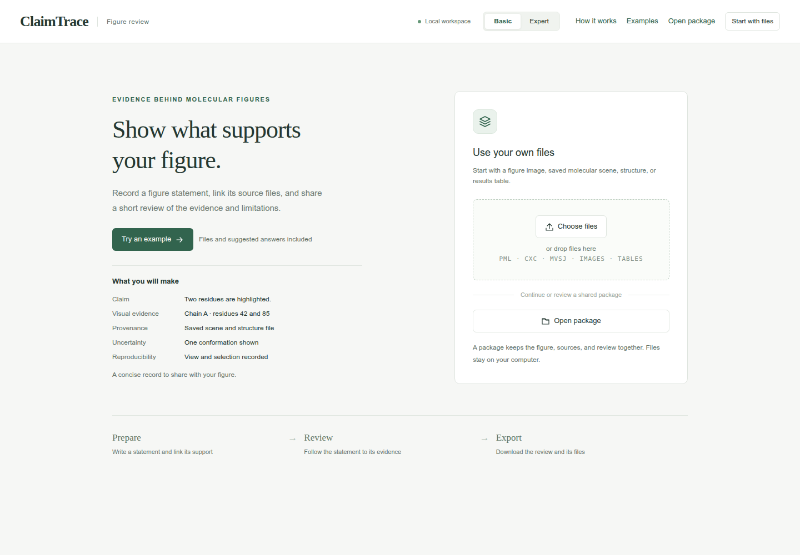

# Install and open ClaimTrace

Install ClaimTrace, try a guided example, and save a figure review package.
For reading first, open the [illustrated tutorials](https://github.com/GeraltZeroZhong/ClaimTrace/blob/v1.0/docs/tutorial/README.md) directly
on GitHub. To work with an agent, install ClaimTrace here, then follow
[Install the skill](agents.md#install-the-skill).

## Install ClaimTrace

Use Python 3.10 or newer. Check with `py --version` in Windows PowerShell or
`python3 --version` in Linux, macOS or WSL. Open a terminal in a folder of your
choice. `.venv` holds this installation and its dependencies.

Installation downloads the required Python packages; later GUI sessions use
the local installation. Choose the commands for your terminal.

### Windows PowerShell

```powershell
py -m venv .venv
.\.venv\Scripts\python.exe -m pip install claimtrace==1.0
.\.venv\Scripts\python.exe -m claimtrace --version
```

If your Python installation provides `python` instead of `py`, use
`python -m venv .venv` for the first command.

### Linux, macOS or WSL

```bash
python3 -m venv .venv
.venv/bin/python -m pip install claimtrace==1.0
.venv/bin/python -m claimtrace --version
```

### Install from a source checkout

Download and extract the repository with **Code → Download ZIP**, or use an
existing clone. Run the commands above from the folder containing
`pyproject.toml`, replacing `pip install claimtrace==1.0` with `pip install .`.

**Check:** The last command prints `claimtrace` followed by its version number.
Keep using the same terminal environment for ClaimTrace and its file paths.
In WSL, a Windows path such as `C:\work\figure` becomes `/mnt/c/work/figure`.

## Open the GUI

From the folder where you created `.venv`:

**Windows PowerShell**

```powershell
.\.venv\Scripts\python.exe -m claimtrace gui
```

**Linux, macOS or WSL**

```bash
.venv/bin/python -m claimtrace gui
```

The terminal prints an address and opens your browser:

```text
ClaimTrace GUI: http://127.0.0.1:8765
```

If the browser stays closed, open that printed address yourself. Keep the terminal
open during your session. The welcome page offers **Choose files**, **Open
package** and **Try an example**.



Following the article tutorial? Return to [Start here](https://github.com/GeraltZeroZhong/ClaimTrace/blob/v1.0/docs/tutorial/README.md)
with the welcome page open.

## Complete your first review

1. Choose **Try an example → Start first example**. Stay in **Basic** mode.
2. Follow the question above the figure. **Use practice values** supplies example
   entries as you add a claim, evidence and a limitation.
3. Open **Review** and inspect the five rows: Claim, Visual evidence, Provenance,
   Uncertainty and Reproducibility.
4. Open **Export**, keep **Working draft**, and download the package.

The built-in examples use synthetic data. For a real-data walkthrough with
screenshots and exact field values, follow
[Figure 1B1: Pocket visibility](https://github.com/GeraltZeroZhong/ClaimTrace/blob/v1.0/docs/tutorial/markdown/cases/f1-b1.md).
Read the [GUI guide](gui.md) when working with your own files.

## Return to your work

Packages save in `claimtrace-workspace/` beneath the folder where you launched
ClaimTrace. **Saved locally** shows the package path. Your browser's
download folder holds exported ZIPs.

Press Ctrl+C in the terminal to stop the GUI server. Next time, open a terminal
in the folder containing `.venv` and repeat only the GUI command. Choose **Open package**
and enter the saved folder containing `semantic_layer.json`.

You can also pass the package path when starting the GUI:

```bash
.venv/bin/python -m claimtrace gui "path/to/saved-package"
```

On Windows, use `.\.venv\Scripts\python.exe` in that command. For a received
ZIP, extract it first and select the folder containing `semantic_layer.json`.

## Use the short command

Other guides use `claimtrace` as a shortcut. Activate this environment in each
new terminal to make that command available:

| Terminal | Activate |
| --- | --- |
| Windows PowerShell | `.\.venv\Scripts\Activate.ps1` |
| Linux, macOS or WSL Bash | `source .venv/bin/activate` |

Then run `claimtrace --version` or `claimtrace gui`. You can always use the full
Python commands above, including when PowerShell restricts activation scripts.

## Setup help

| What you see | Next action |
| --- | --- |
| Python launcher is unavailable | Install Python 3.10 or newer, reopen the terminal, and check its version. |
| `No module named venv` or an unavailable `ensurepip` on Linux | Install your distribution's Python venv package, then repeat the installation steps. |
| pip asks for `pyproject.toml` or `setup.py` | Open the repository folder containing `pyproject.toml`, then rerun the install command. |
| `No module named claimtrace` | Run the install command with the same `.venv` Python used to launch the GUI. |
| Port 8765 is occupied | Add `--port 0` to the GUI command and open the newly printed address. |
| The browser opens on another desktop or stays closed | Add `--no-browser`, then open the printed address in your preferred browser. |
| A saved package is hard to locate | Check `claimtrace-workspace/` in the original launch folder, or use the path shown by **Saved locally**. |

[Tutorials](https://github.com/GeraltZeroZhong/ClaimTrace/blob/v1.0/docs/tutorial/README.md) · [Install the skill](agents.md#install-the-skill) ·
[GUI reference](gui.md) · [Repository home](../README.md)
