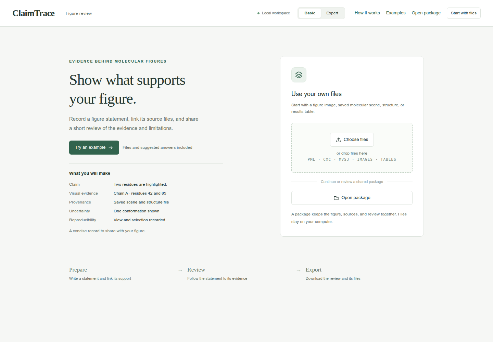
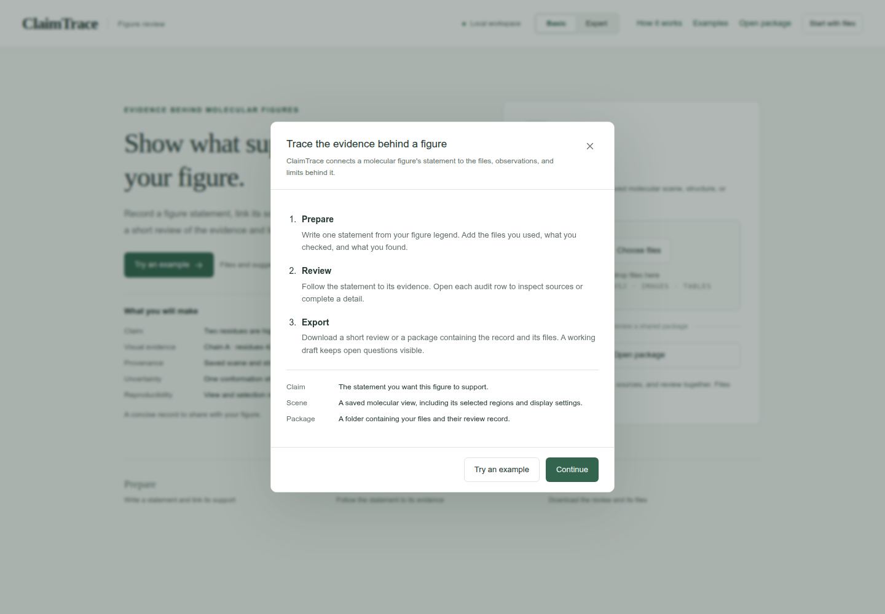

# Start here

Review one figure statement and export a package that another reader can inspect.

Begin with **Figure 1B1: Pocket visibility**. You will link two views of the same ligand to their source files and record the settings and interpretation limits. The example supplies input files, field values and screenshots for every step.

## Before you begin

[Install and open ClaimTrace](../start.md), then return to this guide when the welcome page appears. Keep the application and tutorial in separate tabs, with **Basic** selected in ClaimTrace.

Already running ClaimTrace? Continue from its welcome page.

## What you will do

1. **Prepare** — import the supplied files, save one figure statement, and add its evidence and limitation.
2. **Review** — inspect the five audit rows: Claim, Visual evidence, Provenance, Uncertainty and Reproducibility.
3. **Export** — download a **Working draft** with the source files, saved record and open questions.

The first case begins with the input download. Keep its `LAB_NOTES.txt` open beside the tutorial as you enter the supplied observations.

**[Start Figure 1B1](markdown/cases/f1-b1.md)** · [Choose another case](markdown/README.md)

Preview the workspace

**Check:** The welcome page offers **Choose files** and **Open package**.

For a short tour in ClaimTrace, open **How it works**. Close the tour to return to your current screen.

Evidence fields and audit status

Use each case's field values to record the supplied observations. Add your own measurement or replay result after performing that check.

### Evidence fields

| Field | What to enter | Example |
| --- | --- | --- |
| How was it checked? | The check or analysis used. | Pocket visibility source check |
| What did you find? | The observed result for this statement. | Both supplied views show 1AKE chain A and AP5. |
| Analysis settings | Selections, distance rules or sampled frames. | Chain A; ligand AP5; pocket within 4.2 angstrom. |

### Audit status

| Status | Meaning | Next action |
| --- | --- | --- |
| Recorded | The relevant details are saved. | Open the row and inspect the source record. |
| Review needed | The audit identifies a detail to complete or inspect. | Read the open question and keep it with the draft. |
| Replay pending | The saved molecular scene awaits a replay check. | Open it in its original molecular viewer. |
| Draft checks passed | The current record can be exported as a Working draft. | Download the package with its open questions. |

## Read on GitHub or offline

The case pages display directly on GitHub. To download a case ZIP, open its file page and select **Download raw file**, then extract it.

For offline reading, download `claimtrace-tutorials-1.0.zip` from the
[v1.0 release](https://github.com/GeraltZeroZhong/ClaimTrace/releases/tag/v1.0),
extract it, and open the top-level `index.html` in a browser. It opens **Start here**.
Keep the extracted folders together so screenshots and case downloads remain available.
The HTML guide includes copy buttons for field values.

If you already have a repository checkout or downloaded it with **Code → Download ZIP**,
open `docs/tutorial/index.html` in that folder.

[Data sources and attribution](SOURCES.md) · [Open a review package](markdown/recipient.md)
