# Pocket visibility

Figure 1B1 · Describe molecular views · Basic mode

Link two pocket views to the same AP5 ligand and record the representation, selection and saved camera.

[Download input files](../../downloads/f1-b1-inputs.zip) · [Download completed example](../../downloads/f1-b1-completed.zip)

[Open ClaimTrace](../../../start.md) · [Start here](../../README.md) · [All cases](../README.md)

Extract the input ZIP and select all 7 files in `files/`.

## 1. Import the example files

Extract the input ZIP and read LAB_NOTES.txt beside the files/ folder. In ClaimTrace, click **Choose files** on the welcome page, or **Start with files** in an open package. Select all 7 files inside files/. Enter the package name below and click **Create package**.

**Package name**

```text
Figure 1B1 - Pocket visibility
```

**Check:** The package opens in **Prepare** with 7 saved files and the figure visible.

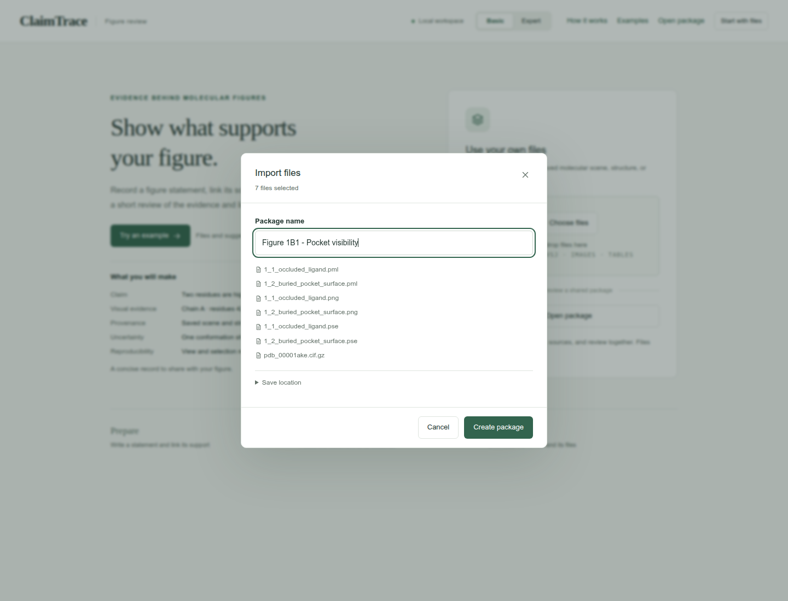

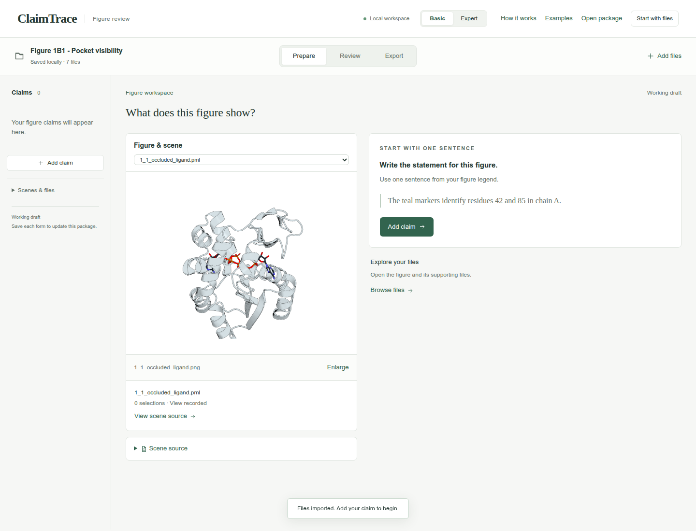

## 2. Write one figure statement

Click **Add claim**. Enter the statement and figure label, choose Structure view, check both **Linked scenes**, and click **Save claim**.

**Figure statement**

```text
Two views locate AP5 within the adenylate kinase pocket.
```

**Figure label**

```text
Figure 1B1
```

**Statement type**

```text
Structure view
```

**Linked scenes**

```text
1_1_occluded_ligand.pml; 1_2_buried_pocket_surface.pml
```

**Check:** The statement appears in the left claim list and the figure stays linked.

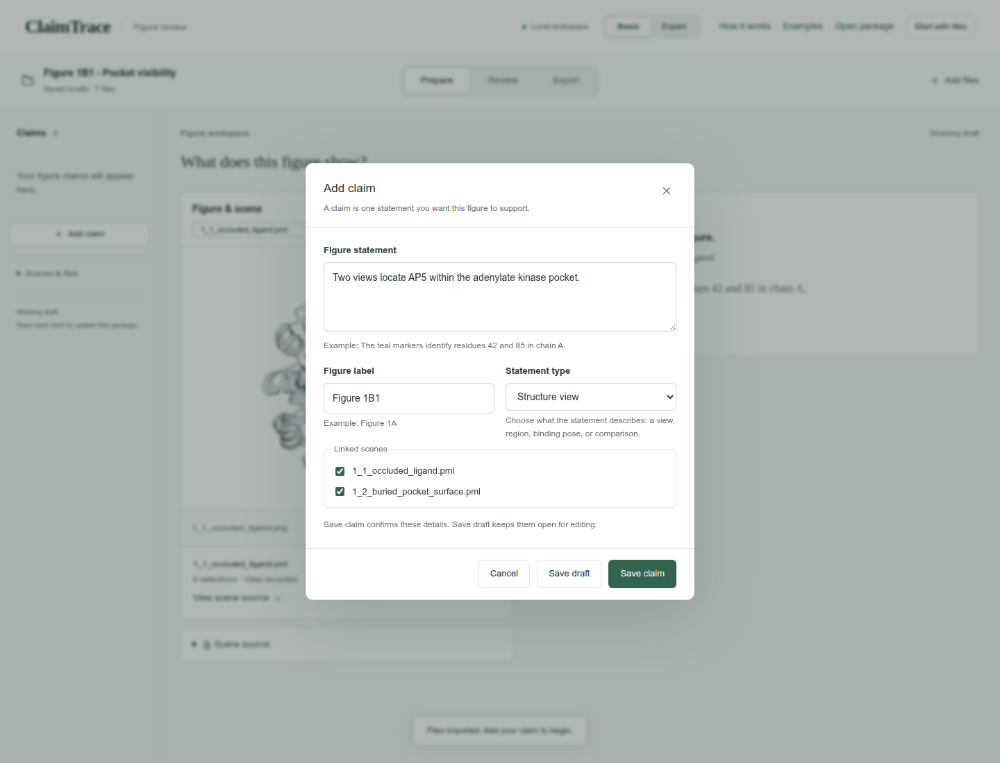

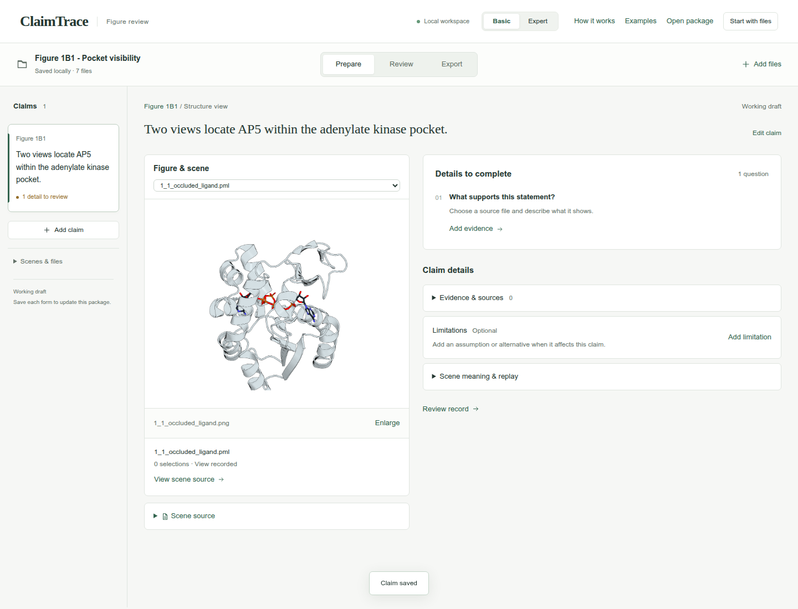

## 3. Choose the supporting files

Click **Add evidence**. Choose the **Evidence type** and select the listed **Source files**. Continue in this form for the next step.

**Evidence type**

```text
Figure or structure inspection
```

**Source files**

```text
1_1_occluded_ligand.pml
1_2_buried_pocket_surface.pml
1_1_occluded_ligand.pse
1_2_buried_pocket_surface.pse
pdb_00001ake.cif.gz
```

**Check:** The source counter shows 5 selected.

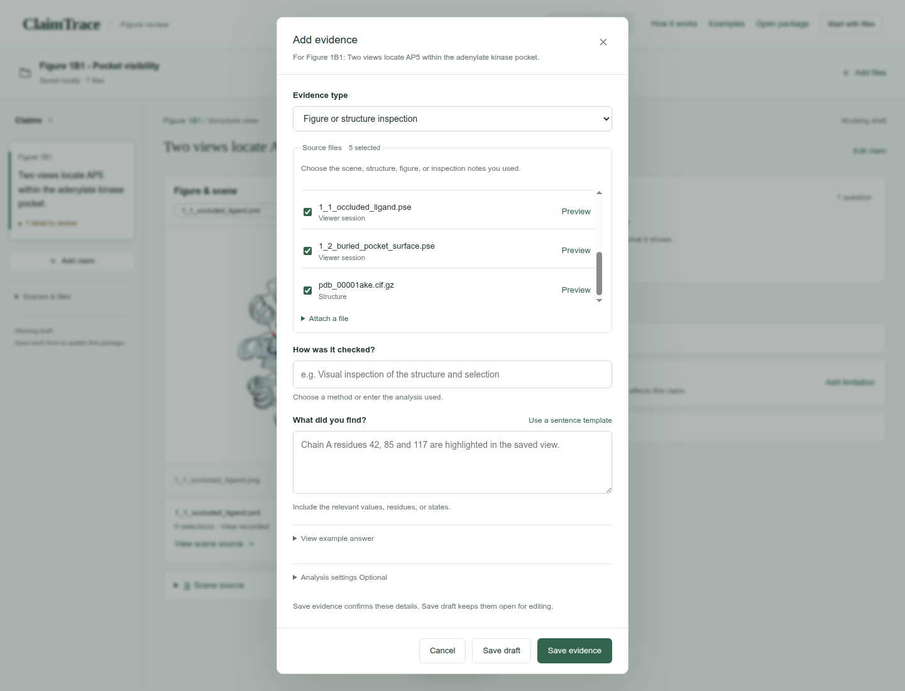

## 4. Record the finding and settings

Enter the method under **How was it checked?** and the observation under **What did you find?** Open **Analysis settings** and complete **Selections, cutoffs and sampling**. Click **Save evidence**.

**How was it checked?**

```text
Inspect the supplied pocket views, scene scripts and 1AKE coordinates.
```

**What did you find?**

```text
Both supplied views show 1AKE chain A and AP5. The surface view exposes the pocket around the ligand.
```

**Selections, cutoffs and sampling**

```text
Structure: PDB 1AKE, chain A; ligand: AP5. Pocket: whole residues with any atom within 4.2 angstrom of AP5.
```

**Check:** The evidence record appears under **Evidence & sources**.

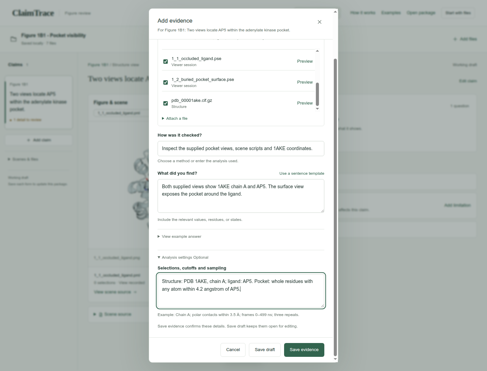

## 5. State the interpretation limit

Click **Add limitation**. Enter the limitation and click **Save limitation**.

**What limits this conclusion?**

```text
Pocket visibility depends on the representation and camera. Use the supplied PSE for the full saved view; the reduced PML records the structure and camera. Native-view replay remains pending.
```

**Check:** **Limitations** shows 1 saved record.

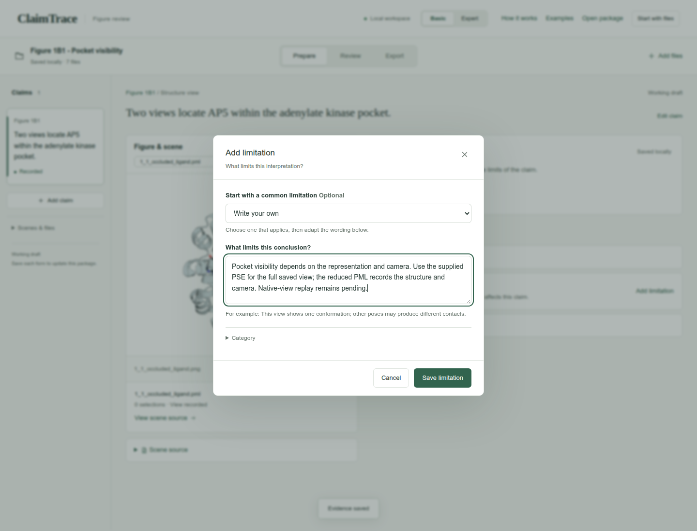

## 6. Review the short audit

Click **Review**. Read the five rows of the **Claim audit** and confirm the evidence and limitation match the figure. Use the scene dropdown above the figure to choose 1_2_buried_pocket_surface.pml and inspect the second linked view.

**Check:** Both saved views are recorded; scene replay remains pending.

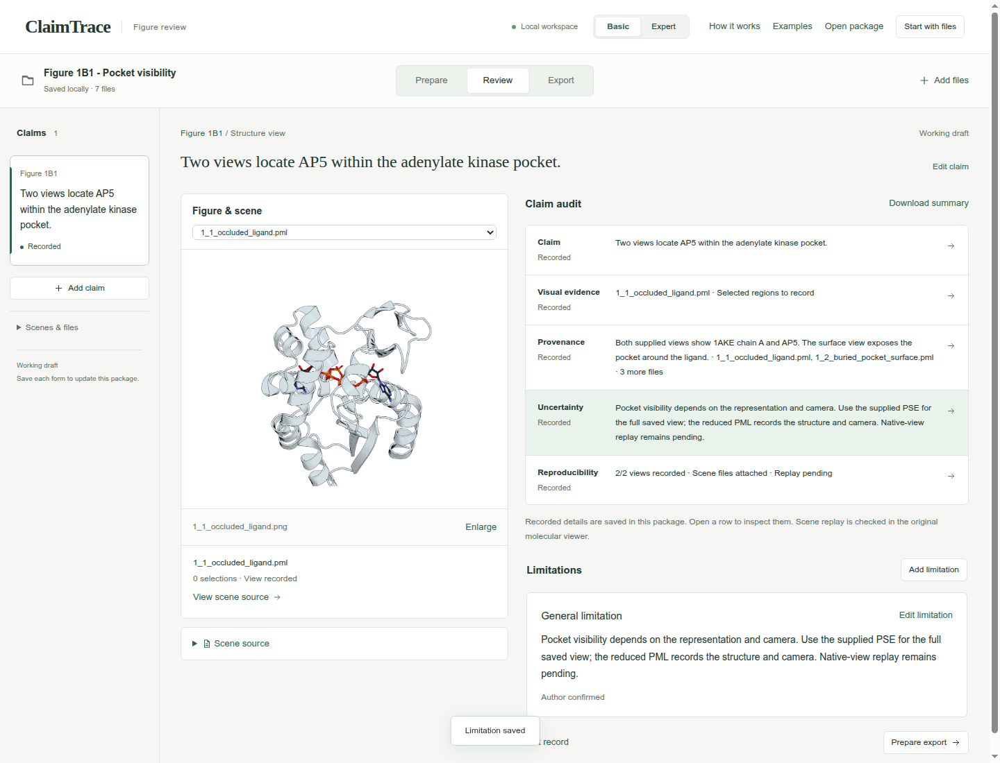

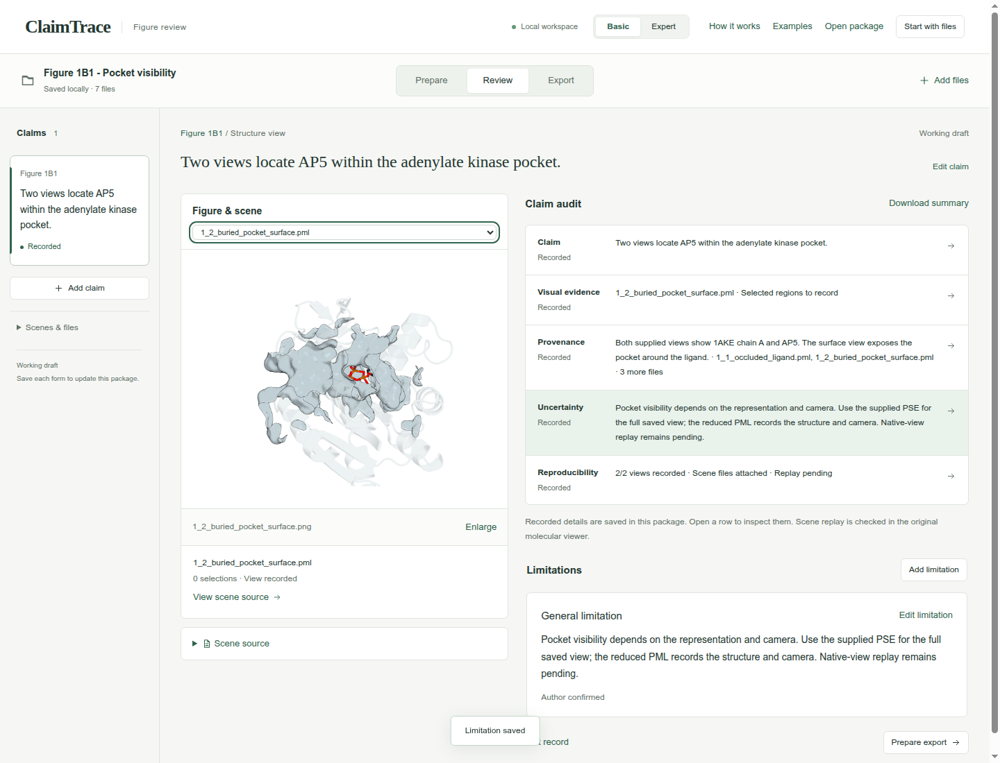

## 7. Check the draft export

Click **Export**. Keep **Working draft** selected and confirm **Draft checks passed**.

**Export purpose**

```text
Working draft
```

**Check:** **Download package · ZIP** is enabled.

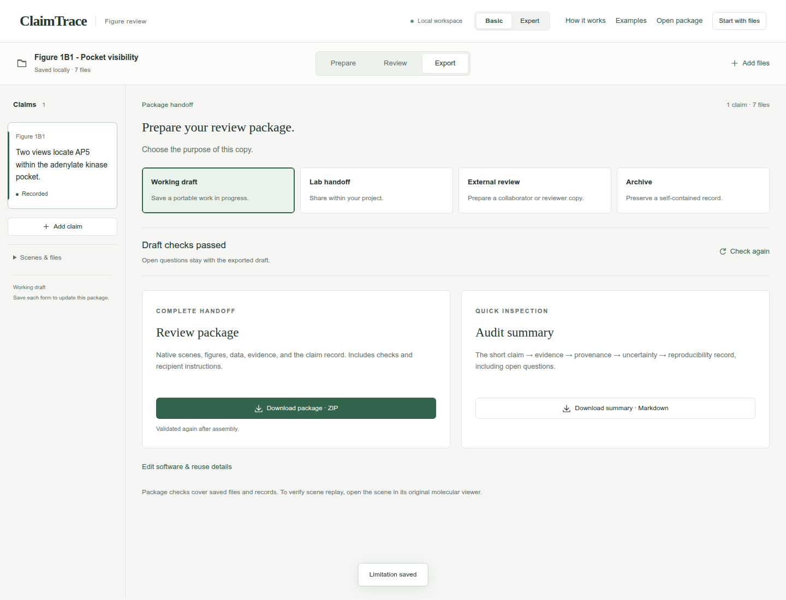

## 8. Download the package

Click **Download package · ZIP**. Check your browser’s downloads for claimtrace-review.zip, then save it with your figure. The ZIP contains the source files, claim record and recipient instructions.

**Check:** The page confirms: **Export checks passed. Your browser will download the package.**

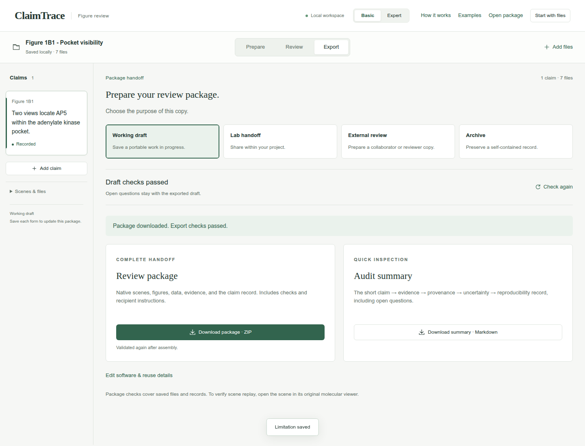

## Your saved result

A downloaded Working draft ZIP containing 1 claim, 1 evidence record, 1 limitation, and 7 source files.

## Continue the scientific review

- Reopen the original PSE files in PyMOL to check scene replay.
- Name the pocket selections and link them to their source coordinates for the recipient.
