# Contacts across views

Figure 1B2 · Check contacts and distances · Basic mode

Link the same AP5 neighborhood across a 3D proximity view and a residue contact map.

[Download input files](../../downloads/f1-b2-inputs.zip) · [Download completed example](../../downloads/f1-b2-completed.zip)

[Open ClaimTrace](../../../start.md) · [Start here](../../README.md) · [All cases](../README.md)

Extract the input ZIP and select all 8 files in `files/`.

## 1. Import the example files

Extract the input ZIP and read LAB_NOTES.txt beside the files/ folder. In ClaimTrace, click **Choose files** on the welcome page, or **Start with files** in an open package. Select all 8 files inside files/. Enter the package name below and click **Create package**.

**Package name**

```text
Figure 1B2 - Contacts across views
```

**Check:** The package opens in **Prepare** with 8 saved files and the figure visible.

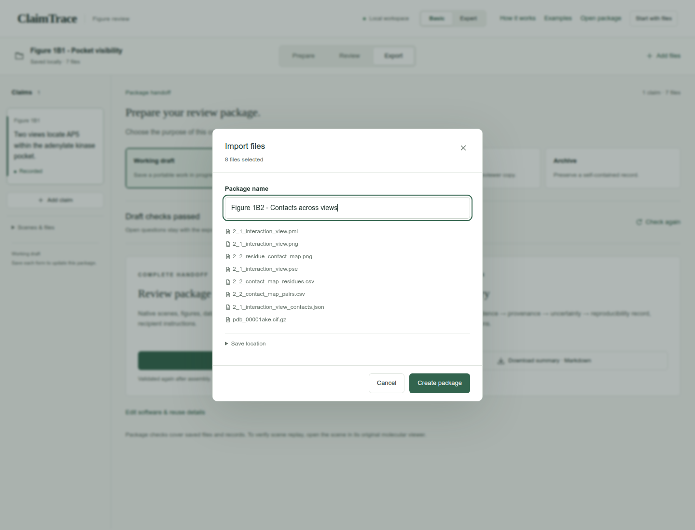

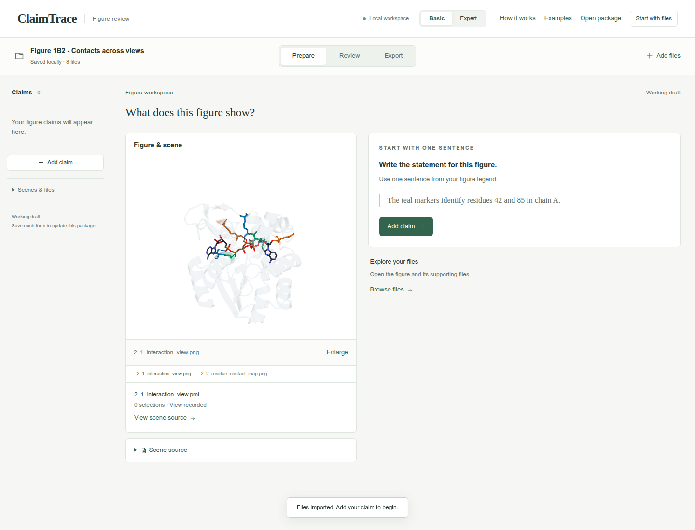

## 2. Write one figure statement

Click **Add claim**. Enter the statement and figure label, choose the statement type, and click **Save claim**.

**Figure statement**

```text
The AP5 pocket links a 3D proximity view to a residue contact map.
```

**Figure label**

```text
Figure 1B2
```

**Statement type**

```text
Structure view
```

**Check:** The statement appears in the left claim list and the figure stays linked.

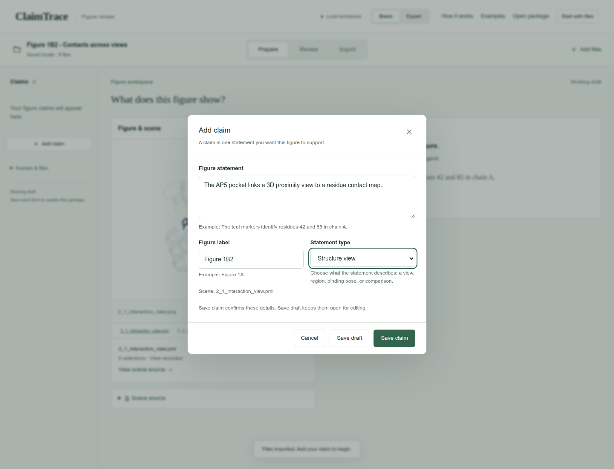

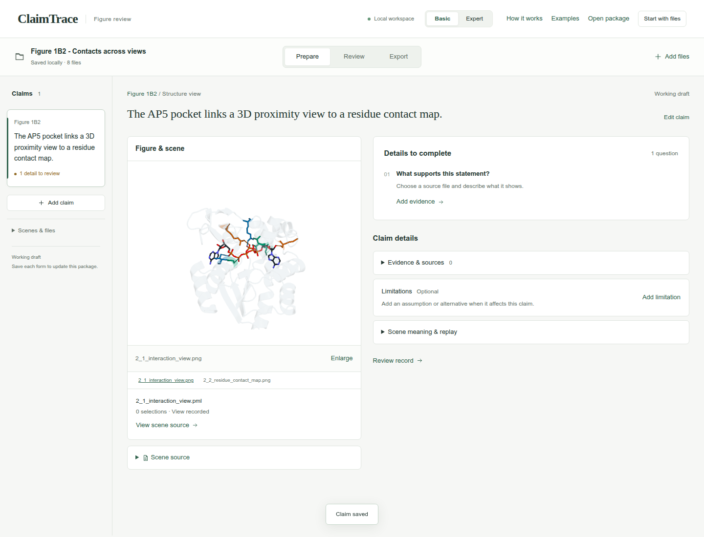

## 3. Choose the supporting files

Click **Add evidence**. Choose the **Evidence type** and select the listed **Source files**. Continue in this form for the next step.

**Evidence type**

```text
Contact table
```

**Source files**

```text
2_2_contact_map_residues.csv
2_2_contact_map_pairs.csv
2_1_interaction_view_contacts.json
pdb_00001ake.cif.gz
```

**Check:** The source counter shows 4 selected.

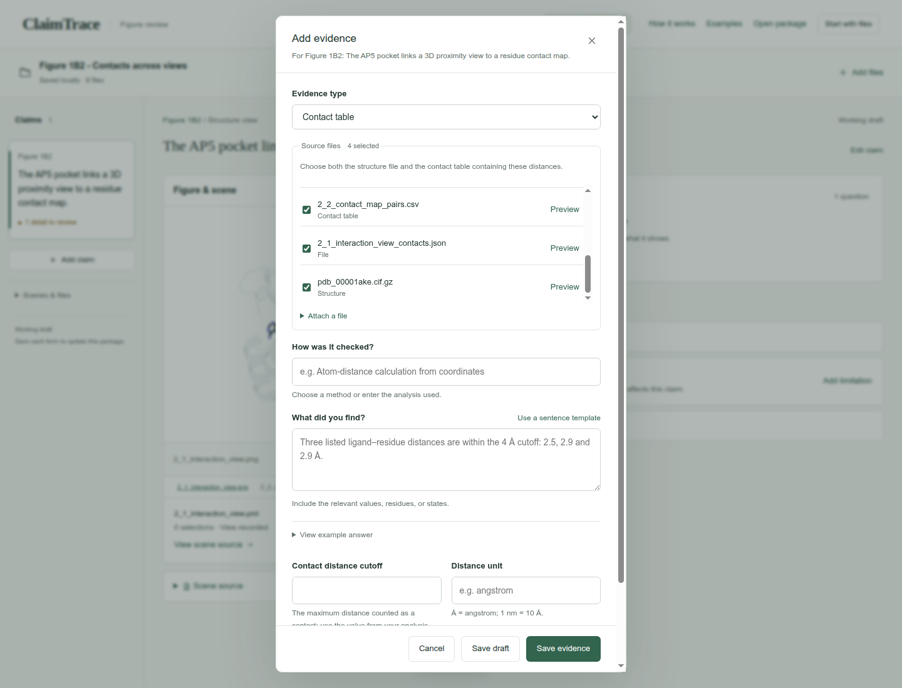

## 4. Record the finding and settings

Enter the method under **How was it checked?** and the observation under **What did you find?** Enter the contact cutoff and distance unit. Open **Analysis settings** and complete **Selections, cutoffs and sampling**. Click **Save evidence**.

**How was it checked?**

```text
Review the residue and contact tables alongside the supplied 3D view and contact map.
```

**What did you find?**

```text
The supplied tables describe 214 residues, 36 AP5-neighbor rows, 453 unique full-protein C-alpha contact pairs and 175 contact cells in the displayed map.
```

**Contact distance cutoff**

```text
8
```

**Distance unit**

```text
angstrom
```

**Selections, cutoffs and sampling**

```text
Protein contacts: C-alpha distance below 8 angstrom with sequence separation at least 4. Displayed rows: 36 residues within 4.2 angstrom of AP5. Ligand guide cutoff: 4 angstrom. Structure: 1AKE chain A.
```

**Check:** The evidence record appears under **Evidence & sources**.

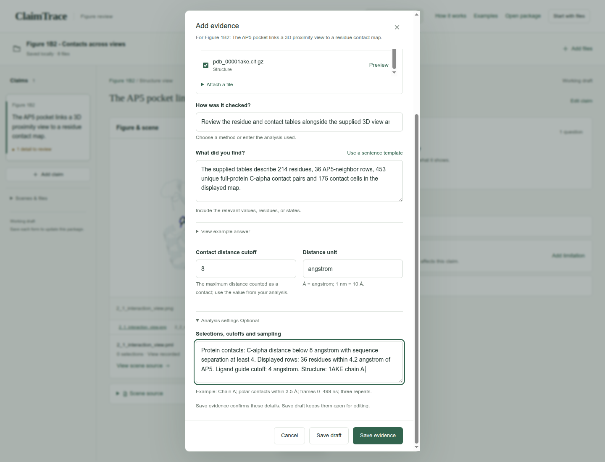

## 5. Inspect the linked contact map

Under the figure, click 2_2_residue_contact_map.png. Read the displayed residue map alongside the recorded counts.

**Check:** The figure switches from the 3D view to the contact map while the same claim remains selected.

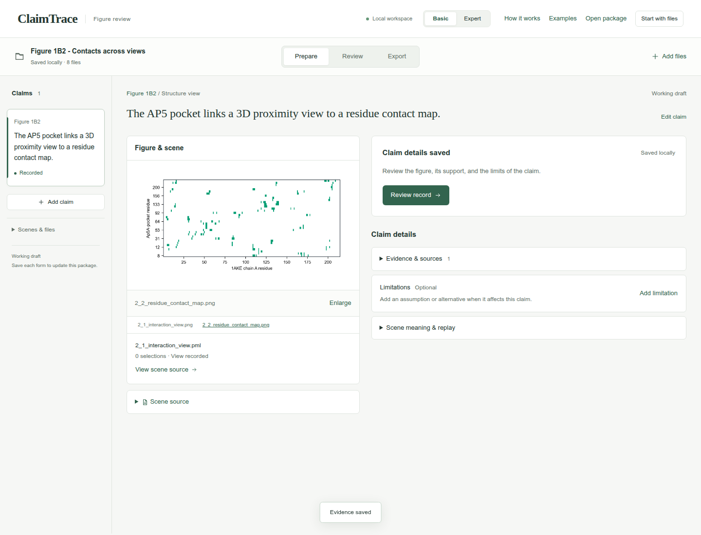

## 6. State the interpretation limit

Click **Add limitation**. Enter the limitation and click **Save limitation**.

**What limits this conclusion?**

```text
The 175 displayed cells and 453 full-protein pairs count different selections. Distance guides show proximity. The 0.521 angstrom AP5 O1D-ARG167 NH1 pair uses B/B alternate locations and needs coordinate-level interpretation.
```

**Check:** **Limitations** shows 1 saved record.

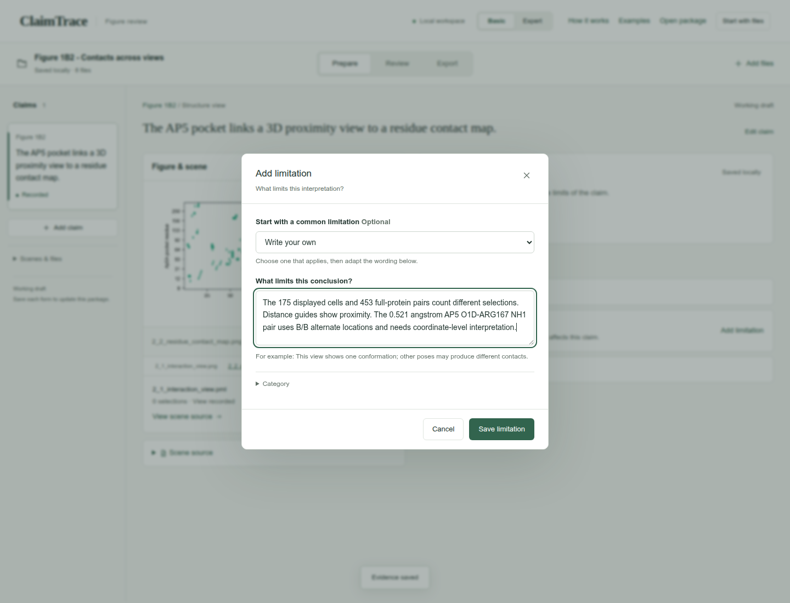

## 7. Review the short audit

Click **Review**. Read the five rows of the **Claim audit** and confirm the evidence and limitation match the figure.

**Check:** Claim, visual evidence, provenance, uncertainty, and reproducibility appear together.

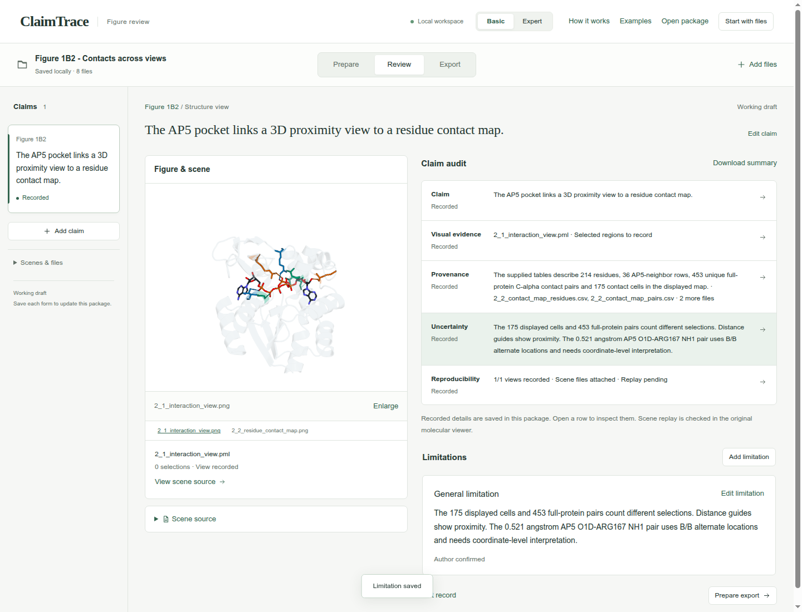

## 8. Check the draft export

Click **Export**. Keep **Working draft** selected and confirm **Draft checks passed**.

**Export purpose**

```text
Working draft
```

**Check:** **Download package · ZIP** is enabled.

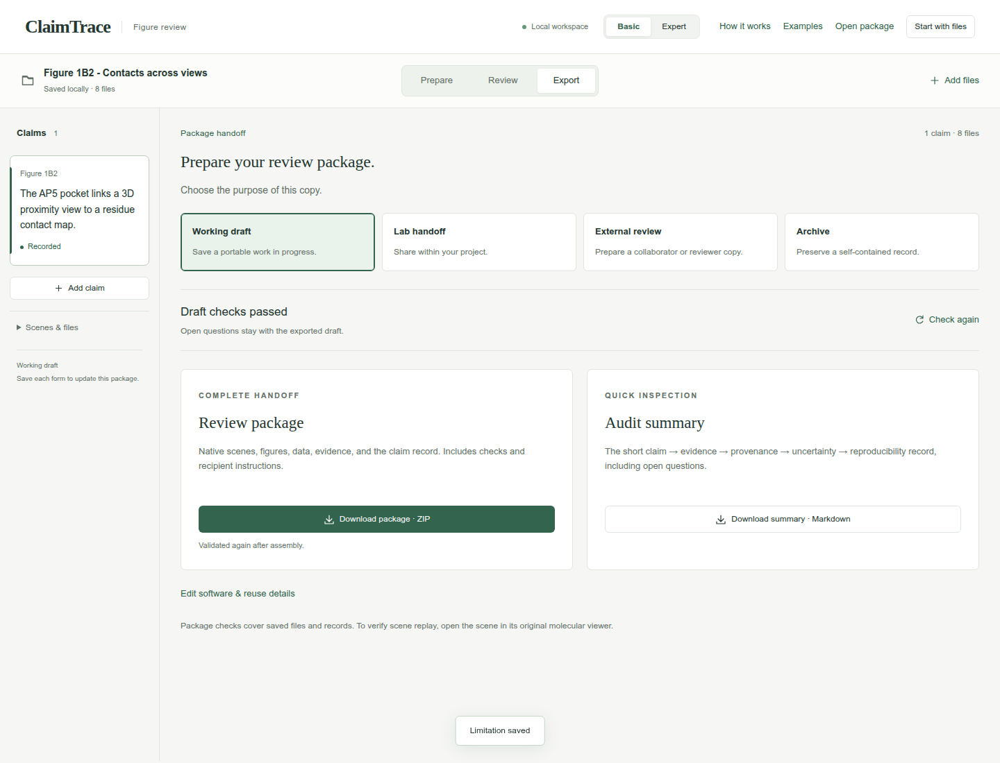

## 9. Download the package

Click **Download package · ZIP**. Check your browser’s downloads for claimtrace-review.zip, then save it with your figure. The ZIP contains the source files, claim record and recipient instructions.

**Check:** The page confirms: **Export checks passed. Your browser will download the package.**

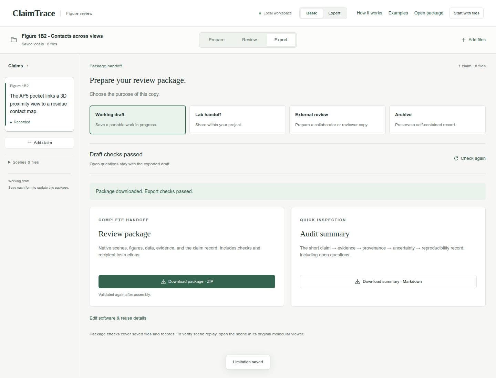

## Your saved result

A downloaded Working draft ZIP containing 1 claim, 1 evidence record, 1 limitation, and 8 source files.

## Continue the scientific review

- Inspect the AP5 O1D-ARG167 NH1 B/B alternate-location pair in the source coordinates.
- Check the saved view in PyMOL.
