# Confidence and geometry

Figure 1B3 · Compare models and ensembles · Basic mode

Record which model a confidence-colored view uses, what its colors mean and which residues the geometry plot covers.

[Download input files](../../downloads/f1-b3-inputs.zip) · [Download completed example](../../downloads/f1-b3-completed.zip)

[Open ClaimTrace](../../../start.md) · [Start here](../../README.md) · [All cases](../README.md)

Extract the input ZIP and select all 7 files in `files/`.

## 1. Import the example files

Extract the input ZIP and read LAB_NOTES.txt beside the files/ folder. In ClaimTrace, click **Choose files** on the welcome page, or **Start with files** in an open package. Select all 7 files inside files/. Enter the package name below and click **Create package**.

**Package name**

```text
Figure 1B3 - Confidence and geometry
```

**Check:** The package opens in **Prepare** with 7 saved files and the figure visible.

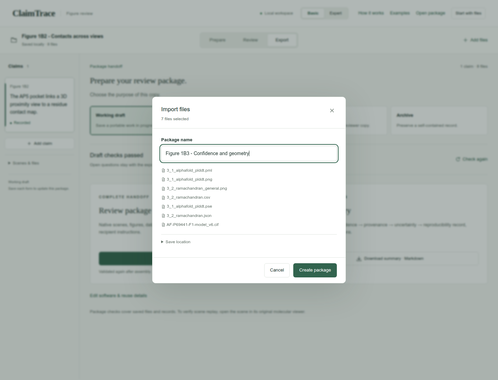

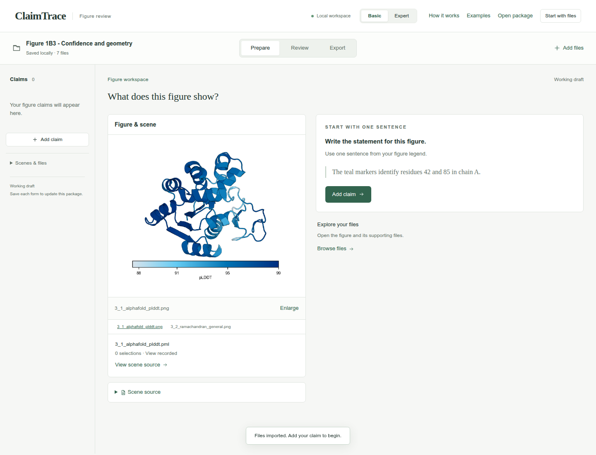

## 2. Write one figure statement

Click **Add claim**. Enter the statement and figure label, choose the statement type, and click **Save claim**.

**Figure statement**

```text
AlphaFold confidence and backbone geometry provide complementary checks of the P69441 model.
```

**Figure label**

```text
Figure 1B3
```

**Statement type**

```text
Computed model
```

**Check:** The statement appears in the left claim list and the figure stays linked.

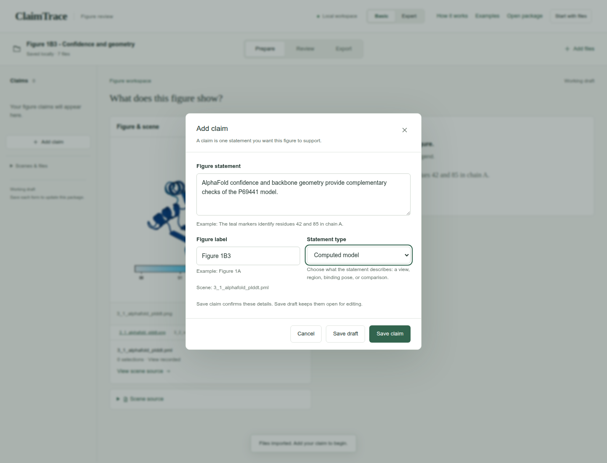

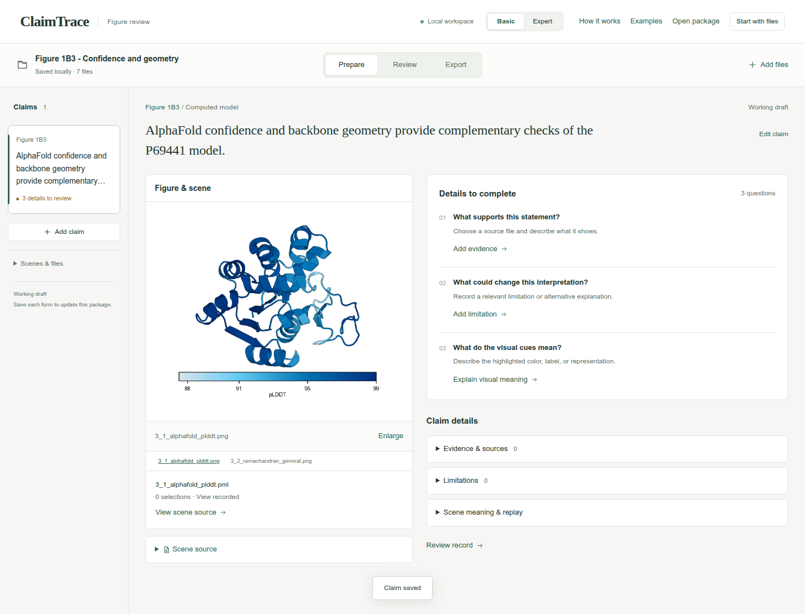

## 3. Choose the supporting files

Click **Add evidence**. Choose the **Evidence type** and select the listed **Source files**. Continue in this form for the next step.

**Evidence type**

```text
Comparison or validation report
```

**Source files**

```text
3_2_ramachandran.csv
3_2_ramachandran.json
AF-P69441-F1-model_v6.cif
3_1_alphafold_plddt.pse
```

**Check:** The source counter shows 4 selected.

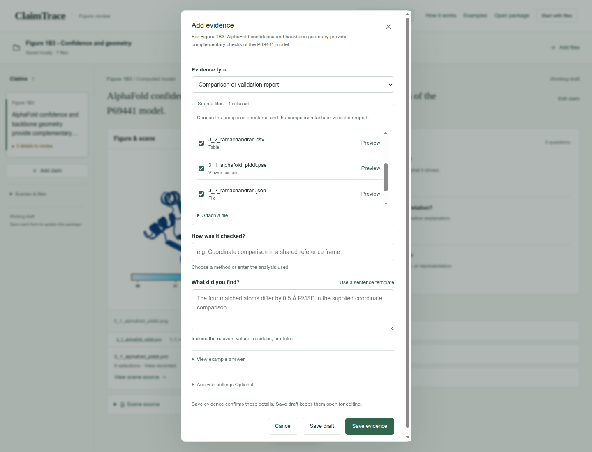

## 4. Record the finding and settings

Enter the method under **How was it checked?** and the observation under **What did you find?** Open **Analysis settings** and complete **Selections, cutoffs and sampling**. Click **Save evidence**.

**How was it checked?**

```text
Review the model confidence values and supplied Ramachandran assessment.
```

**What did you find?**

```text
The model has pLDDT values from 87.88 to 98.62. The supplied geometry assessment covers 212 residues: 209 favored, 3 allowed and 0 outliers. The displayed general-residue panel contains 144 residues.
```

**Selections, cutoffs and sampling**

```text
Model: AF-P69441-F1 v6. Confidence: pLDDT, 0-100. Geometry assessment: the same model, 212 assessed residues; general-residue panel: 144 residues.
```

**Check:** The evidence record appears under **Evidence & sources**.

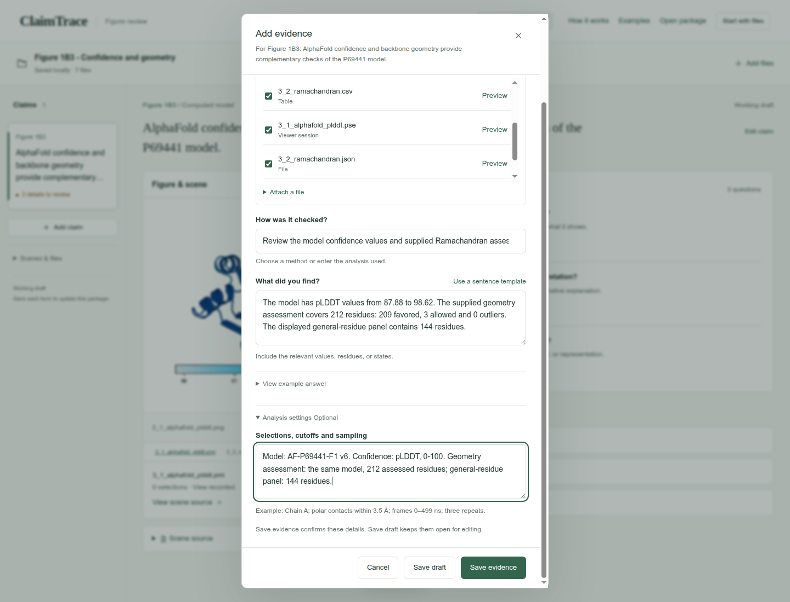

## 5. Explain the confidence colors

Click **Explain visual meaning**. Choose **Other meaning**, enter the **Color key**, and click **Save color key**. Then click 3_2_ramachandran_general.png to inspect the geometry panel.

**What is this color used for?**

```text
Other meaning
```

**Color key**

```text
The PML colors the B-factor pLDDT field from red (0) to blue (100). The original PSE records a narrower 87.5-99 display range.
```

**Check:** The visual-meaning task is resolved, and the linked geometry plot remains available.

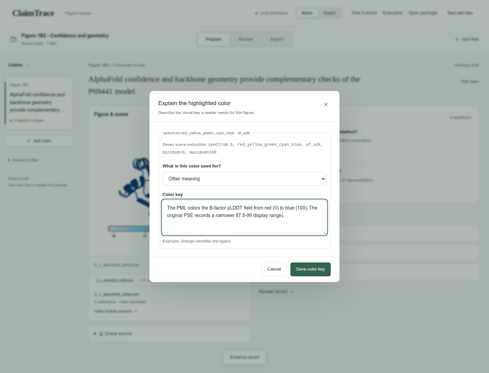

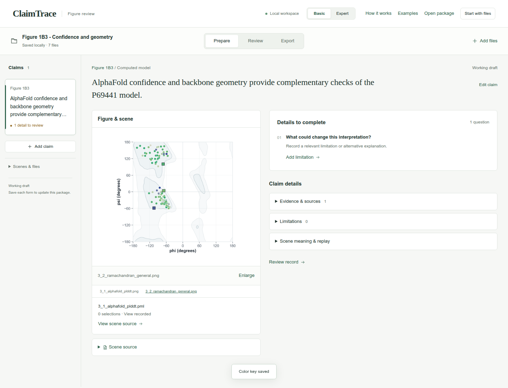

## 6. State the interpretation limit

Click **Add limitation**. Enter the limitation and click **Save limitation**.

**What limits this conclusion?**

```text
Confidence and backbone geometry address different properties. The supplied PML specifies a 0-100 color range; the original PSE records a narrower 87.5-99 range. Match the color key to the saved scene when checking replay.
```

**Check:** **Limitations** shows 1 saved record.

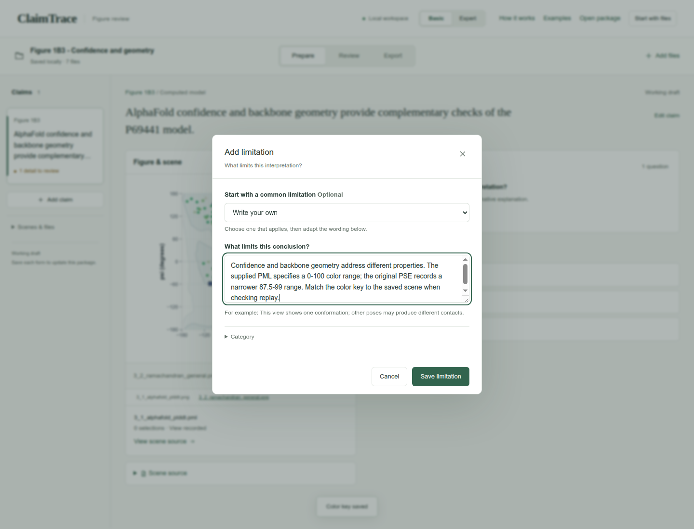

## 7. Review the short audit

Click **Review**. Read the five rows of the **Claim audit** and confirm the evidence and limitation match the figure.

**Check:** Claim, visual evidence, provenance, uncertainty, and reproducibility appear together.

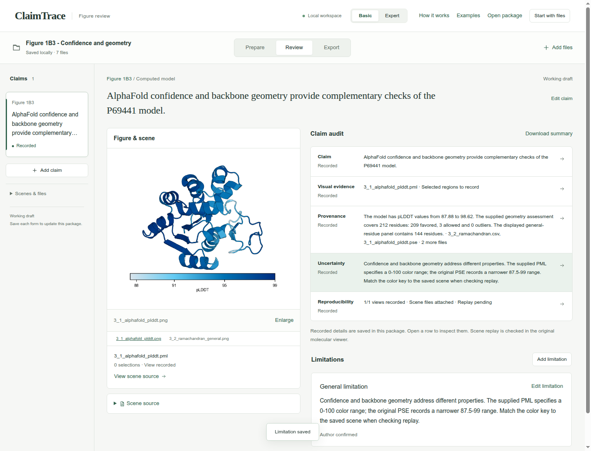

## 8. Check the draft export

Click **Export**. Keep **Working draft** selected and confirm **Draft checks passed**.

**Export purpose**

```text
Working draft
```

**Check:** **Download package · ZIP** is enabled.

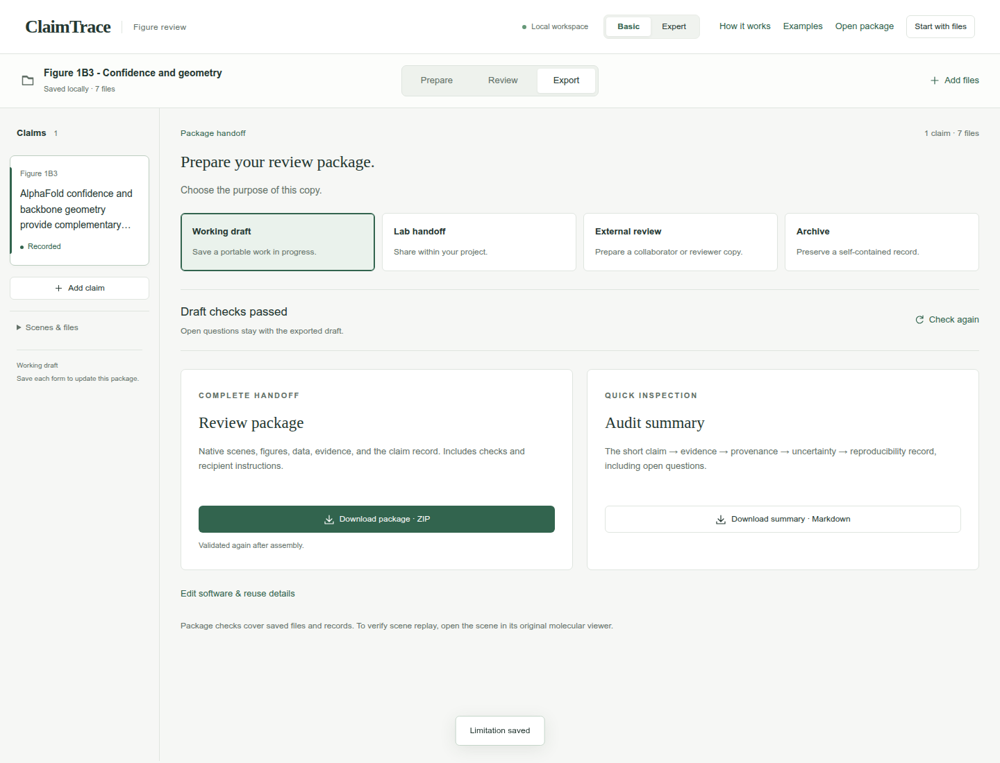

## 9. Download the package

Click **Download package · ZIP**. Check your browser’s downloads for claimtrace-review.zip, then save it with your figure. The ZIP contains the source files, claim record and recipient instructions.

**Check:** The page confirms: **Export checks passed. Your browser will download the package.**

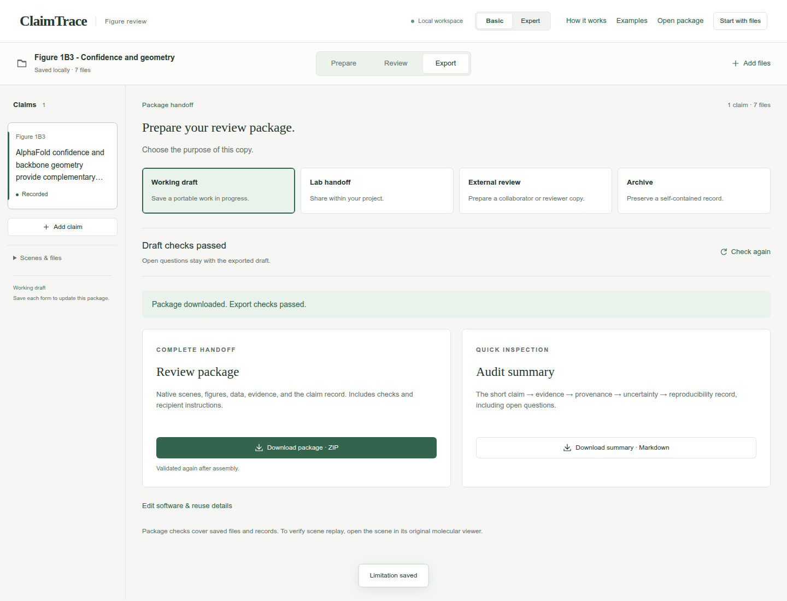

## Your saved result

A downloaded Working draft ZIP containing 1 claim, 1 evidence record, 1 limitation, and 7 source files.

## Continue the scientific review

- Compare the saved PSE color range with the PML color command.
- Open the scene in PyMOL and record the replay result.
