# AP5 conformational clusters

Figure 1B4 · Compare models and ensembles · Basic mode

Link four displayed AP5 clusters to their coordinate sources, alignment reference and exploratory density plot.

[Download input files](../../downloads/f1-b4-inputs.zip) · [Download completed example](../../downloads/f1-b4-completed.zip)

[Open ClaimTrace](../../../start.md) · [Start here](../../README.md) · [All cases](../README.md)

Extract the input ZIP and select all 25 files in `files/`.

## 1. Import the example files

Extract the input ZIP and read LAB_NOTES.txt beside the files/ folder. In ClaimTrace, click **Choose files** on the welcome page, or **Start with files** in an open package. Select all 25 files inside files/. Enter the package name below and click **Create package**.

**Package name**

```text
Figure 1B4 - AP5 conformational clusters
```

**Check:** The package opens in **Prepare** with 25 saved files and the figure visible.

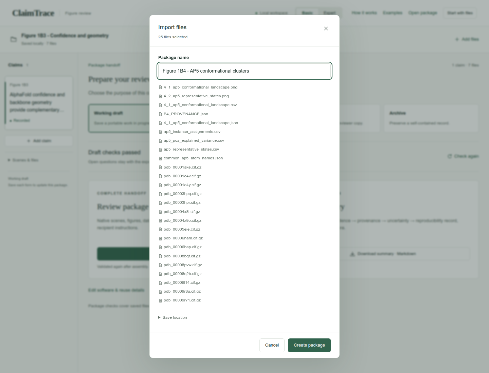

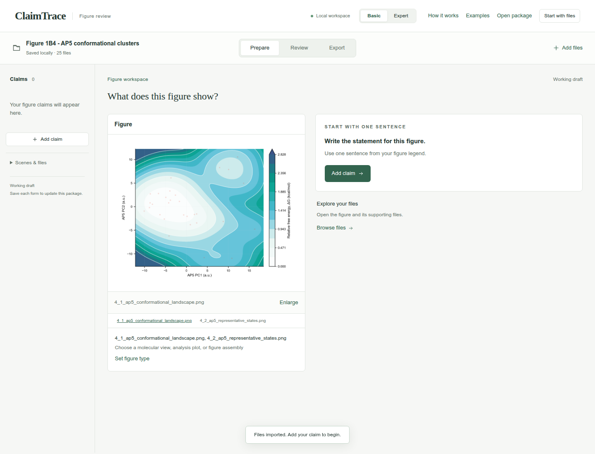

## 2. Write one figure statement

Click **Add claim**. Enter the statement and figure label, choose the statement type, and click **Save claim**.

**Figure statement**

```text
Thirty AP5 instances form four descriptive conformational clusters.
```

**Figure label**

```text
Figure 1B4
```

**Statement type**

```text
Model comparison
```

**Check:** The statement appears in the left claim list and the figure stays linked.

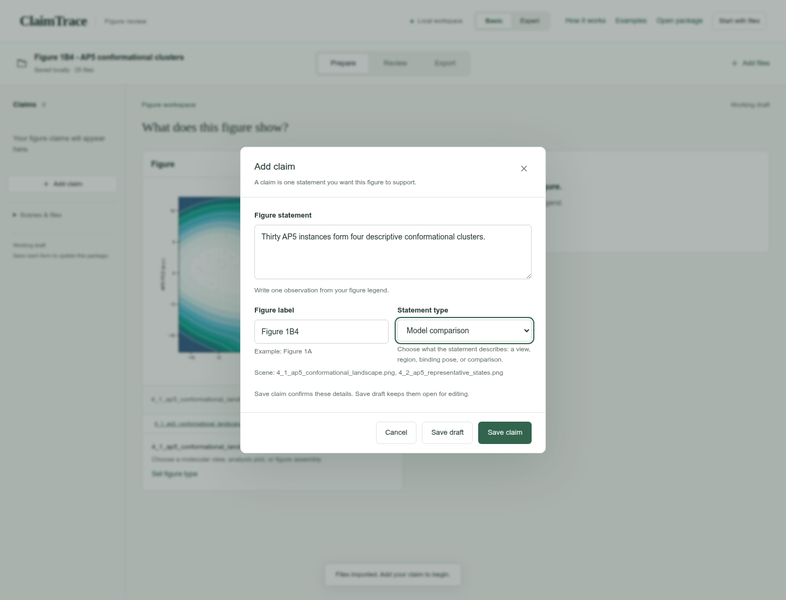

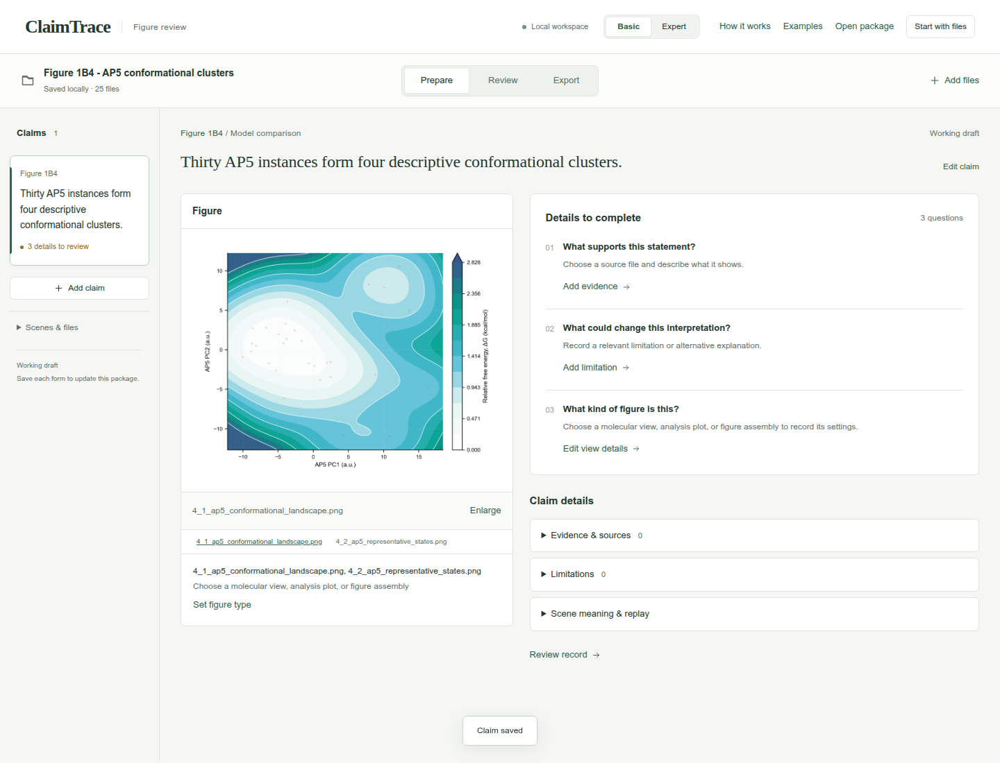

## 3. Record the plot context

Click **Set figure type**. Choose **Analysis plot**, enter the **Plot settings**, and click **Save details**.

**View type**

```text
Analysis plot
```

**Plot settings**

```text
PC1 versus PC2 for 30 AP5 instances with four cluster assignments. The saved surface applies -kB*T*ln(P/Pmax) to a KDE of these crystallographic samples at a chosen 300 K display temperature. Representatives: 4X8O B, 5EJE B, 6HAM A and 8Q2B A.
```

**Check:** The figure shows Saved figure · Settings recorded.

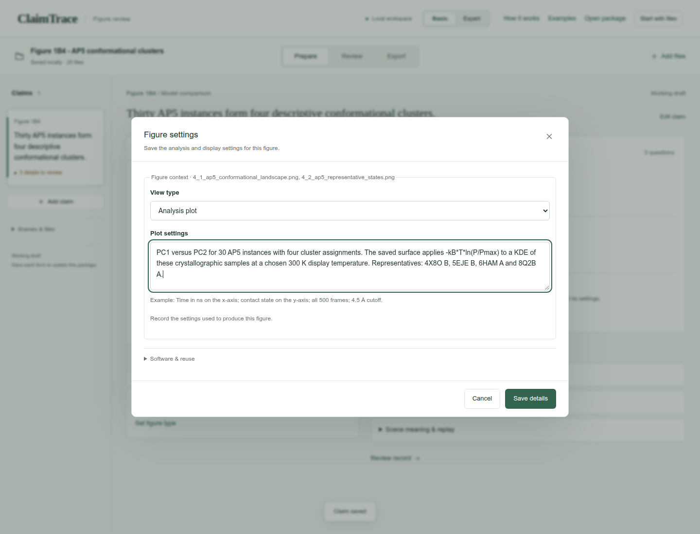

## 4. Choose the supporting files

Click **Add evidence**. Choose the **Evidence type** and select the listed **Source files**. Continue in this form for the next step.

**Evidence type**

```text
Comparison or validation report
```

**Source files**

```text
4_1_ap5_conformational_landscape.csv
B4_PROVENANCE.json
ap5_instance_assignments.csv
ap5_pca_explained_variance.csv
ap5_representative_states.csv
```

**Check:** The source counter shows 5 selected.

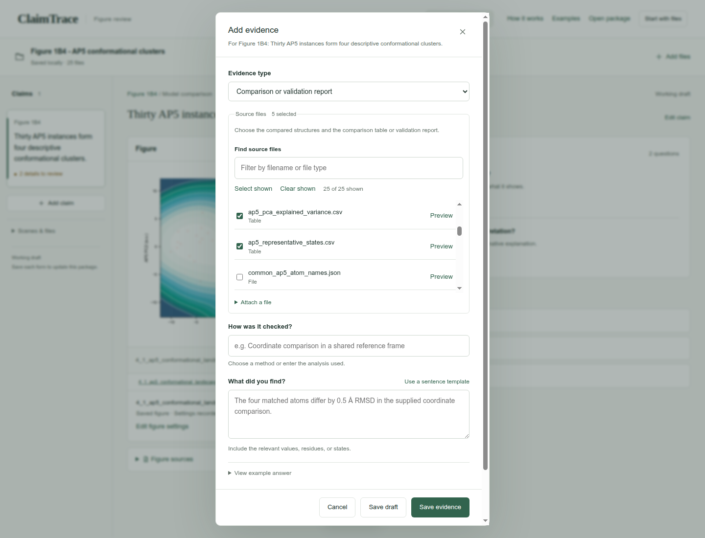

## 5. Select all coordinate sources

In **Find source files**, type .cif.gz. Click **Select shown**. Confirm 16 of 25 shown and 21 selected, then clear the search field.

**Find source files**

```text
.cif.gz
```

**Check:** All 16 coordinate files join the 5 selected processed sources.

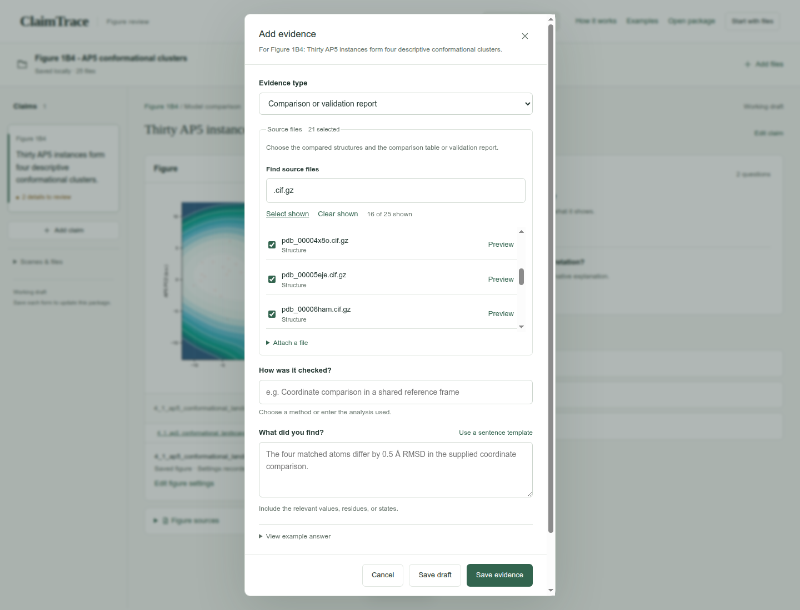

## 6. Record the finding and settings

Enter the method under **How was it checked?** and the observation under **What did you find?** Open **Analysis settings** and complete **Selections, cutoffs and sampling**. Click **Save evidence**.

**How was it checked?**

```text
Review the supplied protein-aligned AP5 coordinates, standardized-coordinate PCA, clustering and density summaries.
```

**What did you find?**

```text
The supplied assignments retain 30 AP5 instances from 15 of 16 input PDB entries and identify four clusters. PC1 and PC2 explain 32.66% and 14.19% of the variance.
```

**Selections, cutoffs and sampling**

```text
Alignment: corresponding protein C-alpha atoms to 1AKE chain A. Features: 55 AP5 heavy atoms after applying that protein alignment; standardized coordinates. Clustering: KMeans on PC1 and PC2, four clusters, random state 19, n_init 50. Excluded instances: 8PVW A and 9R6U A. Representatives: 4X8O B, 5EJE B, 6HAM A and 8Q2B A.
```

**Check:** The evidence record appears under **Evidence & sources**.

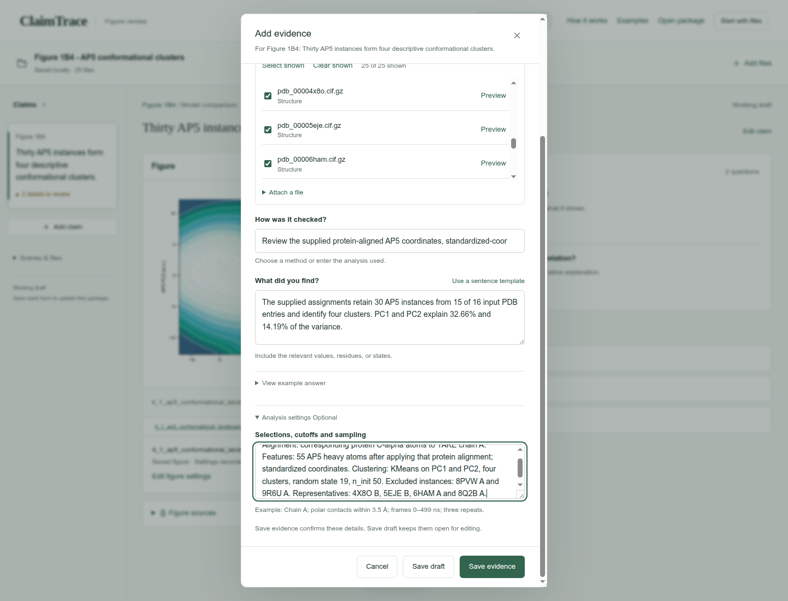

## 7. State the interpretation limit

Click **Add limitation**. Enter the limitation and click **Save limitation**.

**What limits this conclusion?**

```text
The landscape is an exploratory density transform of a crystallographic sample. Its energy-like scale depends on the selected structures, alignment, KDE and chosen display temperature; thermodynamic interpretation requires equilibrium sampling.
```

**Check:** **Limitations** shows 1 saved record.

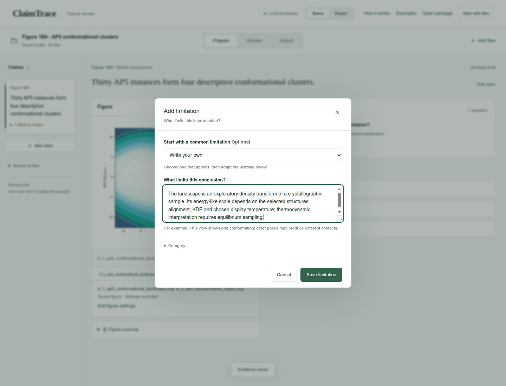

## 8. Review the short audit

Click **Review**. Read the five rows of the **Claim audit** and confirm the evidence and limitation match the figure.

**Check:** Claim, visual evidence, provenance, uncertainty, and reproducibility appear together.

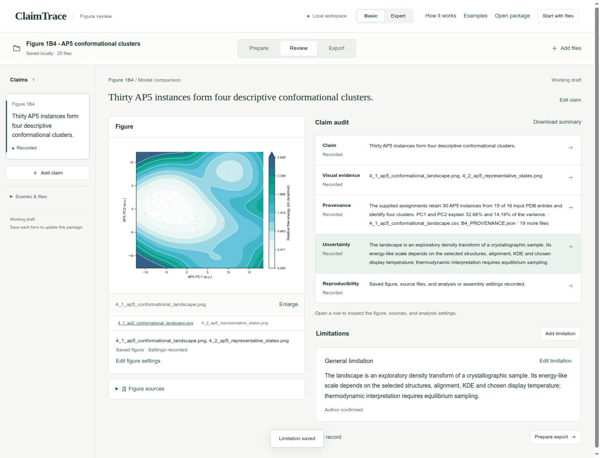

## 9. Check the draft export

Click **Export**. Keep **Working draft** selected and confirm **Draft checks passed**.

**Export purpose**

```text
Working draft
```

**Check:** **Download package · ZIP** is enabled.

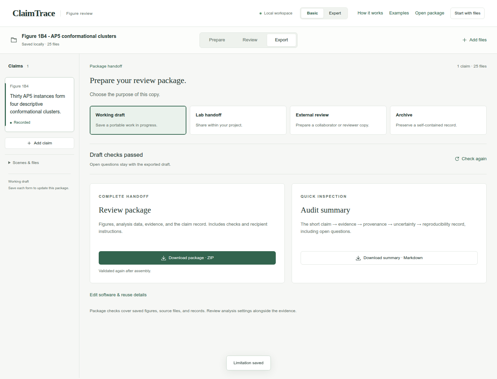

## 10. Download the package

Click **Download package · ZIP**. Check your browser’s downloads for claimtrace-review.zip, then save it with your figure. The ZIP contains the source files, claim record and recipient instructions.

**Check:** The page confirms: **Export checks passed. Your browser will download the package.**

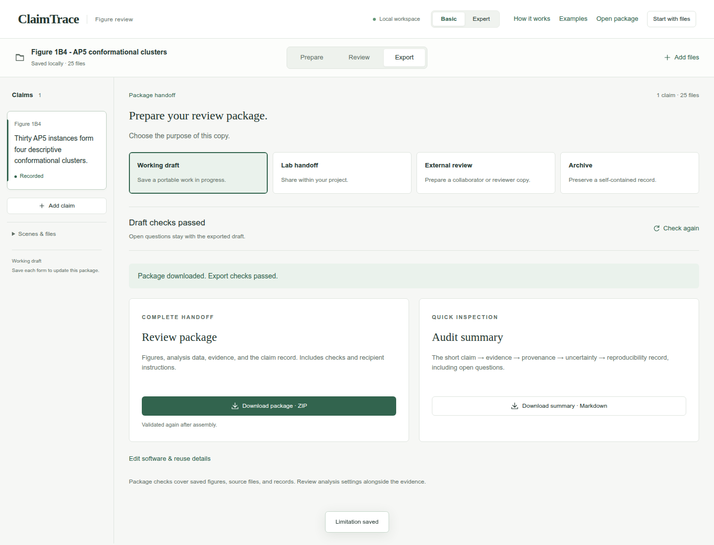

## Your saved result

A downloaded Working draft ZIP containing 1 claim, 1 evidence record, 1 limitation, and 25 source files.

## Continue the scientific review

- Keep the cluster/density interpretation descriptive for the sampled crystallographic structures.
- Use the supplied provenance and settings when reproducing the upstream analysis.
