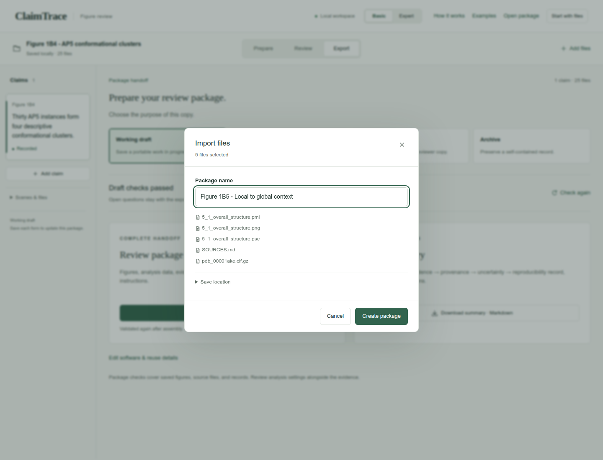
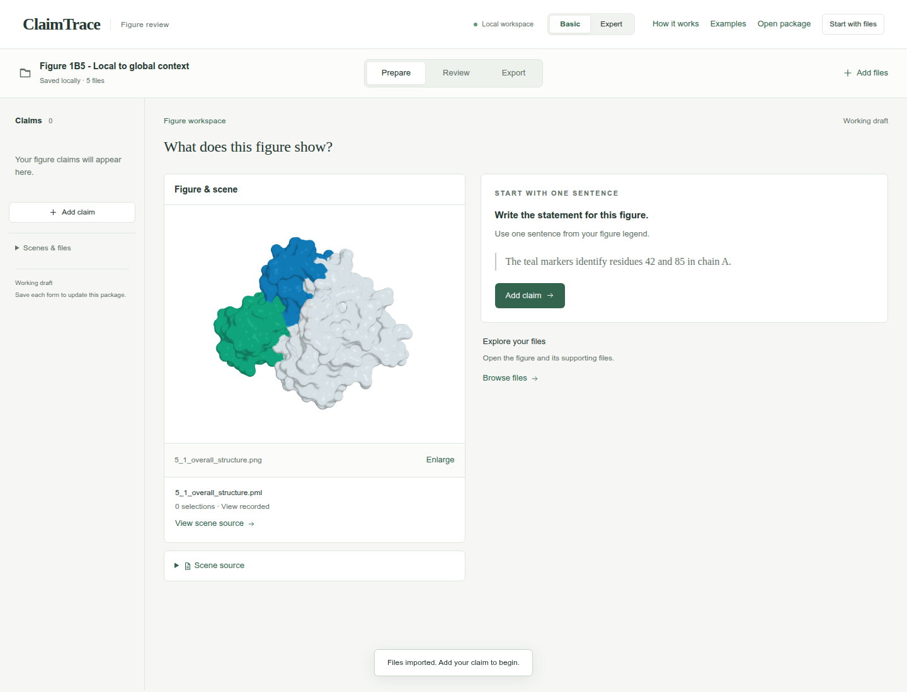
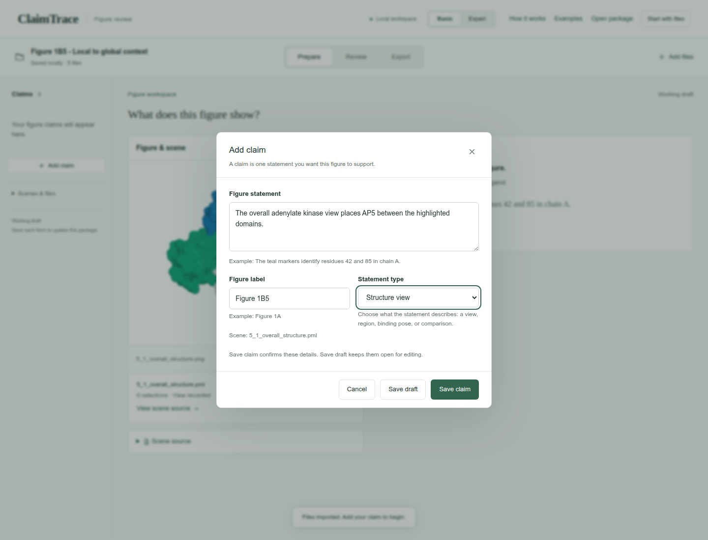
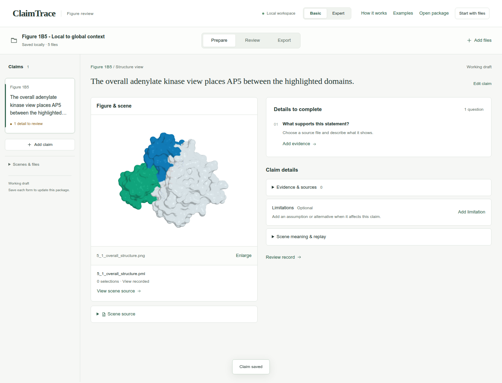
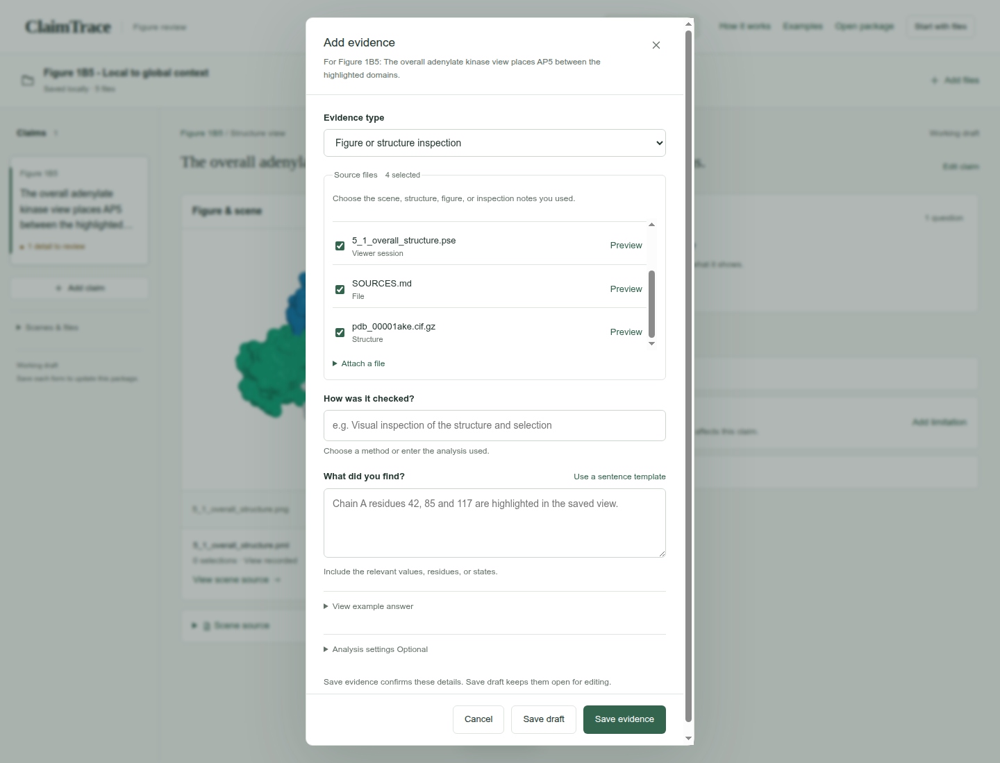
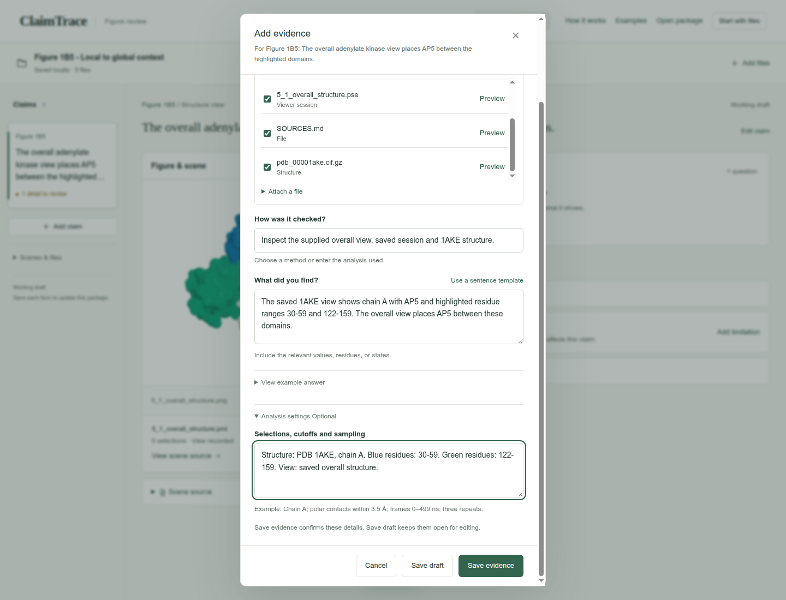
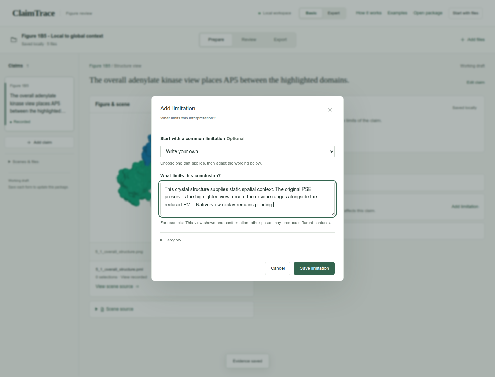
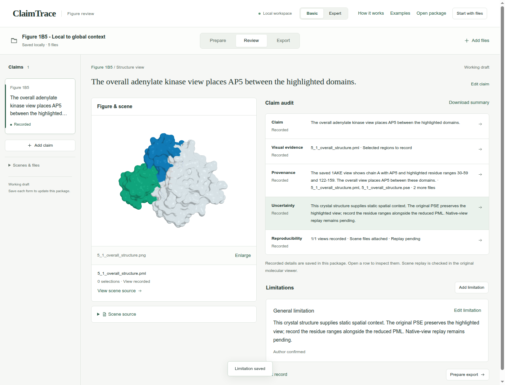
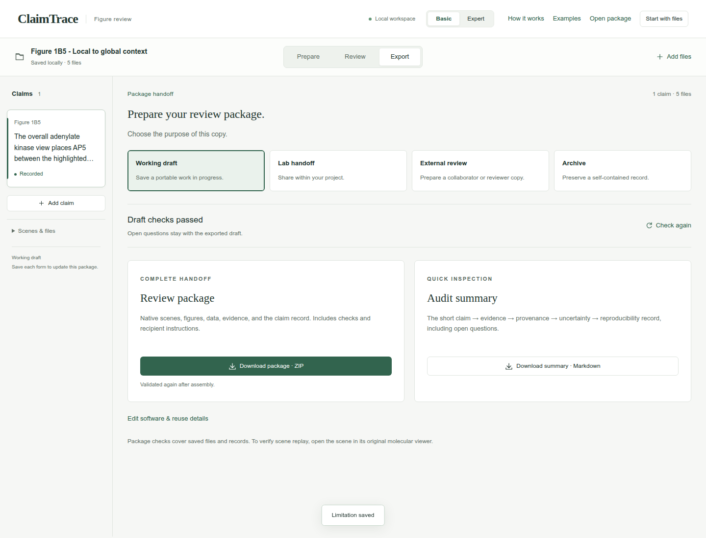
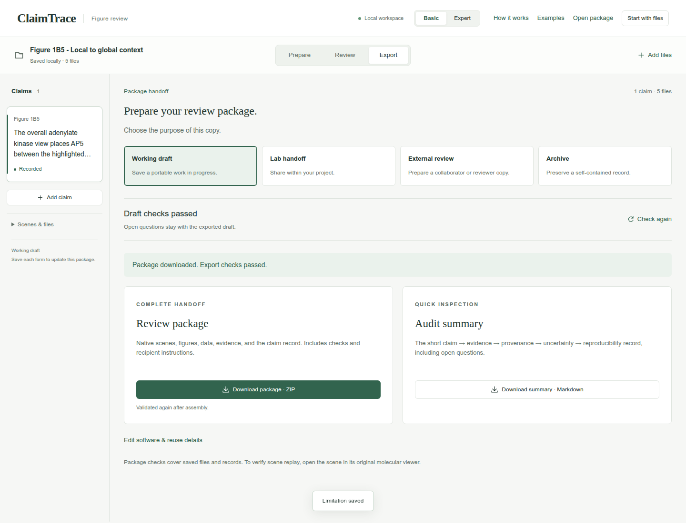

# Local to global context

Figure 1B5 · Describe molecular views · Basic mode

Locate AP5 within an overall structure and record the residue ranges highlighted around it.

[Download input files](../../downloads/f1-b5-inputs.zip) · [Download completed example](../../downloads/f1-b5-completed.zip)

[Open ClaimTrace](../../../start.md) · [Start here](../../README.md) · [All cases](../README.md)

Extract the input ZIP and select all 5 files in `files/`.

## 1. Import the example files

Extract the input ZIP and read LAB_NOTES.txt beside the files/ folder. In ClaimTrace, click **Choose files** on the welcome page, or **Start with files** in an open package. Select all 5 files inside files/. Enter the package name below and click **Create package**.

**Package name**

```text
Figure 1B5 - Local to global context
```

**Check:** The package opens in **Prepare** with 5 saved files and the figure visible.





## 2. Write one figure statement

Click **Add claim**. Enter the statement and figure label, choose the statement type, and click **Save claim**.

**Figure statement**

```text
The overall adenylate kinase view places AP5 between the highlighted domains.
```

**Figure label**

```text
Figure 1B5
```

**Statement type**

```text
Structure view
```

**Check:** The statement appears in the left claim list and the figure stays linked.





## 3. Choose the supporting files

Click **Add evidence**. Choose the **Evidence type** and select the listed **Source files**. Continue in this form for the next step.

**Evidence type**

```text
Figure or structure inspection
```

**Source files**

```text
5_1_overall_structure.pml
5_1_overall_structure.pse
pdb_00001ake.cif.gz
SOURCES.md
```

**Check:** The source counter shows 4 selected.



## 4. Record the finding and settings

Enter the method under **How was it checked?** and the observation under **What did you find?** Open **Analysis settings** and complete **Selections, cutoffs and sampling**. Click **Save evidence**.

**How was it checked?**

```text
Inspect the supplied overall view, saved session and 1AKE structure.
```

**What did you find?**

```text
The saved 1AKE view shows chain A with AP5 and highlighted residue ranges 30-59 and 122-159. The overall view places AP5 between these domains.
```

**Selections, cutoffs and sampling**

```text
Structure: PDB 1AKE, chain A. Blue residues: 30-59. Green residues: 122-159. View: saved overall structure.
```

**Check:** The evidence record appears under **Evidence & sources**.



## 5. State the interpretation limit

Click **Add limitation**. Enter the limitation and click **Save limitation**.

**What limits this conclusion?**

```text
This crystal structure supplies static spatial context. The original PSE preserves the highlighted view; record the residue ranges alongside the reduced PML. Native-view replay remains pending.
```

**Check:** **Limitations** shows 1 saved record.



## 6. Review the short audit

Click **Review**. Read the five rows of the **Claim audit** and confirm the evidence and limitation match the figure.

**Check:** Claim, visual evidence, provenance, uncertainty, and reproducibility appear together.



## 7. Check the draft export

Click **Export**. Keep **Working draft** selected and confirm **Draft checks passed**.

**Export purpose**

```text
Working draft
```

**Check:** **Download package · ZIP** is enabled.



## 8. Download the package

Click **Download package · ZIP**. Check your browser’s downloads for claimtrace-review.zip, then save it with your figure. The ZIP contains the source files, claim record and recipient instructions.

**Check:** The page confirms: **Export checks passed. Your browser will download the package.**



## Your saved result

A downloaded Working draft ZIP containing 1 claim, 1 evidence record, 1 limitation, and 5 source files.

## Continue the scientific review

- Open the original PSE in PyMOL and record the names and residue ranges of its highlighted selections.
- Keep the interpretation scoped to static spatial context.
