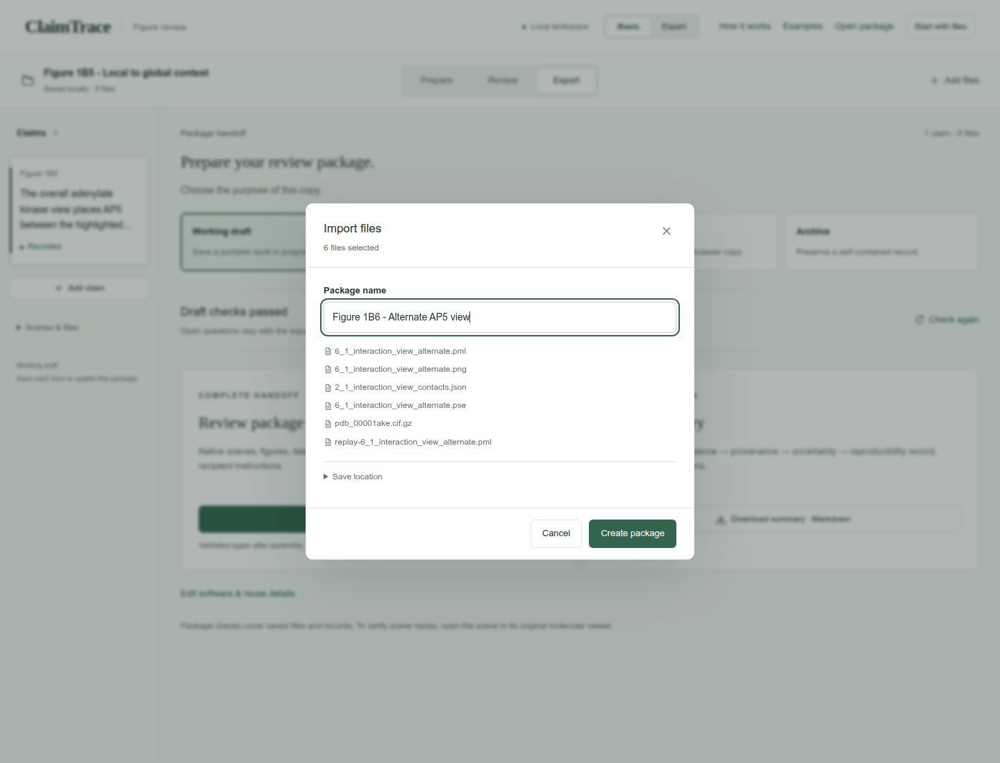
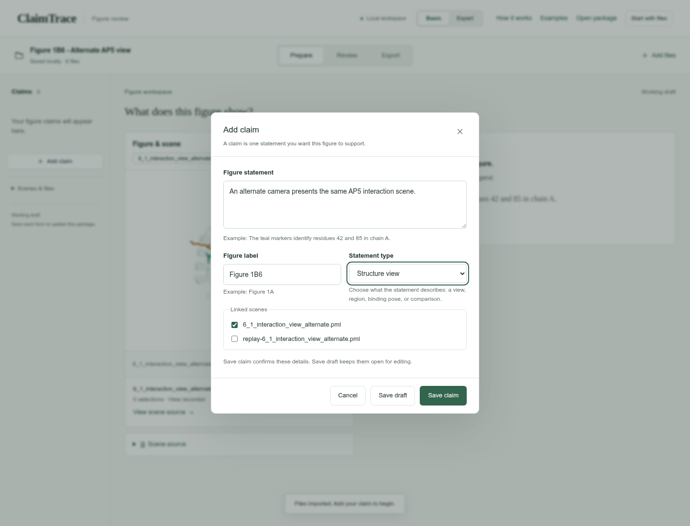
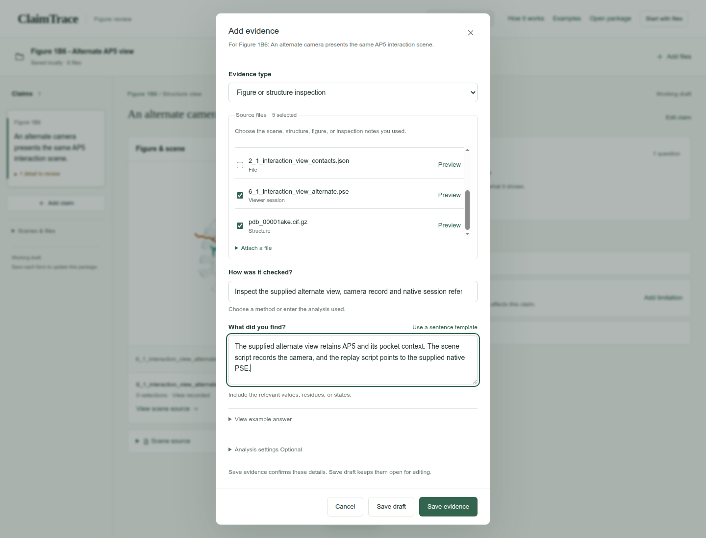
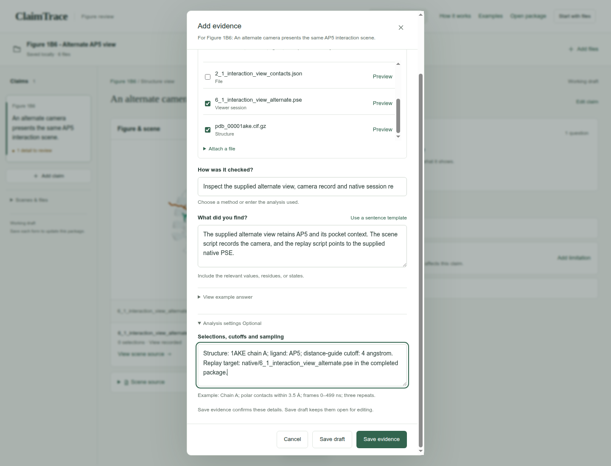
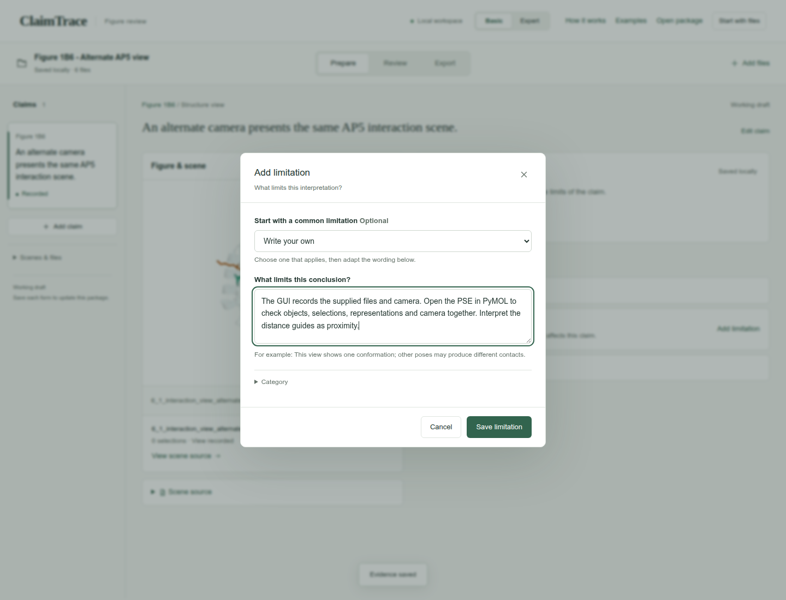
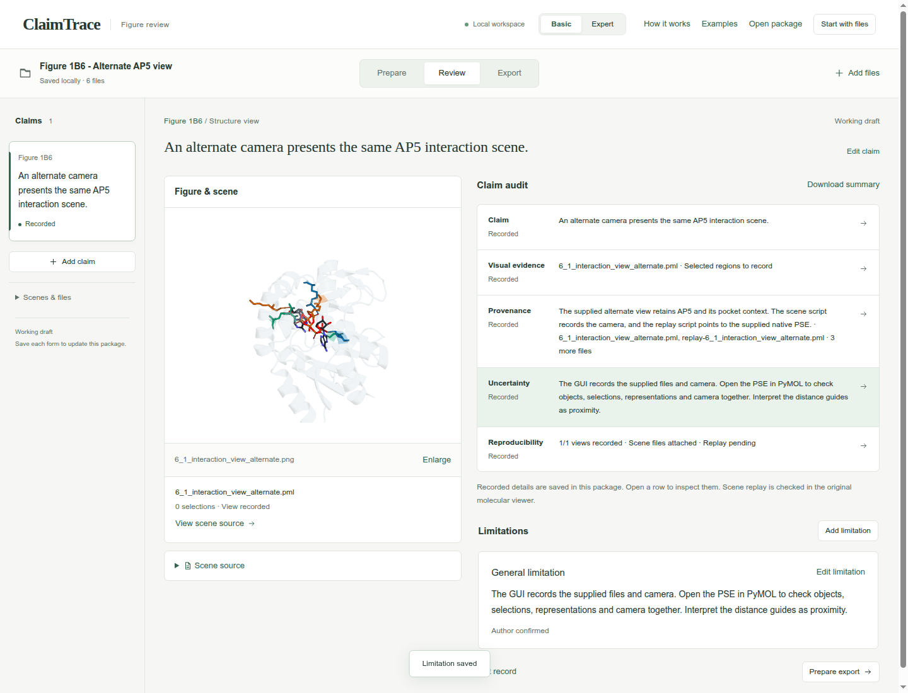
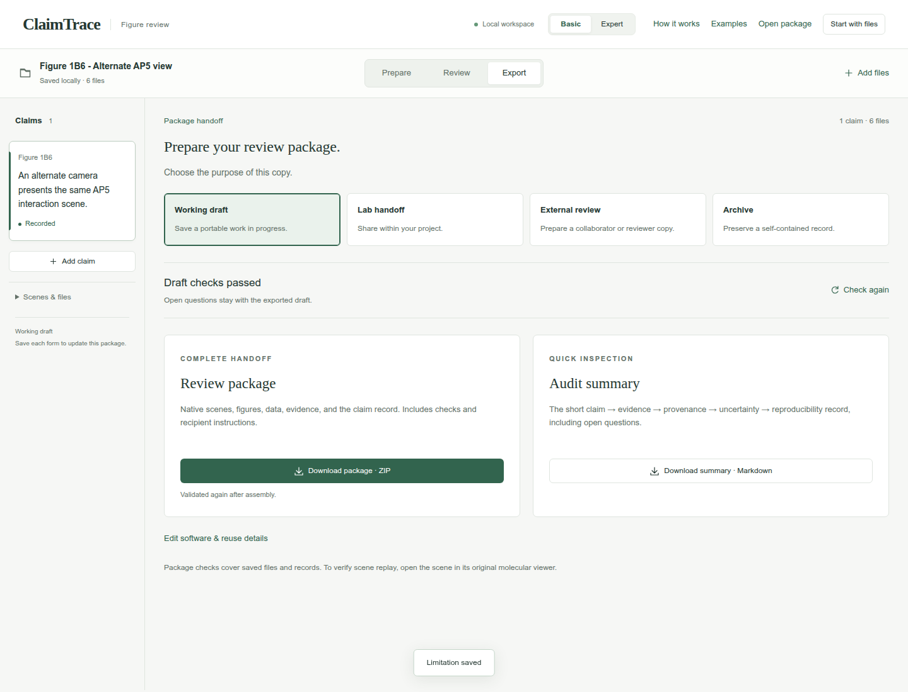
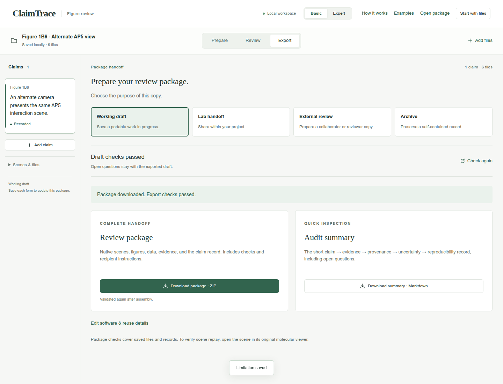

# Preserve an alternate AP5 interaction view

Figure 1B6 · Describe molecular views · Basic mode

Link an alternate AP5 pocket view to its saved session and record what remains to check in PyMOL.

[Download input files](../../downloads/f1-b6-inputs.zip) · [Download completed example](../../downloads/f1-b6-completed.zip)

[Open ClaimTrace](../../../start.md) · [Start here](../../README.md) · [All cases](../README.md)

Extract the input ZIP and select all 6 files in `files/`.

## 1. Create the package

Extract the input ZIP and read LAB_NOTES.txt beside the files/ folder. In ClaimTrace, click **Choose files** on the welcome page, or **Start with files** in an open package. Select all 6 files inside files/. Enter the package name below and click **Create package**.

**Package name**

```text
Figure 1B6 - Alternate AP5 view
```

**Check:** The package opens with 6 files.



## 2. Write the figure statement

Click **Add claim**. Enter the statement and figure label. Keep 6_1_interaction_view_alternate.pml selected under **Linked scenes**. Click **Save claim**.

**Figure statement**

```text
An alternate camera presents the same AP5 interaction scene.
```

**Figure label**

```text
Figure 1B6
```

**Statement type**

```text
Structure view
```

**Linked scenes**

```text
6_1_interaction_view_alternate.pml
```

**Check:** The statement appears in the Claims sidebar.



## 3. Choose the evidence and its sources

Click **Add evidence**. Choose the evidence type and select the **Source files** listed below. Scroll within the file list to find each source. Enter the method and observation.

**Evidence type**

```text
Figure or structure inspection
```

**Source files**

```text
6_1_interaction_view_alternate.pml
replay-6_1_interaction_view_alternate.pml
6_1_interaction_view_alternate.png
6_1_interaction_view_alternate.pse
pdb_00001ake.cif.gz
```

**How was it checked?**

```text
Inspect the supplied alternate view, camera record and native session reference.
```

**What did you find?**

```text
The supplied alternate view retains AP5 and its pocket context. The scene script records the camera, and the replay script points to the supplied native PSE.
```

**Check:** 5 source files are selected.



## 4. Record the settings

Expand **Analysis settings** and enter the recorded settings. Click **Save evidence**.

**Selections, cutoffs and sampling**

```text
Structure: 1AKE chain A; ligand: AP5; distance-guide cutoff: 4 angstrom. Replay target: native/6_1_interaction_view_alternate.pse in the completed package.
```

**Check:** The page confirms Evidence saved, and **Evidence & sources** shows 1 record.



## 5. State the interpretation limit

Click **Add limitation**. Keep **Write your own** selected, enter the limitation, then click **Save limitation**.

**What limits this conclusion?**

```text
The GUI records the supplied files and camera. Open the PSE in PyMOL to check objects, selections, representations and camera together. Interpret the distance guides as proximity.
```

**Check:** The saved limitation appears with the claim.



## 6. Read the short audit

Click **Review**. Read Claim, **Visual evidence**, **Provenance**, **Uncertainty** and **Reproducibility**. Click a row whenever you want to inspect its linked details.

**Check:** The audit shows the statement, source-linked finding, recorded limitation and current reproducibility status.



## 7. Prepare the working draft

Click **Export**, then **Working draft**. Read the package-check result.

**Purpose**

```text
Working draft
```

**Check:** The page shows **Draft checks passed**.



## 8. Download the package

Click **Download package · ZIP**. Check your browser’s downloads for claimtrace-review.zip, then save it with your figure. The ZIP contains the source files, claim record and recipient instructions.

**Check:** The page confirms: **Export checks passed. Your browser will download the package.**



## Your saved result

A downloaded Working draft ZIP with one claim, 6 input files, one evidence record and one limitation. The GUI confirms export checks passed.

## Continue the scientific review

- Open the supplied PSE in PyMOL and record the result of that replay check.
- Run the supplied replay script from the completed package root.
