# Document conserved pocket-water selection

Figure 4A · Check contacts and distances · Basic mode

Explain which waters remain visible in the retained-water view and record the selection rules.

[Download input files](../../downloads/f3-a-inputs.zip) · [Download completed example](../../downloads/f3-a-completed.zip)

[Open ClaimTrace](../../../start.md) · [Start here](../../README.md) · [All cases](../README.md)

Extract the input ZIP and select all 14 files in `files/`.

## 1. Create the package

Extract the input ZIP and read LAB_NOTES.txt beside the files/ folder. In ClaimTrace, click **Choose files** on the welcome page, or **Start with files** in an open package. Select all 14 files inside files/. Enter the package name below and click **Create package**.

**Package name**

```text
Figure 4A - Selecting conserved pocket waters
```

**Check:** The package opens with 14 files.

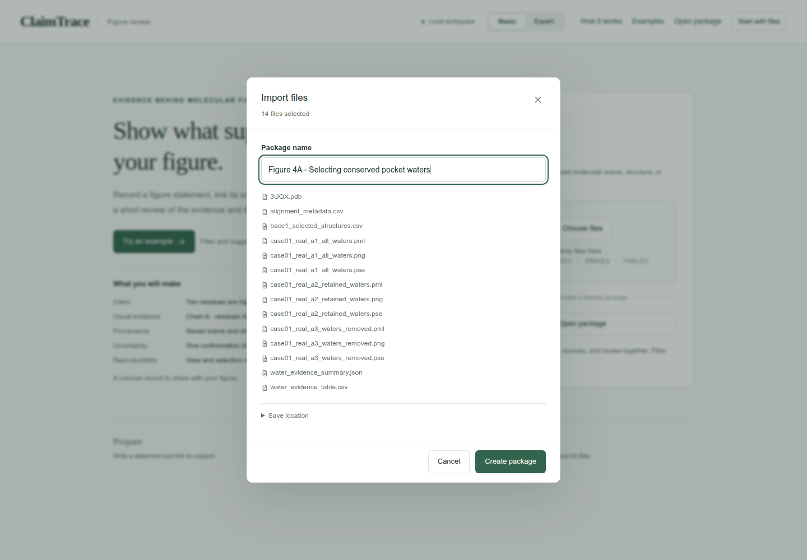

## 2. Write the figure statement

Click **Add claim**. Use **Edit claim** when updating a saved statement. Enter the statement and figure label. Under **Linked scenes**, select case01_real_a2_retained_waters.pml and clear the other scenes. Click **Save claim**.

**Figure statement**

```text
The retained-water view preserves eight selected waters around the 3UQX ligand, including six bridge proxies.
```

**Figure label**

```text
Figure 4A
```

**Statement type**

```text
Structure view
```

**Linked scenes**

```text
case01_real_a2_retained_waters.pml
```

**Check:** The statement appears in the Claims sidebar.

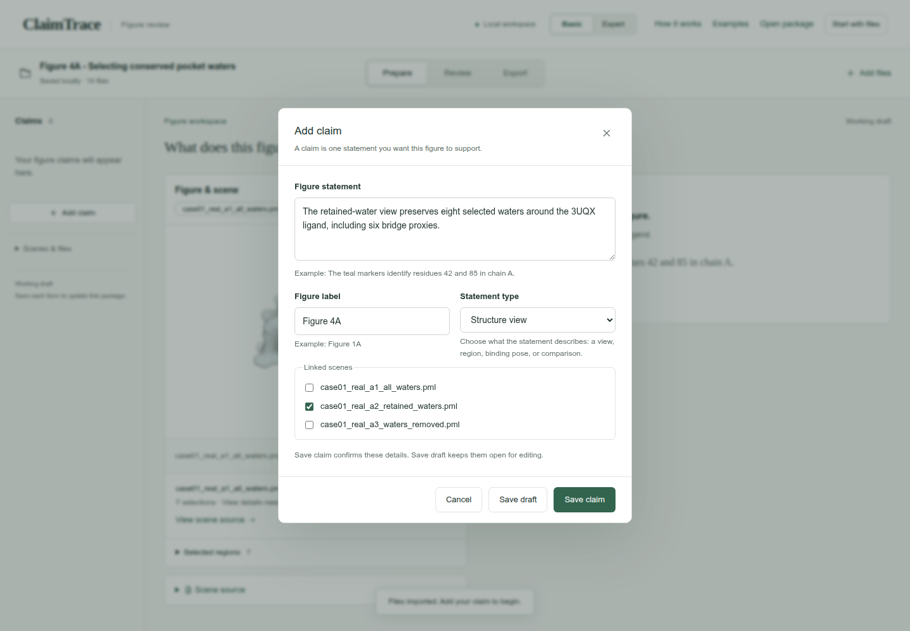

## 3. Choose the evidence and its sources

Click **Add evidence**. Choose the evidence type and select the **Source files** listed below. Scroll within the file list to find each source. Enter the method and observation.

**Evidence type**

```text
Contact table
```

**Source files**

```text
3UQX.pdb
alignment_metadata.csv
bace1_selected_structures.csv
water_evidence_summary.json
water_evidence_table.csv
```

**How was it checked?**

```text
Compare the three saved water views with the supplied water-selection table.
```

**What did you find?**

```text
The 3UQX rows contain 14 nearby waters, eight retained waters and six bridge proxies. Across 20 structures, the supplied table contains 283 water records, 114 clusters and 132 retained records.
```

**Check:** 5 source files are selected.

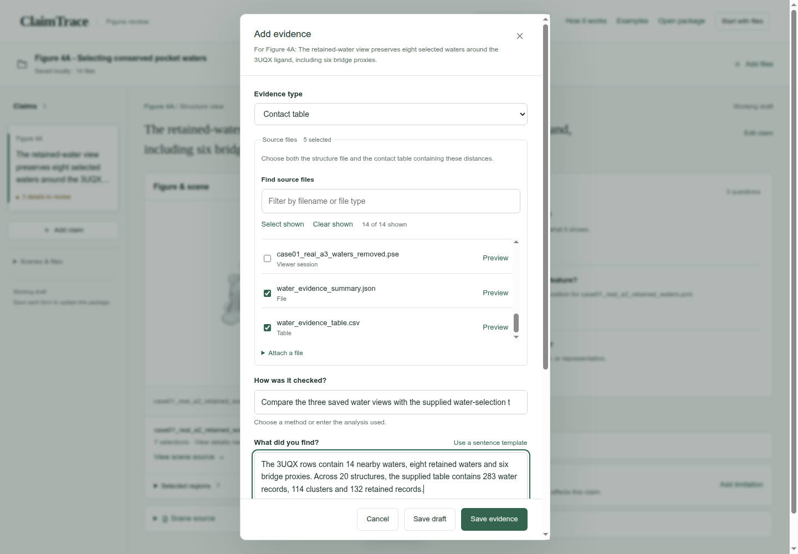

## 4. Record the settings

Enter the 4 angstrom water-neighborhood cutoff. Expand **Analysis settings** and record the separate cluster, conservation and bridge-proxy thresholds. Click **Save evidence**.

**Contact distance cutoff**

```text
4
```

**Distance unit**

```text
angstrom
```

**Selections, cutoffs and sampling**

```text
Reference: 3UQX, chain A ligand ZPZ401. Water neighborhood: 4 angstrom; cluster radius: 1.2 angstrom; conservation fraction: at least 0.3; bridge proxy: each water-to-partner distance within 3.5 angstrom. Ensemble: 20 structures.
```

**Check:** The page confirms Evidence saved, and **Evidence & sources** shows 1 record.

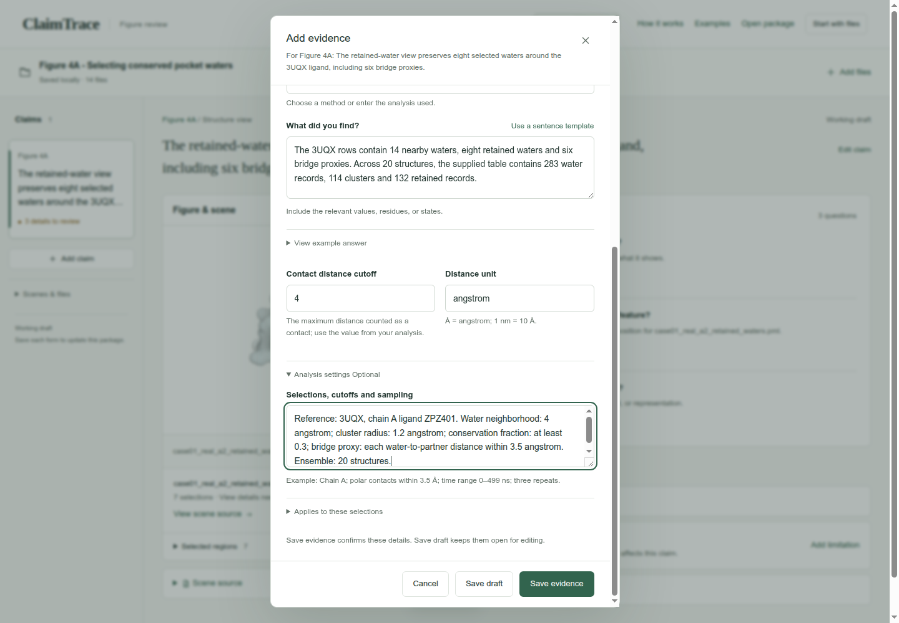

## 5. Describe the saved view

Click **Edit view details** in **Details to complete**. Enter the saved-view context and the visibility explanations from the scene script. Click **Save details**.

**Saved view or camera context**

```text
Open case01_real_a2_retained_waters.pse. The script orients ligand or pocket, turns y by -15 and x by 8, zooms by 4.8 and clips a slab of 35.
```

**Why is not (polymer.protein or (resn ZPZ and chain A and resi 401) or resn HOH) excluded?**

```text
Only protein, ZPZ in chain A residue 401, and water molecules remain in this scene.
```

**Why is all hidden?**

```text
The initial hide command clears representations before the script selectively shows the pocket, ligand and retained waters.
```

**Why is pocket and elem H hidden?**

```text
Pocket hydrogen sticks are hidden; heavy-atom representations remain.
```

**Why is bridge_proxy_\* hidden?**

```text
Bridge proxy labels are hidden; distance guide lines remain.
```

**Check:** **View recorded** appears beside the scene.

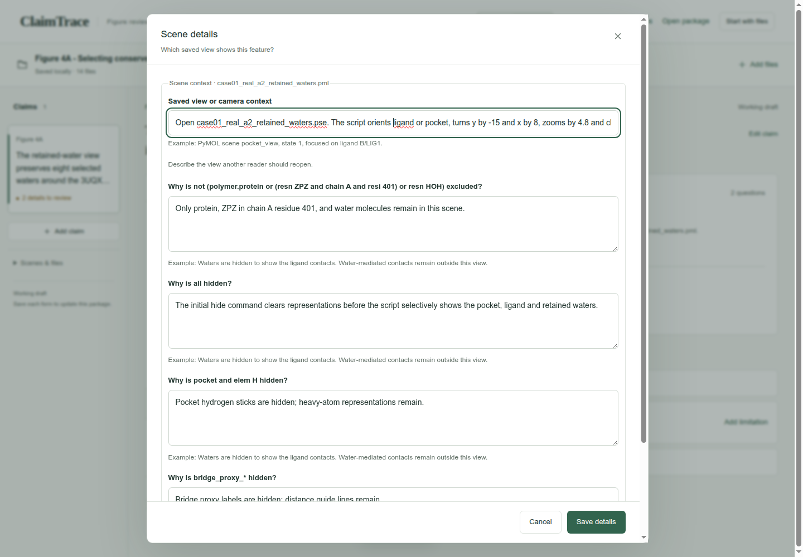

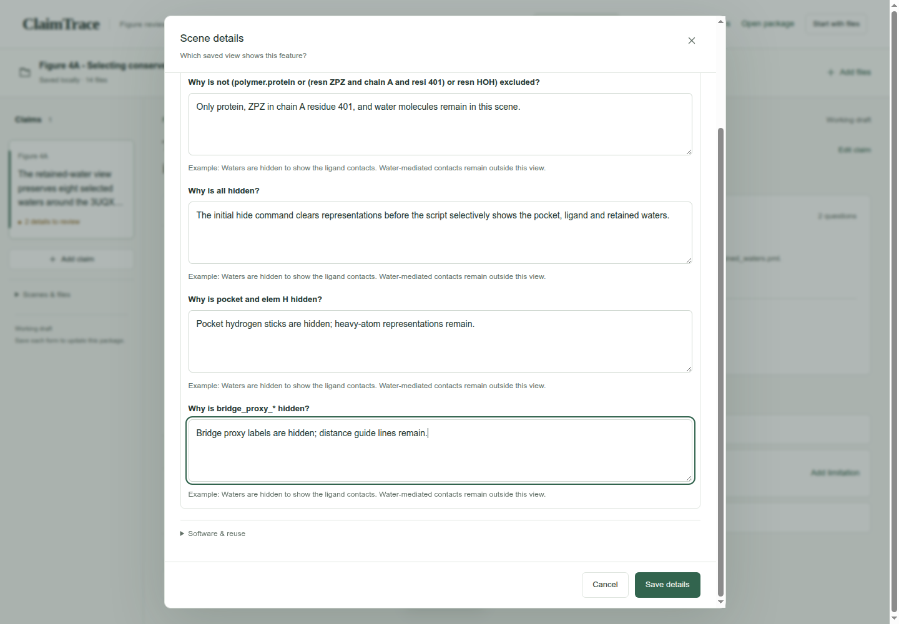

## 6. Explain the color key

Click **Explain visual meaning**. For each saved color instruction, choose **Identify this molecule or region**, then enter its color key. Scroll through the entries and click **Save color key**.

**What is this color used for? — each entry**

```text
Identify this molecule or region
```

**Color key — protein_gray · context**

```text
Light gray identifies the surrounding protein context.
```

**Color key — protein_surface_gray · pocket_surface**

```text
Pale gray identifies the pocket surface.
```

**Color key — pocket_gray · pocket and elem C**

```text
Gray identifies carbon atoms in the pocket.
```

**Color key — ligand_carbon · (ligand) and elem C**

```text
Teal identifies ligand carbon atoms.
```

**Color key — oxygen_red · (ligand) and elem O**

```text
Red identifies ligand oxygen atoms.
```

**Color key — nitrogen_blue · (ligand) and elem N**

```text
Blue identifies ligand nitrogen atoms.
```

**Color key — sulfur_yellow · (ligand) and elem S**

```text
Yellow identifies ligand sulfur atoms.
```

**Color key — chlorine_green · (ligand) and elem CL**

```text
Green identifies ligand chlorine atoms.
```

**Color key — retained_green · retained_waters**

```text
Green identifies retained water molecules. Larger green spheres mark the six bridge proxies.
```

**Color key — retained_green · bridge_proxy_\***

```text
Green distance guides connect the displayed protein-water-ligand bridge proxies.
```

**Check:** The visual-key question clears from **Details to complete**.

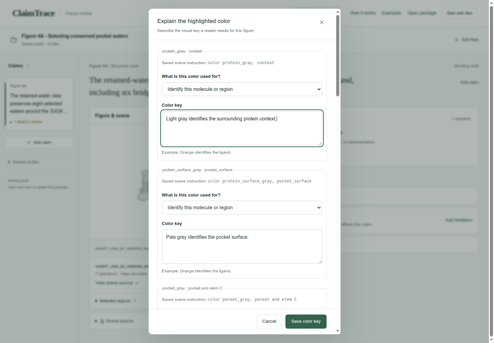

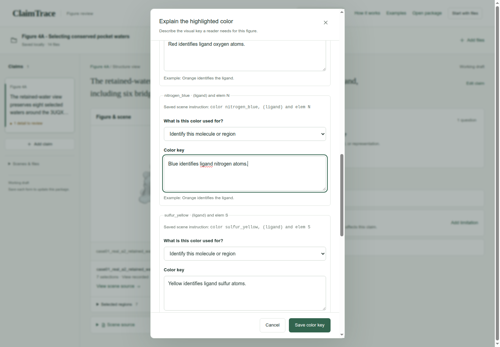

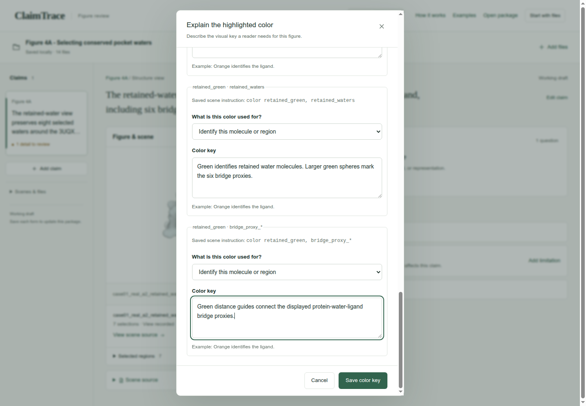

## 7. State the interpretation limit

Click **Add limitation**. Keep **Write your own** selected, enter the limitation, then click **Save limitation**.

**What limits this conclusion?**

```text
Bridge proxies use heavy-atom distances. Full ensemble realignment requires the other source structures. The supplied reference coordinates and three scenes support comparison of retained and hidden water context.
```

**Check:** The saved limitation appears with the claim.

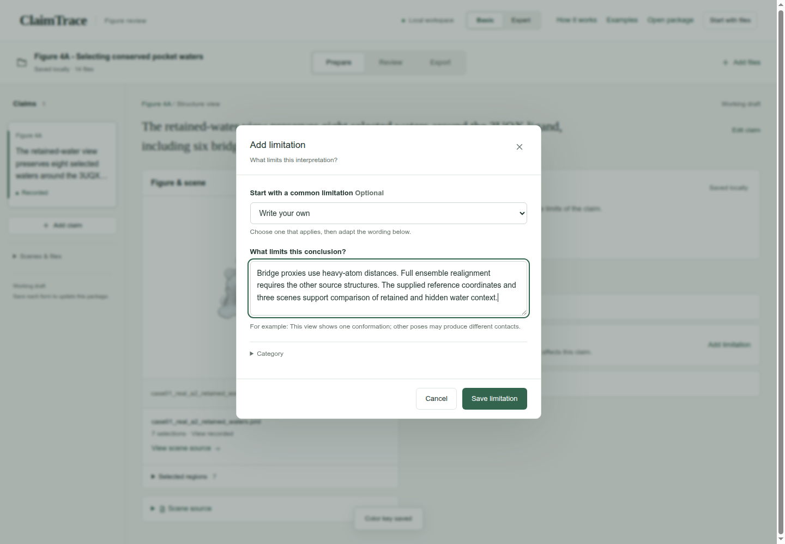

## 8. Read the short audit

Click **Review**. Read Claim, **Visual evidence**, **Provenance**, **Uncertainty** and **Reproducibility**. Click a row whenever you want to inspect its linked details.

**Check:** The audit shows the statement, source-linked finding, recorded limitation and current reproducibility status.

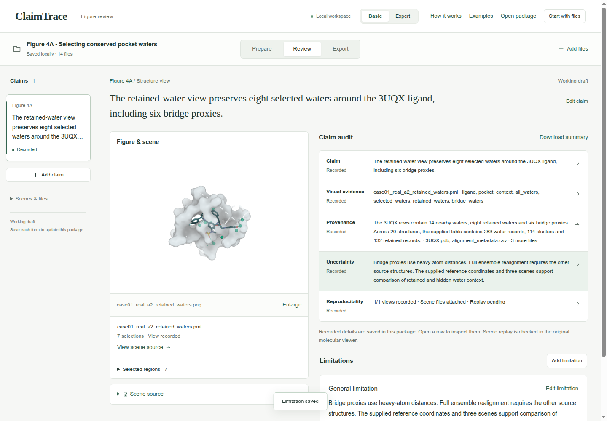

## 9. Prepare the working draft

Click **Export**, then **Working draft**. Read the package-check result.

**Purpose**

```text
Working draft
```

**Check:** The page shows **Draft checks passed**.

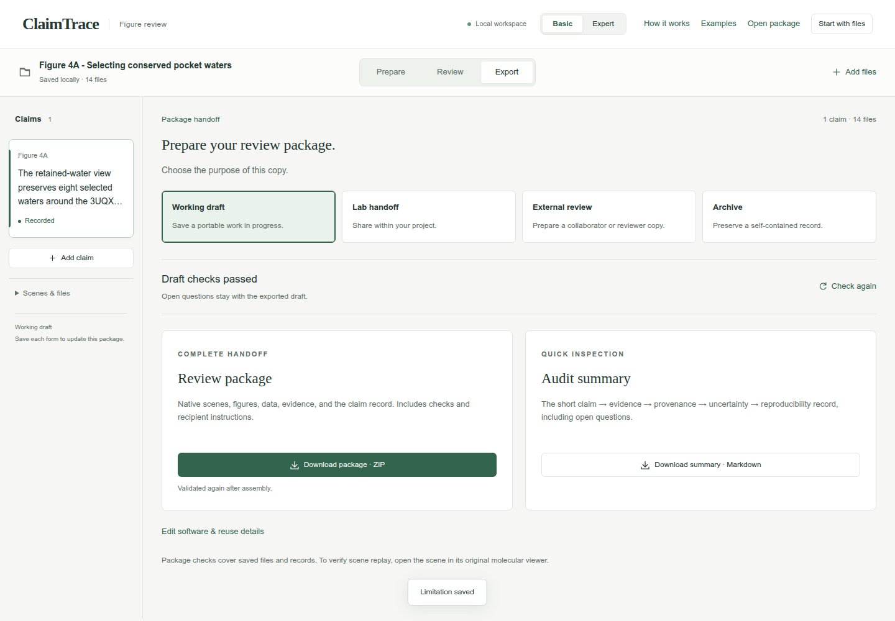

## 10. Download the package

Click **Download package · ZIP**. Check your browser’s downloads for claimtrace-review.zip, then save it with your figure. The ZIP contains the source files, claim record and recipient instructions.

**Check:** The page confirms: **Export checks passed. Your browser will download the package.**

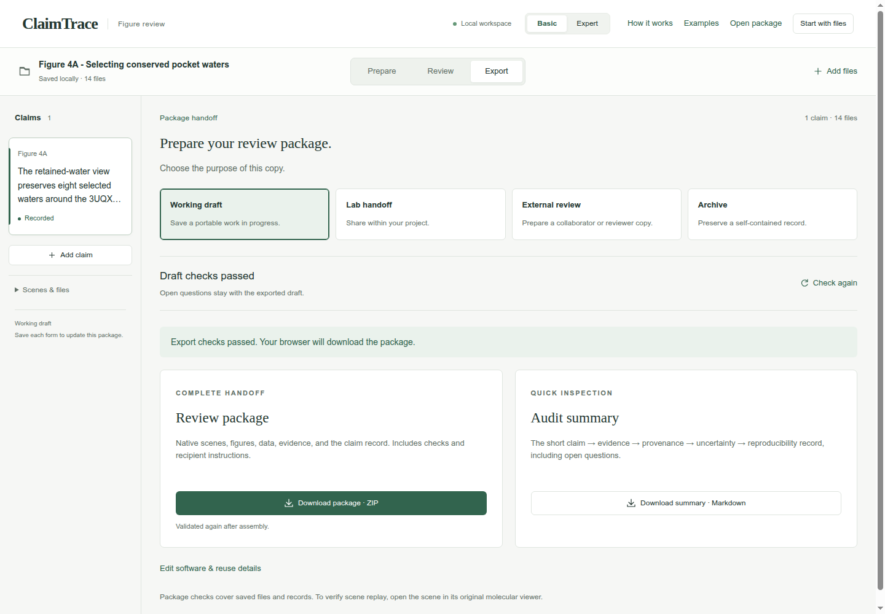

## Your saved result

A downloaded Working draft ZIP with one claim, 14 input files, one evidence record and one limitation. The GUI confirms export checks passed.

## Continue the scientific review

- Gather the remaining source structures before repeating the ensemble alignment.
- Bridge proxies describe heavy-atom distances. Molecular replay remains a separate viewer check.
