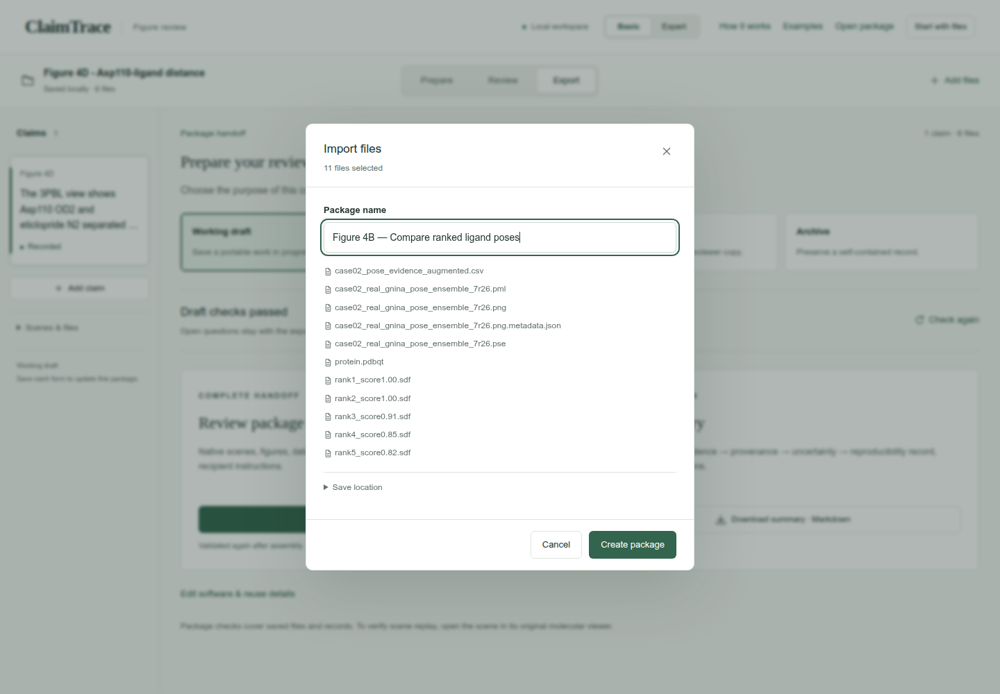
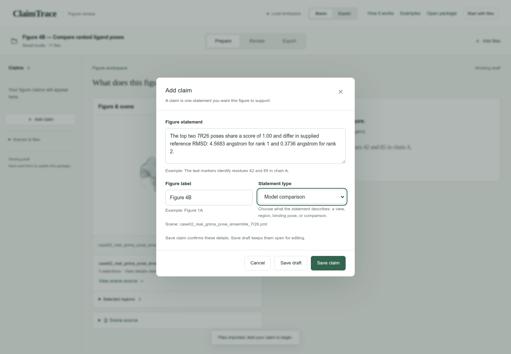
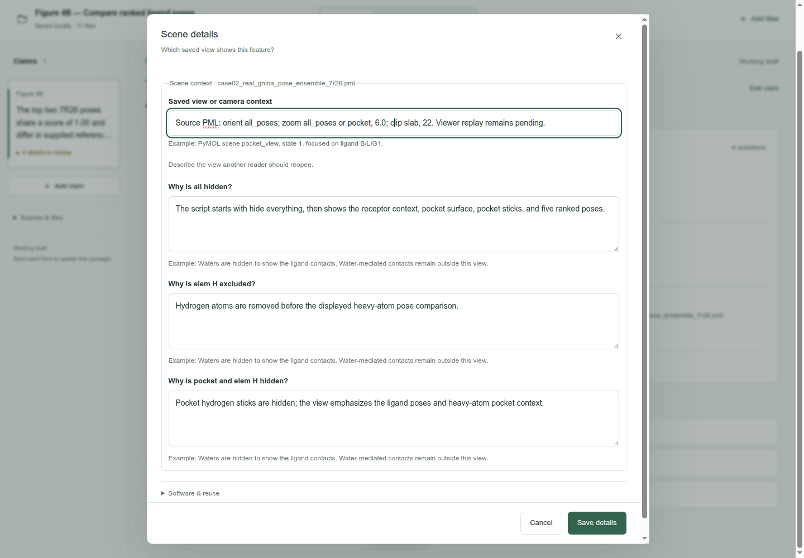
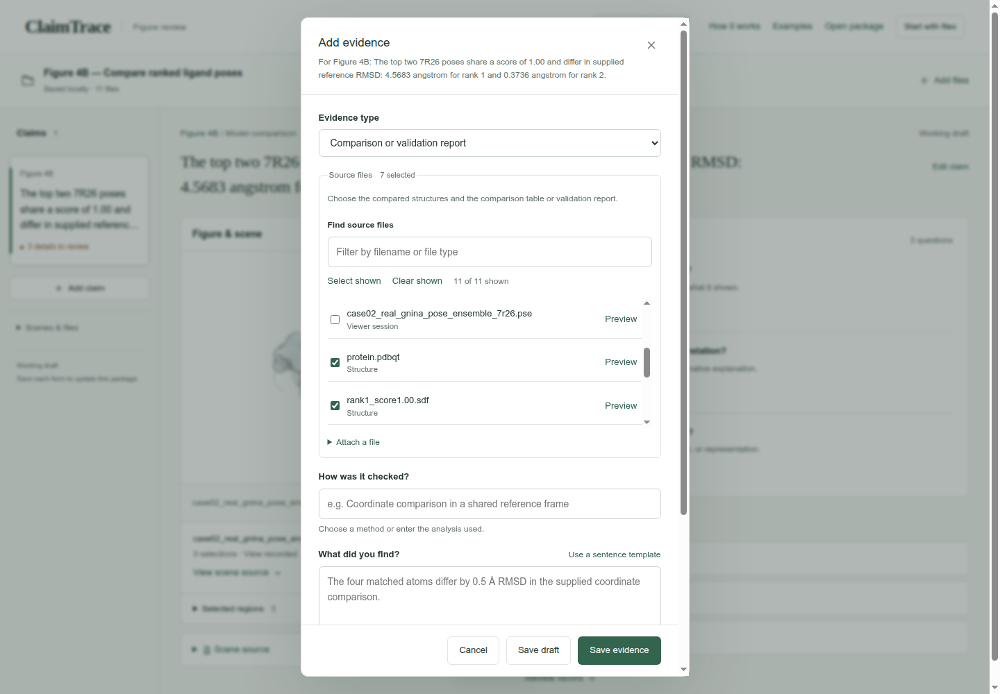
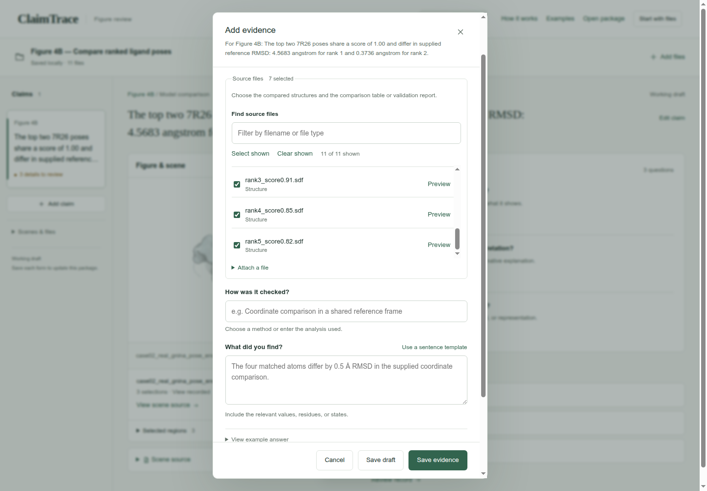
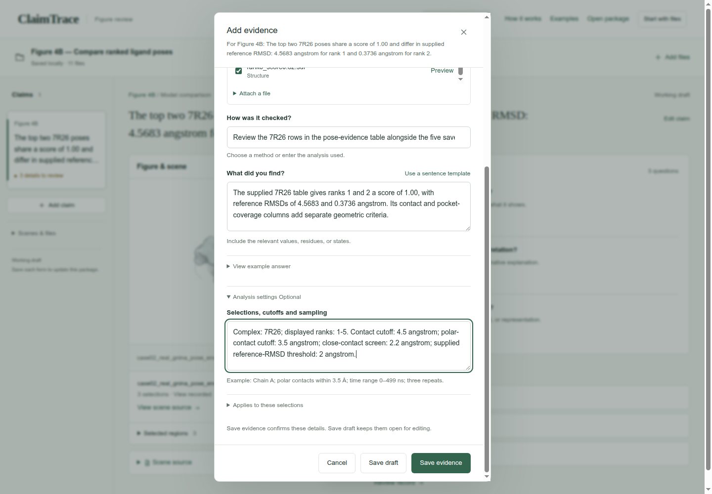
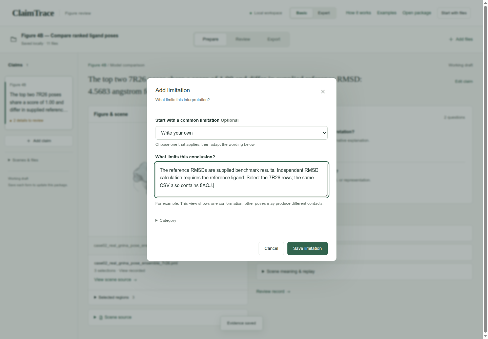
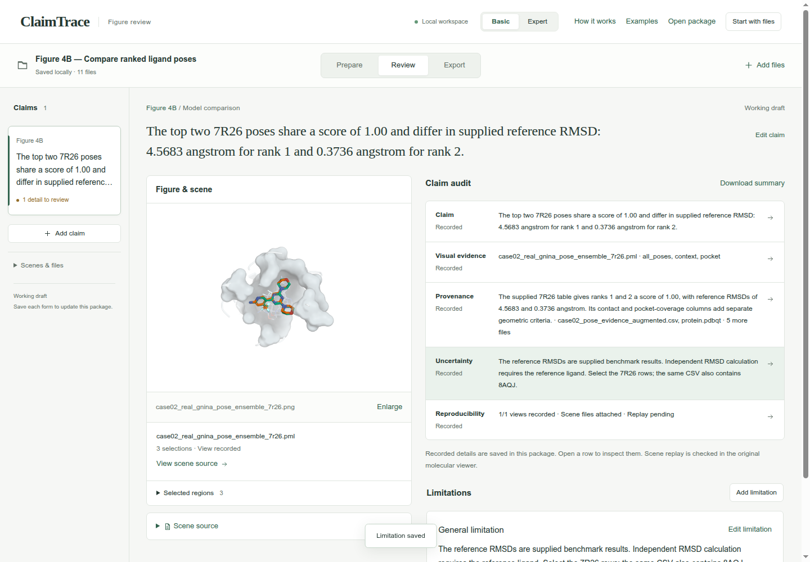
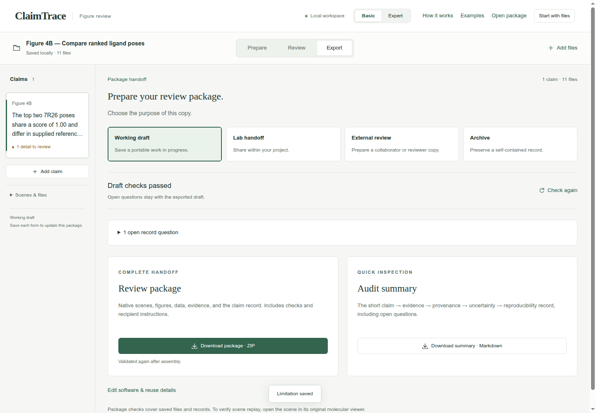
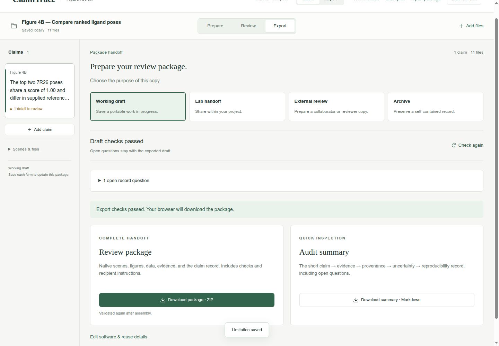

# Compare ranked ligand poses

Figure 4B · Compare models and ensembles · Basic mode

Compare five displayed poses and trace their scores and reference RMSDs to the supplied table.

[Download input files](../../downloads/f3-b-inputs.zip) · [Download completed example](../../downloads/f3-b-completed.zip)

[Open ClaimTrace](../../../start.md) · [Start here](../../README.md) · [All cases](../README.md)

Extract the input ZIP and select all 11 files in `files/`.

## 1. Import the case files

Extract the input ZIP and read LAB_NOTES.txt beside the files/ folder. In ClaimTrace, click **Choose files** on the welcome page, or **Start with files** in an open package. Select all 11 files inside files/. Enter the package name below and click **Create package**.

**Package name**

```text
Figure 4B — Compare ranked ligand poses
```

**Check:** Saved locally · 11 files appears, and the figure is displayed.



## 2. Write the figure statement

Click **Add claim**. Enter the statement and figure label, choose Model comparison, then click **Save claim**. Model comparison fits the comparison of scores and supplied reference RMSDs across poses.

**Figure statement**

```text
The top two 7R26 poses share a score of 1.00 and differ in supplied reference RMSD: 4.5683 angstrom for rank 1 and 0.3736 angstrom for rank 2.
```

**Figure label**

```text
Figure 4B
```

**Statement type**

```text
Model comparison
```

**Check:** The statement appears in the claim list and above the figure.



## 3. Record the source-script view

Click **Edit view details**. Copy the camera instructions and visibility descriptions below, then click **Save details**. These values describe the supplied PML commands; the original viewer supplies the replay check.

**Saved view or camera context**

```text
Source PML: orient all_poses; zoom all_poses or pocket, 6.0; clip slab, 22. Viewer replay remains pending.
```

**Why is all hidden?**

```text
The script starts with hide everything, then shows the receptor context, pocket surface, pocket sticks, and five ranked poses.
```

**Why is elem H excluded?**

```text
Hydrogen atoms are removed before the displayed heavy-atom pose comparison.
```

**Why is pocket and elem H hidden?**

```text
Pocket hydrogen sticks are hidden; the view emphasizes the ligand poses and heavy-atom pocket context.
```

**Check:** **View recorded** appears beside the scene.



## 4. Choose the evidence and source files

Click **Add evidence**. Choose Comparison or validation report. Check the source files listed below. Scroll within **Source files** when needed.

**Evidence type**

```text
Comparison or validation report
```

**Source files**

```text
case02_pose_evidence_augmented.csv
rank1_score1.00.sdf
rank2_score1.00.sdf
rank3_score0.91.sdf
rank4_score0.85.sdf
rank5_score0.82.sdf
protein.pdbqt
```

**Check:** **Source files** shows 7 selected.





## 5. Record the result and analysis settings

Enter the check name and its numerical result. Open **Analysis settings** and enter the recorded thresholds. Click **Save evidence**.

**How was it checked?**

```text
Review the 7R26 rows in the pose-evidence table alongside the five saved poses.
```

**What did you find?**

```text
The supplied 7R26 table gives ranks 1 and 2 a score of 1.00, with reference RMSDs of 4.5683 and 0.3736 angstrom. Its contact and pocket-coverage columns add separate geometric criteria.
```

**Selections, cutoffs and sampling**

```text
Complex: 7R26; displayed ranks: 1-5. Contact cutoff: 4.5 angstrom; polar-contact cutoff: 3.5 angstrom; close-contact screen: 2.2 angstrom; supplied reference-RMSD threshold: 2 angstrom.
```

**Check:** The page confirms Evidence saved, and **Evidence & sources** shows 1 record.



## 6. State the interpretation limit

Click **Add limitation**. Keep **Write your own** selected, enter the limitation below, then click **Save limitation**.

**What limits this conclusion?**

```text
The reference RMSDs are supplied benchmark results. Independent RMSD calculation requires the reference ligand. Select the 7R26 rows; the same CSV also contains 8AQJ.
```

**Check:** Limitation saved appears, and the uncertainty entry is linked to the claim.



## 7. Read the five-part claim audit

Click **Review**. Read Claim, **Visual evidence**, **Provenance**, **Uncertainty** and **Reproducibility**. Compare the numerical values and scope with your source notes.

**Check:** Claim, **Visual evidence**, **Provenance**, **Uncertainty** and **Reproducibility** read **Recorded**. **Reproducibility** also states **Replay pending**.



## 8. Check the working draft

Click **Export**. Keep **Working draft** selected. Expand the open record questions to see the remaining work.

**Purpose**

```text
Working draft
```

**Check:** **Draft checks passed**; 1 open record question: What do the visual cues mean?



## 9. Download the review package

Click **Download package · ZIP**. Check your browser’s downloads for claimtrace-review.zip, then save it with your figure. The ZIP contains the source files, claim record and recipient instructions.

**Check:** The page confirms: **Export checks passed. Your browser will download the package.**



## Your saved result

One Figure 4B claim with 7 linked evidence files and one recorded limitation, exported as a Working draft ZIP.

## Continue the scientific review

- Explain visual meaning for the imported scene colors.
- Add the reference ligand before calculating the reference RMSDs independently.
- Open the scene in PyMOL and record the replay result.
