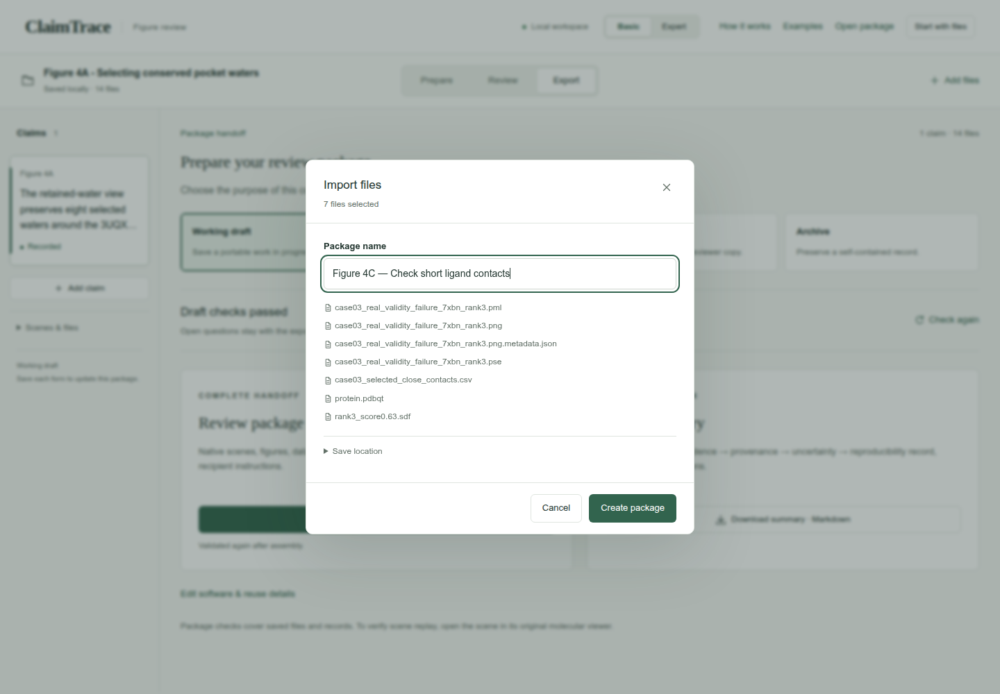
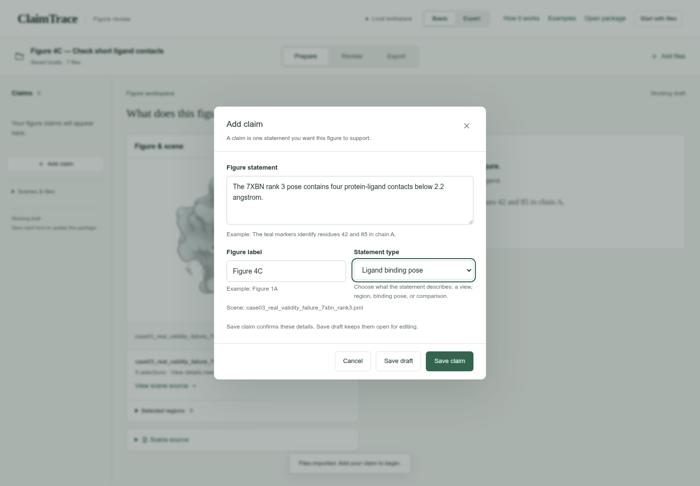
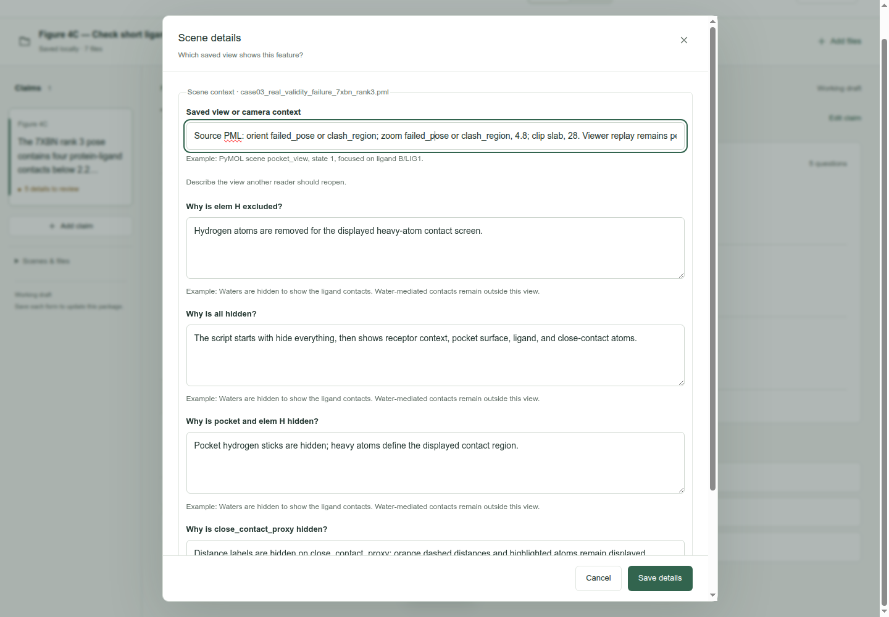
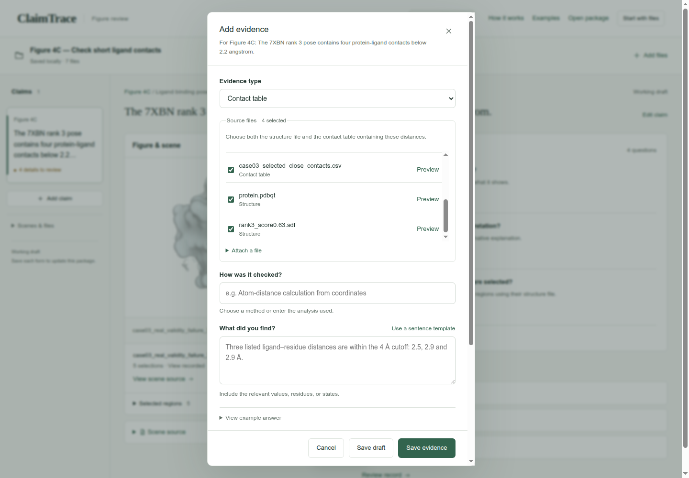
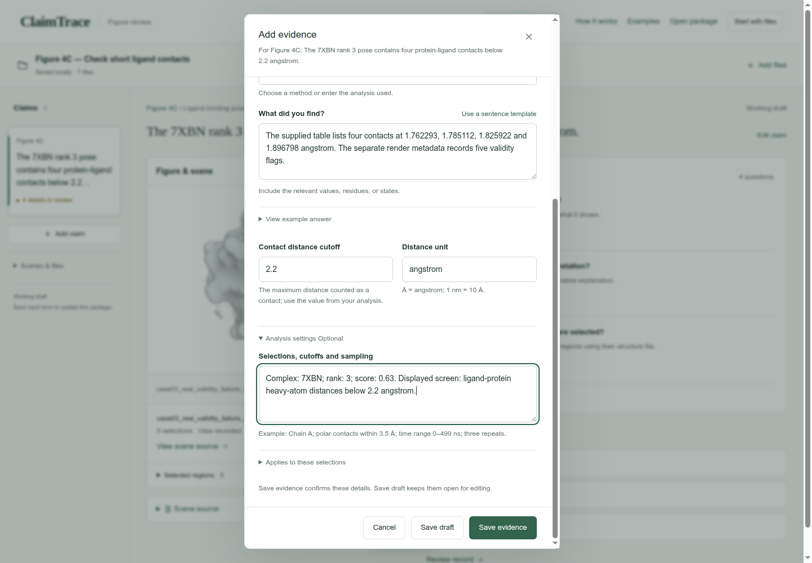
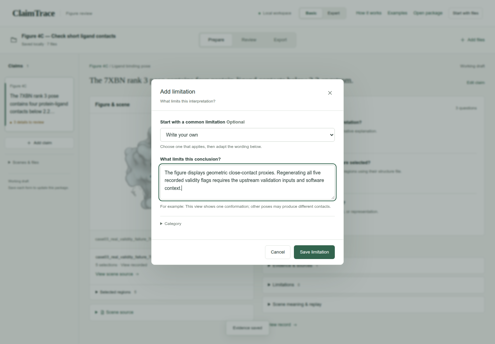
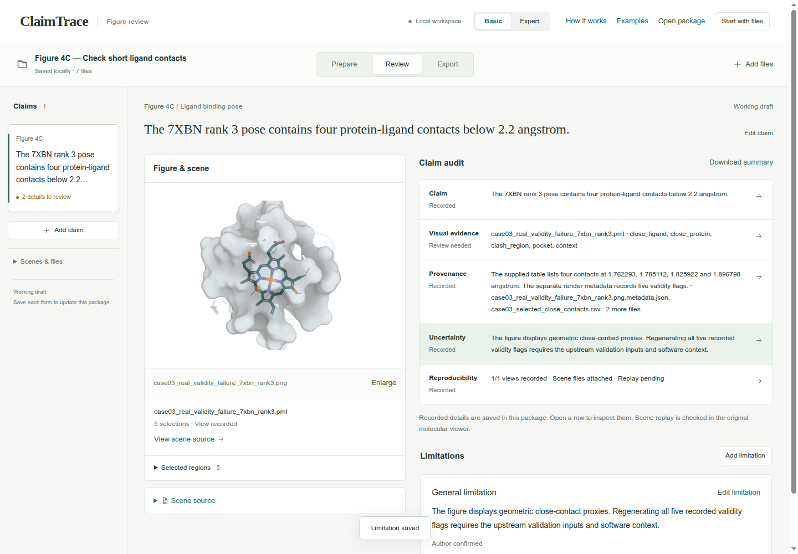
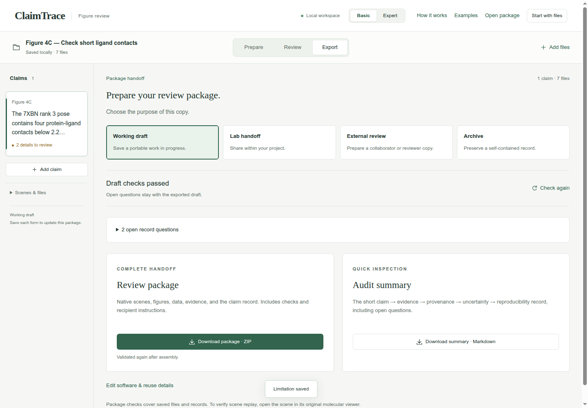
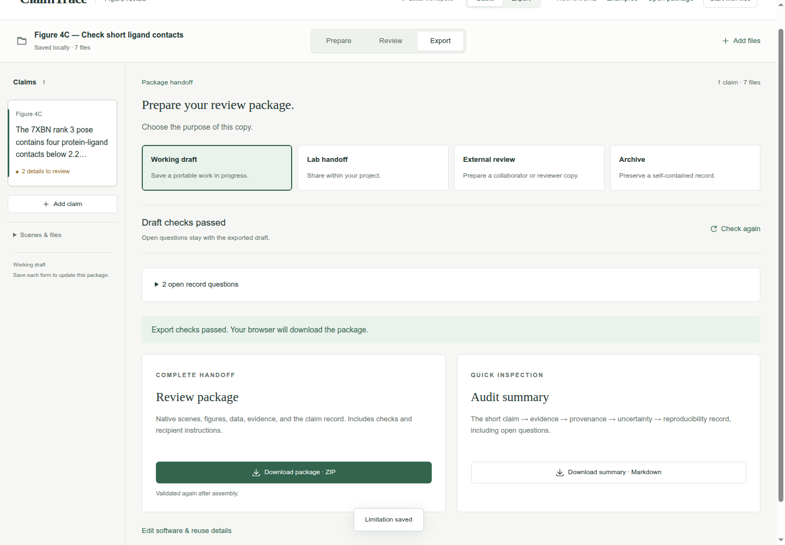

# Check short ligand contacts

Figure 4C · Check contacts and distances · Basic mode

Link the highlighted short contacts to four atom pairs and the 2.2 angstrom screening rule.

[Download input files](../../downloads/f3-c-inputs.zip) · [Download completed example](../../downloads/f3-c-completed.zip)

[Open ClaimTrace](../../../start.md) · [Start here](../../README.md) · [All cases](../README.md)

Extract the input ZIP and select all 7 files in `files/`.

## 1. Import the case files

Extract the input ZIP and read LAB_NOTES.txt beside the files/ folder. In ClaimTrace, click **Choose files** on the welcome page, or **Start with files** in an open package. Select all 7 files inside files/. Enter the package name below and click **Create package**.

**Package name**

```text
Figure 4C — Check short ligand contacts
```

**Check:** Saved locally · 7 files appears, and the figure is displayed.



## 2. Write the figure statement

Click **Add claim**. Enter the statement and figure label, choose Ligand binding pose, then click **Save claim**.

**Figure statement**

```text
The 7XBN rank 3 pose contains four protein-ligand contacts below 2.2 angstrom.
```

**Figure label**

```text
Figure 4C
```

**Statement type**

```text
Ligand binding pose
```

**Check:** The statement appears in the claim list and above the figure.



## 3. Record the source-script view

Click **Edit view details**. Copy the camera instructions and visibility descriptions below, then click **Save details**. These values describe the supplied PML commands; the original viewer supplies the replay check.

**Saved view or camera context**

```text
Source PML: orient failed_pose or clash_region; zoom failed_pose or clash_region, 4.8; clip slab, 28. Viewer replay remains pending.
```

**Why is elem H excluded?**

```text
Hydrogen atoms are removed for the displayed heavy-atom contact screen.
```

**Why is all hidden?**

```text
The script starts with hide everything, then shows receptor context, pocket surface, ligand, and close-contact atoms.
```

**Why is pocket and elem H hidden?**

```text
Pocket hydrogen sticks are hidden; heavy atoms define the displayed contact region.
```

**Why is close_contact_proxy hidden?**

```text
Distance labels are hidden on close_contact_proxy; orange dashed distances and highlighted atoms remain displayed.
```

**Check:** **View recorded** appears beside the scene.



## 4. Choose the evidence and source files

Click **Add evidence**. Choose Contact table. Check the source files listed below. Scroll within **Source files** when needed.

**Evidence type**

```text
Contact table
```

**Source files**

```text
case03_real_validity_failure_7xbn_rank3.png.metadata.json
case03_selected_close_contacts.csv
protein.pdbqt
rank3_score0.63.sdf
```

**Check:** **Source files** shows 4 selected.



## 5. Record the result and analysis settings

Enter the check name and its numerical result. Set the contact cutoff and unit. Open **Analysis settings** and enter the selected system and screen. Click **Save evidence**.

**How was it checked?**

```text
Review the supplied atom-pair table and its coordinates against the highlighted contact view.
```

**What did you find?**

```text
The supplied table lists four contacts at 1.762293, 1.785112, 1.825922 and 1.896798 angstrom. The separate render metadata records five validity flags.
```

**Contact distance cutoff**

```text
2.2
```

**Distance unit**

```text
angstrom
```

**Selections, cutoffs and sampling**

```text
Complex: 7XBN; rank: 3; score: 0.63. Displayed screen: ligand-protein heavy-atom distances below 2.2 angstrom.
```

**Check:** The page confirms Evidence saved, and **Evidence & sources** shows 1 record.



## 6. State the interpretation limit

Click **Add limitation**. Keep **Write your own** selected, enter the limitation below, then click **Save limitation**.

**What limits this conclusion?**

```text
The figure displays geometric close-contact proxies. Regenerating all five recorded validity flags requires the upstream validation inputs and software context.
```

**Check:** Limitation saved appears, and the uncertainty entry is linked to the claim.



## 7. Read the five-part claim audit

Click **Review**. Read Claim, **Visual evidence**, **Provenance**, **Uncertainty** and **Reproducibility**. Compare the numerical values and scope with your source notes.

**Check:** **Provenance** and **Uncertainty** read **Recorded**. **Visual evidence** reads **Review needed** because region identities remain open. **Reproducibility** states **Replay pending**.



## 8. Check the working draft

Click **Export**. Keep **Working draft** selected. Expand the open record questions to see the remaining work.

**Purpose**

```text
Working draft
```

**Check:** **Draft checks passed**; 2 open record questions cover visual meaning and selected region identities.



## 9. Download the review package

Click **Download package · ZIP**. Check your browser’s downloads for claimtrace-review.zip, then save it with your figure. The ZIP contains the source files, claim record and recipient instructions.

**Check:** The page confirms: **Export checks passed. Your browser will download the package.**



## Your saved result

One Figure 4C claim with 4 linked evidence files and one recorded limitation, exported as a Working draft ZIP.

## Continue the scientific review

- Explain visual meaning for the imported scene colors.
- Confirm selected molecule or residue identities.
- Full PoseBusters flag regeneration requires upstream validation inputs and software context.
- Open the scene in PyMOL and record the replay result.
