# Record an Asp110-ligand distance

Figure 4D · Check contacts and distances · Basic mode

Identify the two atoms joined by a distance guide and keep simulation setup context attached to its own source.

[Download input files](../../downloads/f3-d-inputs.zip) · [Download completed example](../../downloads/f3-d-completed.zip)

[Open ClaimTrace](../../../start.md) · [Start here](../../README.md) · [All cases](../README.md)

Extract the input ZIP and select all 6 files in `files/`.

## 1. Create the package

Extract the input ZIP and read LAB_NOTES.txt beside the files/ folder. In ClaimTrace, click **Choose files** on the welcome page, or **Start with files** in an open package. Select all 6 files inside files/. Enter the package name below and click **Create package**.

**Package name**

```text
Figure 4D - Asp110-ligand distance
```

**Check:** The package opens with 6 files.

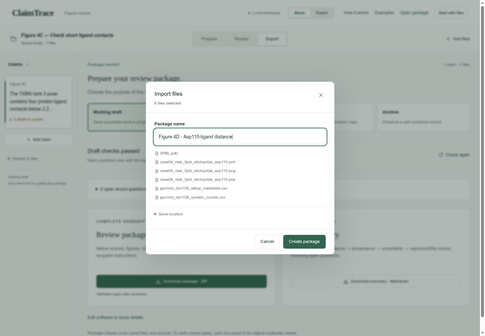

## 2. Write the figure statement

Click **Add claim**. Enter the statement and figure label. Click **Save claim**.

**Figure statement**

```text
The 3PBL view shows Asp110 OD2 and eticlopride N2 separated by 2.702419 angstrom.
```

**Figure label**

```text
Figure 4D
```

**Statement type**

```text
Structure view
```

**Check:** The statement appears in the Claims sidebar.

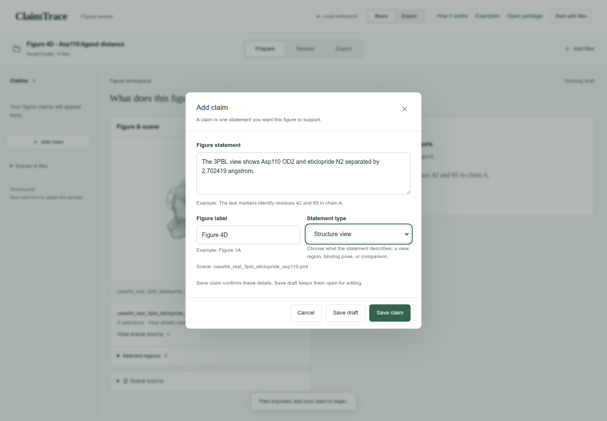

## 3. Choose the evidence and its sources

Click **Add evidence**. Choose the evidence type and select the **Source files** listed below. Scroll within the file list to find each source. Enter the method and observation.

**Evidence type**

```text
Distance measurements
```

**Source files**

```text
case04_real_3pbl_eticlopride_asp110.pml
3PBL.pdb
gpcrmd_dyn106_setup_metadata.csv
gpcrmd_dyn106_system_counts.csv
```

**How was it checked?**

```text
Inspect the two selected atoms in 3PBL and review the separately supplied dyn106 setup table.
```

**What did you find?**

```text
The 3PBL chain A coordinates place Asp110 OD2 2.702419 angstrom from ETQ1200 N2. The separate dyn106 setup table records ACEMD/GPUGRID, CHARMM36m, TIP3P, POPC and a 4 fs timestep.
```

**Check:** 4 source files are selected.

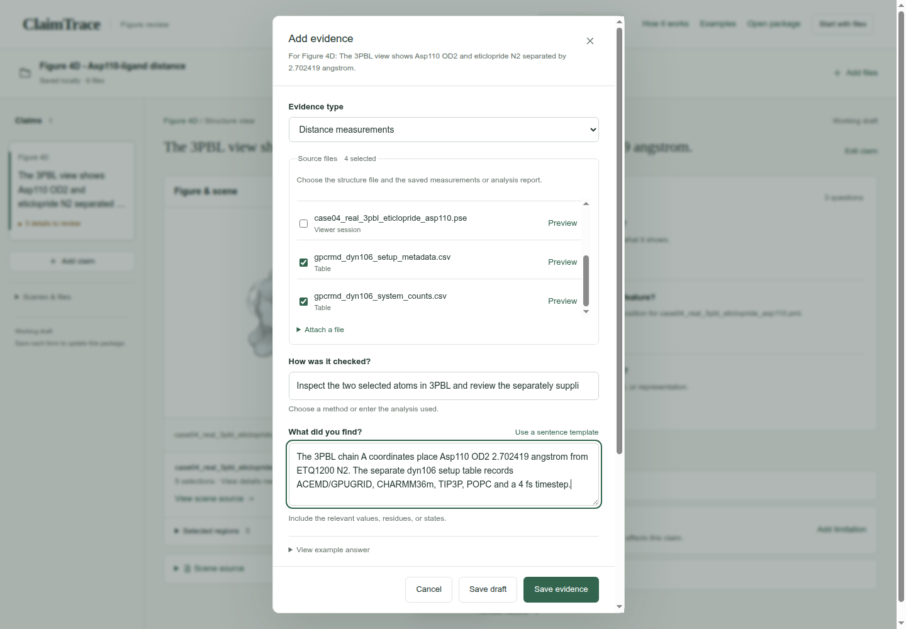

## 4. Record the settings

Enter **Measured distance** and **Distance unit**. Expand **Analysis settings** and enter **Selections, cutoffs and sampling**. Open **Applies to these selections**. Keep ligand and asp110 selected; clear the other selections. Click **Save evidence**.

**Measured distance**

```text
2.702419
```

**Distance unit**

```text
angstrom
```

**Selections, cutoffs and sampling**

```text
Displayed structure: PDB 3PBL, chain A; atom pair: Asp110 OD2 and ETQ1200 N2. Setup context: GPCRmd dyn106, from the supplied metadata table.
```

**Applies to these selections**

```text
ligand; asp110
```

**Check:** The page confirms Evidence saved, and **Evidence & sources** shows 1 record.


## 5. Describe the saved view

Click **Edit view details** in **Details to complete**. Enter the saved-view context and the visibility explanations from the scene script. Click **Save details**.

**Saved view or camera context**

```text
Open case04_real_3pbl_eticlopride_asp110.pse. The script orients ligand or pocket, turns y by -20 and x by 10, zooms ligand or pocket or asp110 by 4.2, and clips a slab of 30.
```

**Why is not chain A excluded?**

```text
The scene retains chain A of 3PBL.
```

**Why is all hidden?**

```text
The initial hide command clears representations before the script selectively shows the pocket, ligand and Asp110.
```

**Why is pocket and elem H hidden?**

```text
Pocket hydrogen sticks are hidden; heavy-atom representations remain.
```

**Why is asp110_eticlopride_proxy hidden?**

```text
The atom-pair distance label is hidden; the green distance guide remains.
```

**Check:** **View recorded** appears beside the scene.

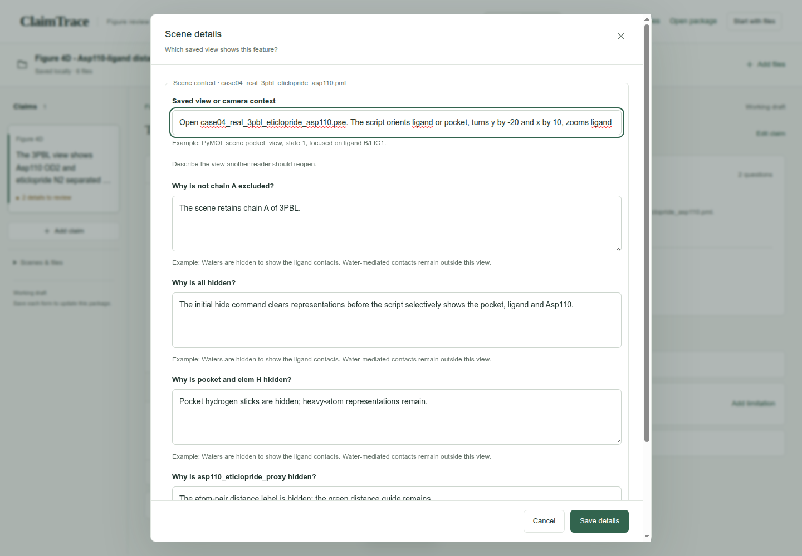

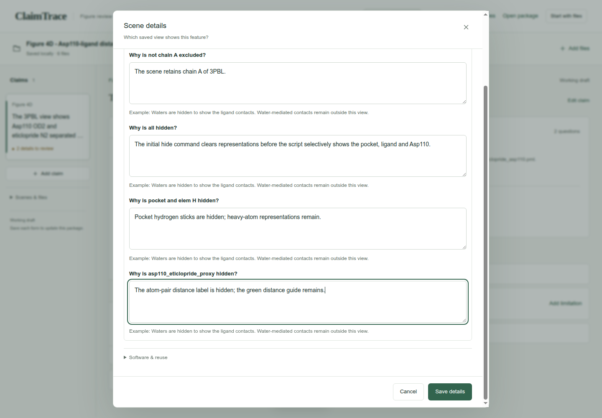

## 6. Explain the color key

Click **Explain visual meaning**. For each saved color instruction, choose **Identify this molecule or region**, then enter its color key. Scroll through the entries and click **Save color key**.

**What is this color used for? — each entry**

```text
Identify this molecule or region
```

**Color key — protein_gray · context**

```text
Light gray identifies the surrounding receptor context.
```

**Color key — protein_surface_gray · pocket_surface**

```text
Pale gray identifies the pocket surface.
```

**Color key — pocket_gray · pocket and elem C**

```text
Gray identifies carbon atoms in the pocket.
```

**Color key — ligand_carbon · (ligand) and elem C**

```text
Teal identifies ligand carbon atoms.
```

**Color key — oxygen_red · (ligand) and elem O**

```text
Red identifies ligand oxygen atoms.
```

**Color key — nitrogen_blue · (ligand) and elem N**

```text
Blue identifies ligand nitrogen atoms.
```

**Color key — sulfur_yellow · (ligand) and elem S**

```text
Yellow identifies ligand sulfur atoms.
```

**Color key — chlorine_green · (ligand) and elem CL**

```text
Green identifies ligand chlorine atoms.
```

**Color key — provenance_blue · asp110 and elem C**

```text
Blue identifies Asp110 carbon atoms.
```

**Color key — oxygen_red · asp110 and elem O**

```text
Red identifies Asp110 oxygen atoms.
```

**Color key — retained_green · asp110_eticlopride_proxy**

```text
The green distance guide joins Asp110 OD2 and eticlopride N2.
```

**Check:** The visual-key question clears from **Details to complete**.

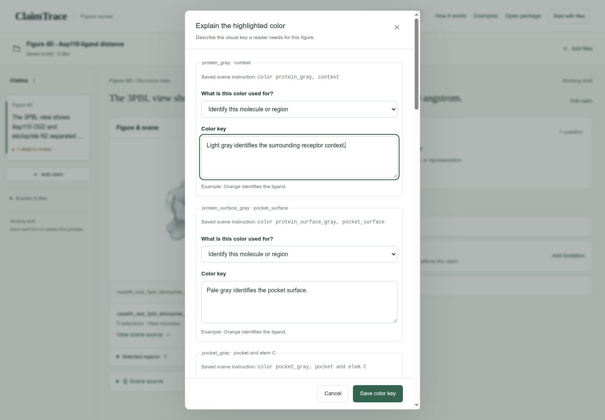

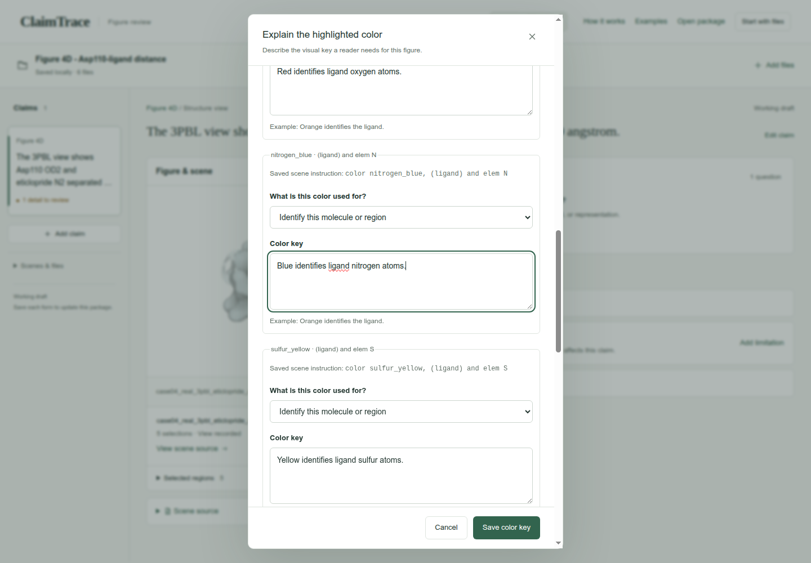

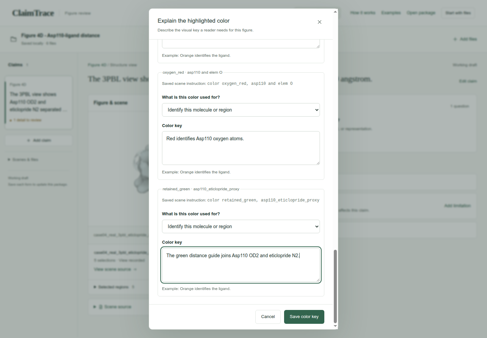

## 7. State the interpretation limit

Click **Add limitation**. Keep **Write your own** selected, enter the limitation, then click **Save limitation**.

**What limits this conclusion?**

```text
The distance describes the static 3PBL structure. GPCRmd dyn106 supplies separate simulation context. Its TIP row reports 8,134 residues and 54,390 atoms; resolve that count against the original topology before using it as a system total.
```

**Check:** The saved limitation appears with the claim.

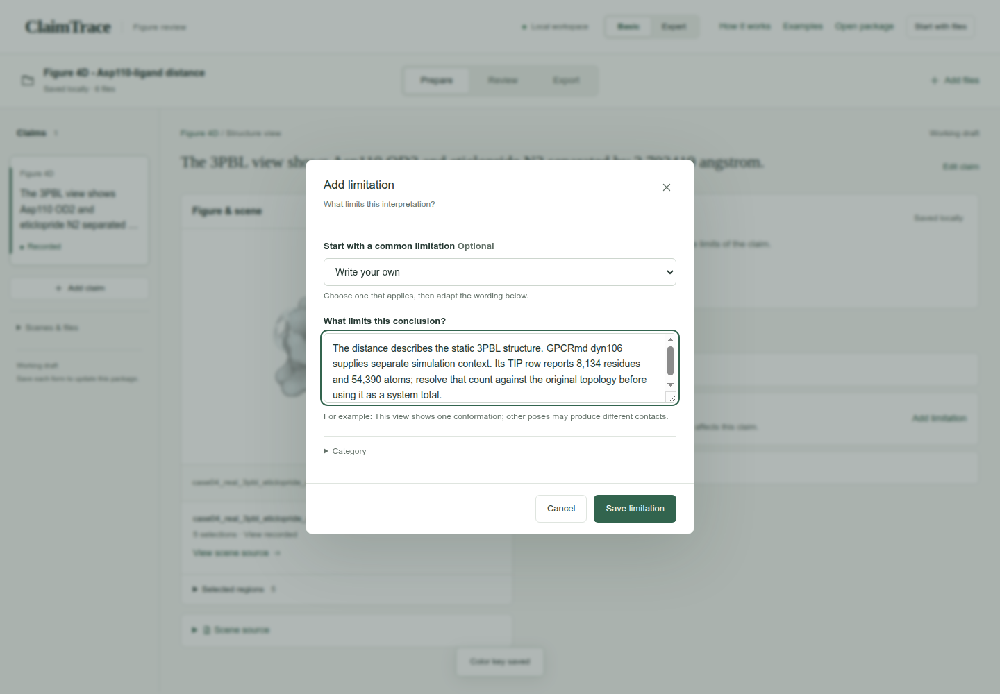

## 8. Read the short audit

Click **Review**. Read Claim, **Visual evidence**, **Provenance**, **Uncertainty** and **Reproducibility**. Click a row whenever you want to inspect its linked details.

**Check:** The audit shows the statement, source-linked finding, recorded limitation and current reproducibility status.

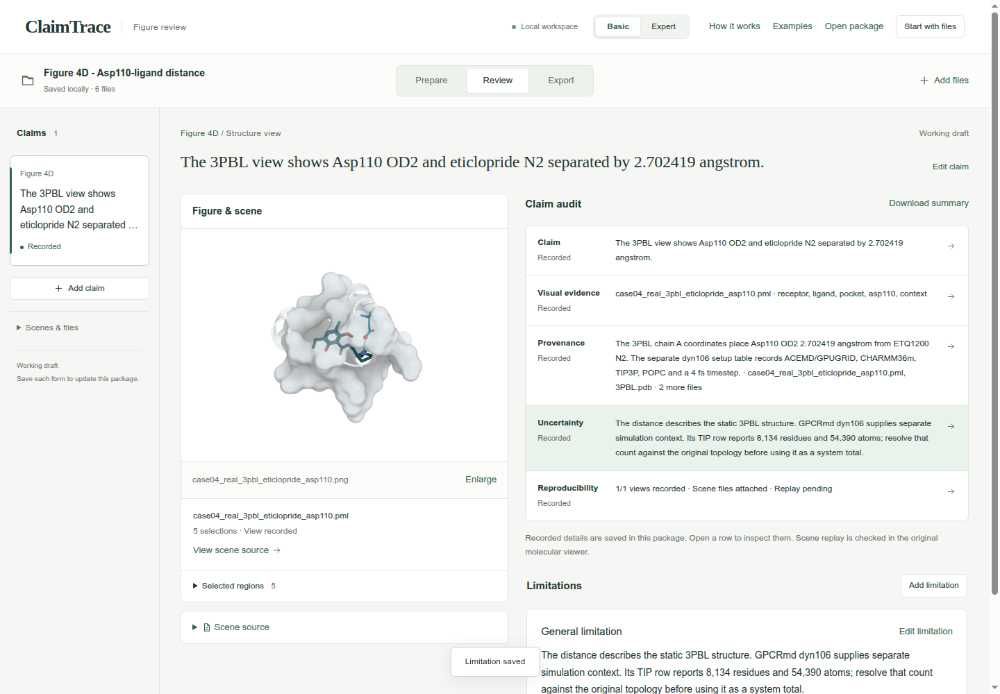

## 9. Prepare the working draft

Click **Export**, then **Working draft**. Read the package-check result.

**Purpose**

```text
Working draft
```

**Check:** The page shows **Draft checks passed**.

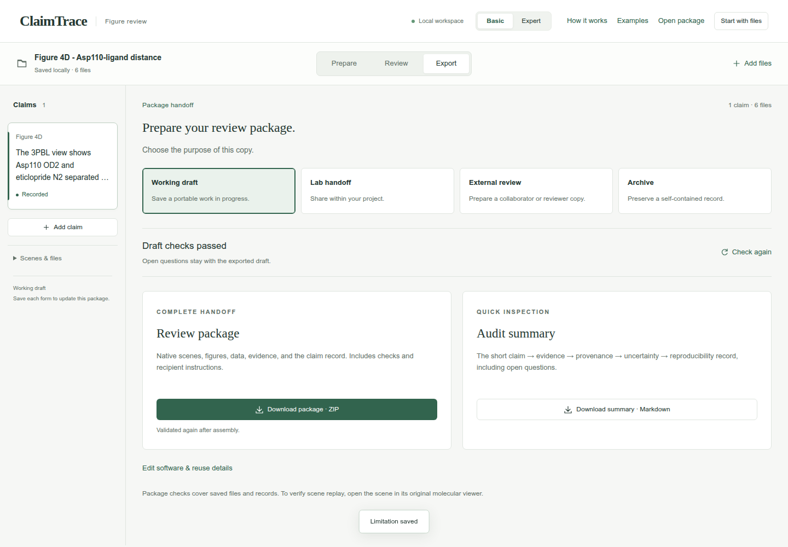

## 10. Download the package

Click **Download package · ZIP**. Check your browser’s downloads for claimtrace-review.zip, then save it with your figure. The ZIP contains the source files, claim record and recipient instructions.

**Check:** The page confirms: **Export checks passed. Your browser will download the package.**

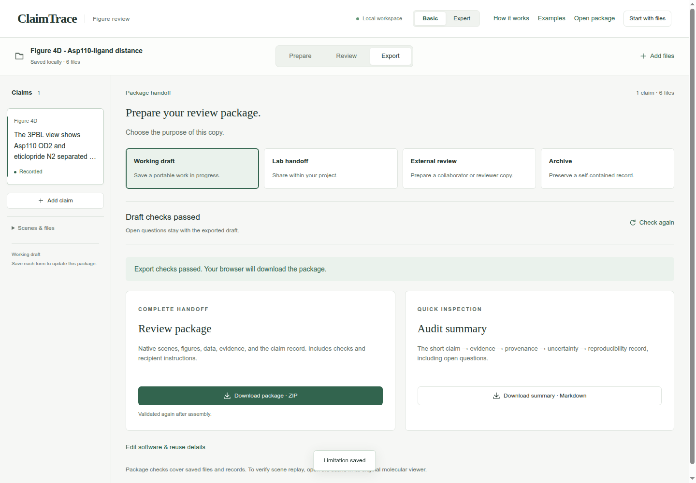

## Your saved result

A downloaded Working draft ZIP with one claim, 6 input files, one evidence record and one limitation. The GUI confirms export checks passed.

## Continue the scientific review

- Use the original dyn106 topology to reconcile the TIP residue and atom counts.
- The 3PBL coordinates provide static context; dyn106 is a separate simulation record. Molecular replay remains a viewer check.
