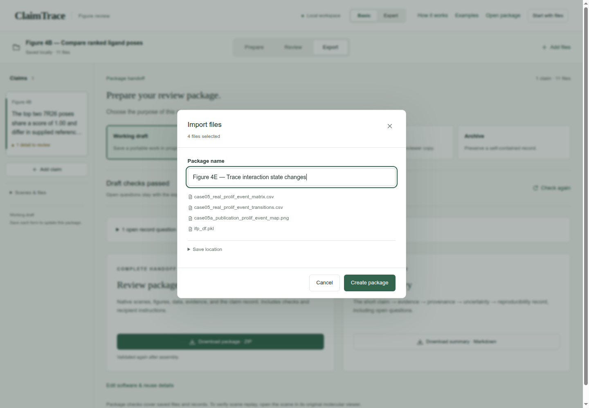
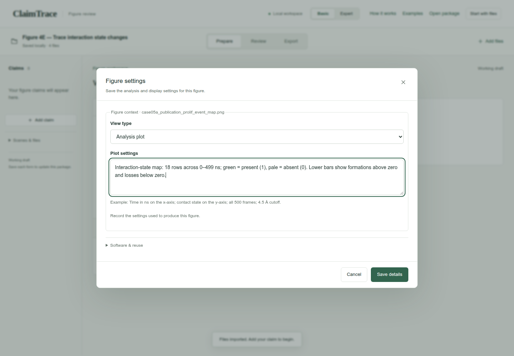
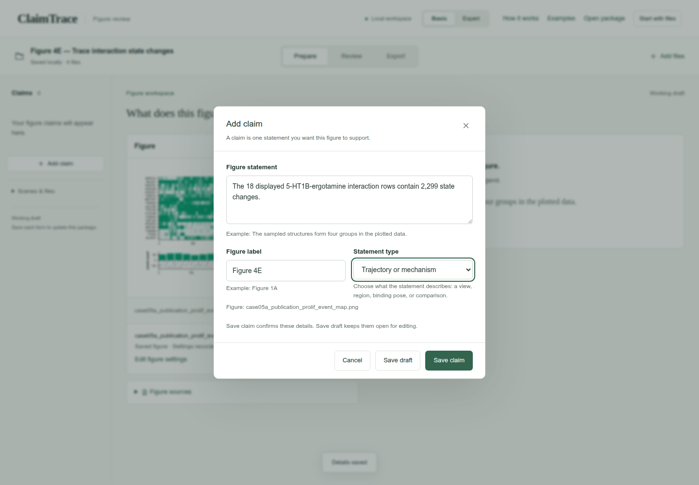
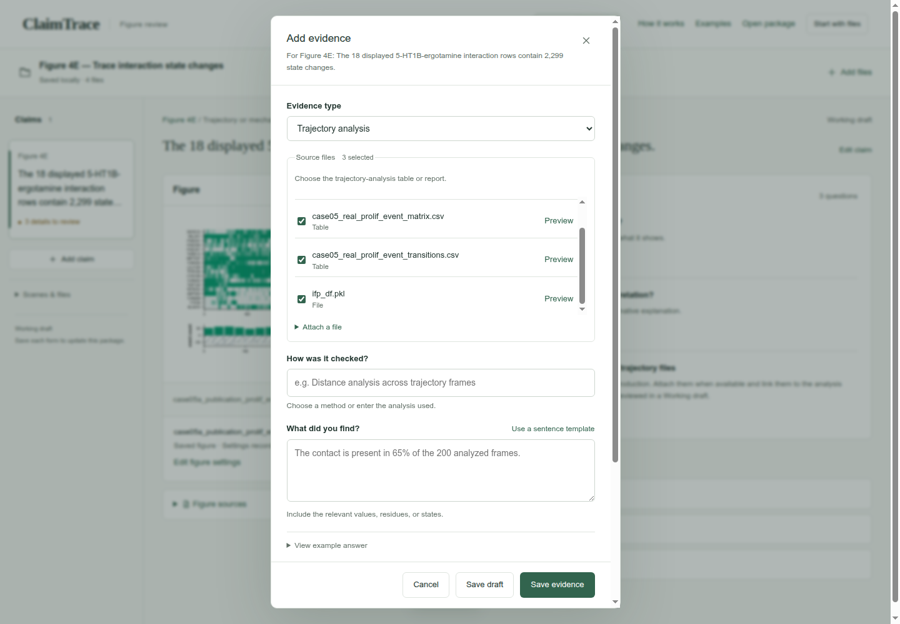
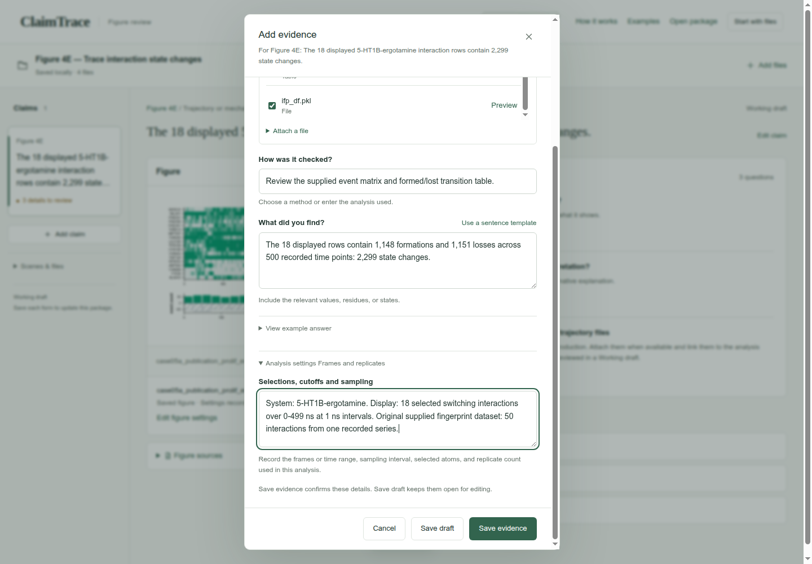
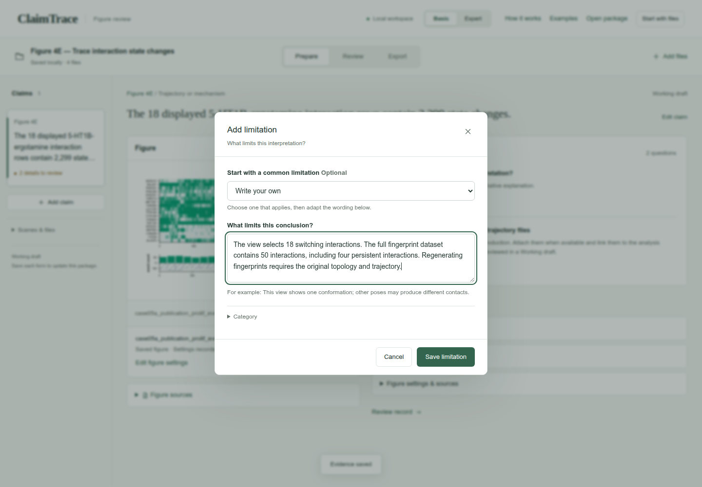
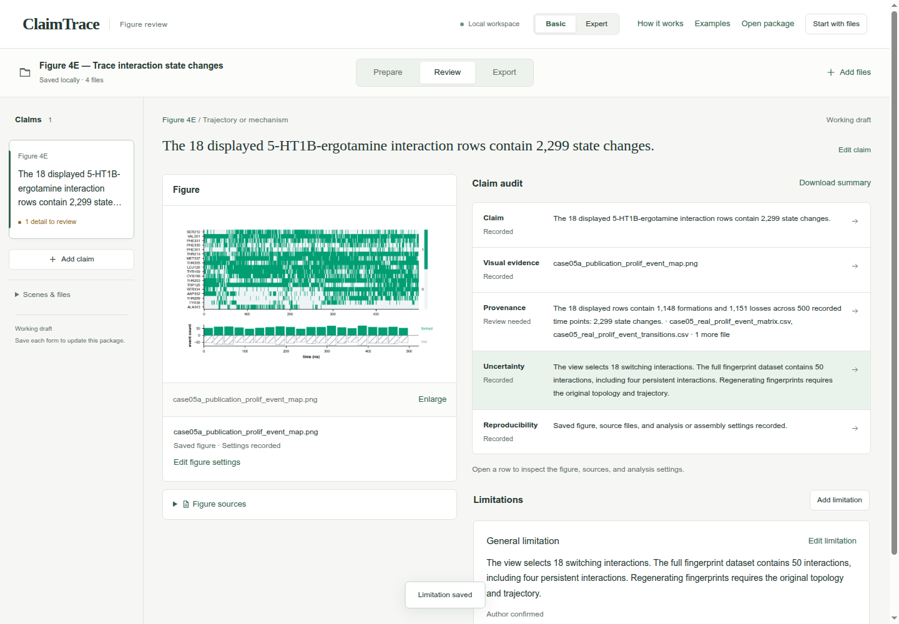
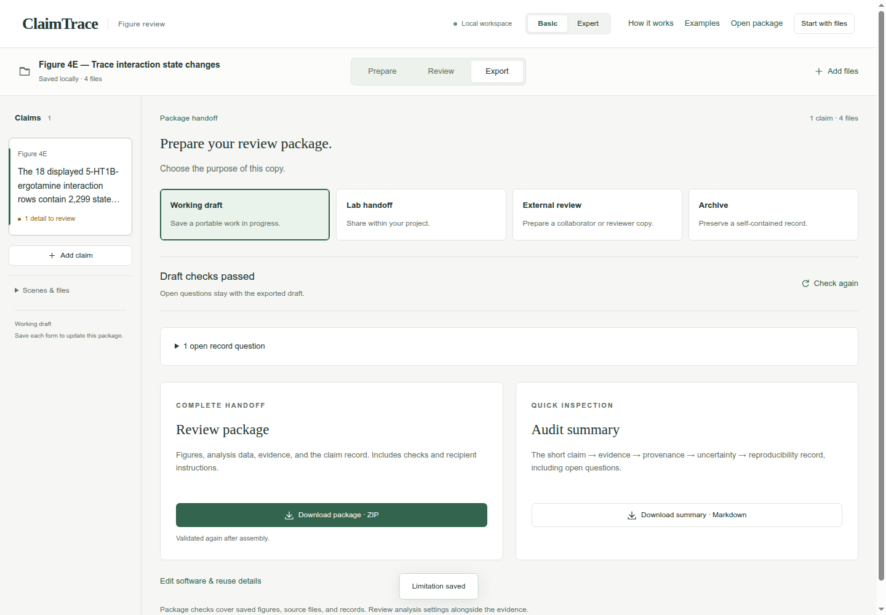
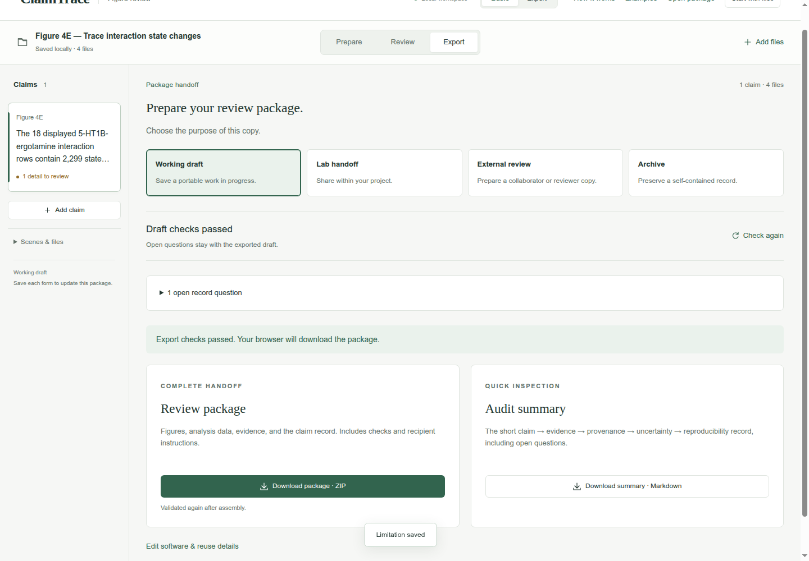

# Trace interaction state changes

Figure 4E · Review trajectories · Basic mode

Trace the displayed interaction changes to selected rows, time sampling and the supplied transition table.

[Download input files](../../downloads/f3-e-inputs.zip) · [Download completed example](../../downloads/f3-e-completed.zip)

[Open ClaimTrace](../../../start.md) · [Start here](../../README.md) · [All cases](../README.md)

Extract the input ZIP and select all 4 files in `files/`.

## 1. Import the case files

Extract the input ZIP and read LAB_NOTES.txt beside the files/ folder. In ClaimTrace, click **Choose files** on the welcome page, or **Start with files** in an open package. Select all 4 files inside files/. Enter the package name below and click **Create package**.

**Package name**

```text
Figure 4E — Trace interaction state changes
```

**Check:** Saved locally · 4 files appears, and the figure is displayed.



## 2. Describe the analysis plot

Click **Set figure type**. Choose **Analysis plot**, enter the plot context, then click **Save details**.

**View type**

```text
Analysis plot
```

**Plot settings**

```text
Interaction-state map: 18 rows across 0–499 ns; green = present (1), pale = absent (0). Lower bars show formations above zero and losses below zero.
```

**Check:** Saved figure · Settings recorded appears below the figure.



## 3. Write the figure statement

Click **Add claim**. Enter the statement and figure label, choose Trajectory or mechanism, then click **Save claim**.

**Figure statement**

```text
The 18 displayed 5-HT1B-ergotamine interaction rows contain 2,299 state changes.
```

**Figure label**

```text
Figure 4E
```

**Statement type**

```text
Trajectory or mechanism
```

**Check:** The statement appears in the claim list and above the figure.



## 4. Choose the evidence and source files

Click **Add evidence**. Choose Trajectory analysis. Check the source files listed below. Scroll within **Source files** when needed.

**Evidence type**

```text
Trajectory analysis
```

**Source files**

```text
case05_real_prolif_event_matrix.csv
case05_real_prolif_event_transitions.csv
ifp_df.pkl
```

**Check:** **Source files** shows 3 selected.



## 5. Record the result and analysis settings

Enter the check name and its numerical result. Use the expanded **Analysis settings — Frames and replicates** section to record the sampling and scope. Click **Save evidence**.

**How was it checked?**

```text
Review the supplied event matrix and formed/lost transition table.
```

**What did you find?**

```text
The 18 displayed rows contain 1,148 formations and 1,151 losses across 500 recorded time points: 2,299 state changes.
```

**Selections, cutoffs and sampling**

```text
System: 5-HT1B-ergotamine. Display: 18 selected switching interactions over 0-499 ns at 1 ns intervals. Original supplied fingerprint dataset: 50 interactions from one recorded series.
```

**Check:** The page confirms Evidence saved, and **Evidence & sources** shows 1 record.



## 6. State the interpretation limit

Click **Add limitation**. Keep **Write your own** selected, enter the limitation below, then click **Save limitation**.

**What limits this conclusion?**

```text
The view selects 18 switching interactions. The full fingerprint dataset contains 50 interactions, including four persistent interactions. Regenerating fingerprints requires the original topology and trajectory.
```

**Check:** Limitation saved appears, and the uncertainty entry is linked to the claim.



## 7. Read the five-part claim audit

Click **Review**. Read Claim, **Visual evidence**, **Provenance**, **Uncertainty** and **Reproducibility**. Compare the numerical values and scope with your source notes.

**Check:** **Visual evidence**, **Uncertainty** and **Reproducibility** read **Recorded**. **Provenance** reads **Review needed** because the original trajectory/topology inputs remain open.



## 8. Check the working draft

Click **Export**. Keep **Working draft** selected. Expand the open record questions to see the remaining work.

**Purpose**

```text
Working draft
```

**Check:** **Draft checks passed**; 1 open record question requests the inputs and settings behind the trajectory claim.



## 9. Download the review package

Click **Download package · ZIP**. Check your browser’s downloads for claimtrace-review.zip, then save it with your figure. The ZIP contains the source files, claim record and recipient instructions.

**Check:** The page confirms: **Export checks passed. Your browser will download the package.**



## Your saved result

One Figure 4E claim with 3 linked evidence files and one recorded limitation, exported as a Working draft ZIP.

## Continue the scientific review

- Add the original topology and trajectory files to support independent analysis.
- Record the fingerprint definitions and software version when recomputing from coordinates.
- The figure shows 18 switching interactions; the full dataset contains 50 interactions, including four persistent interactions.
