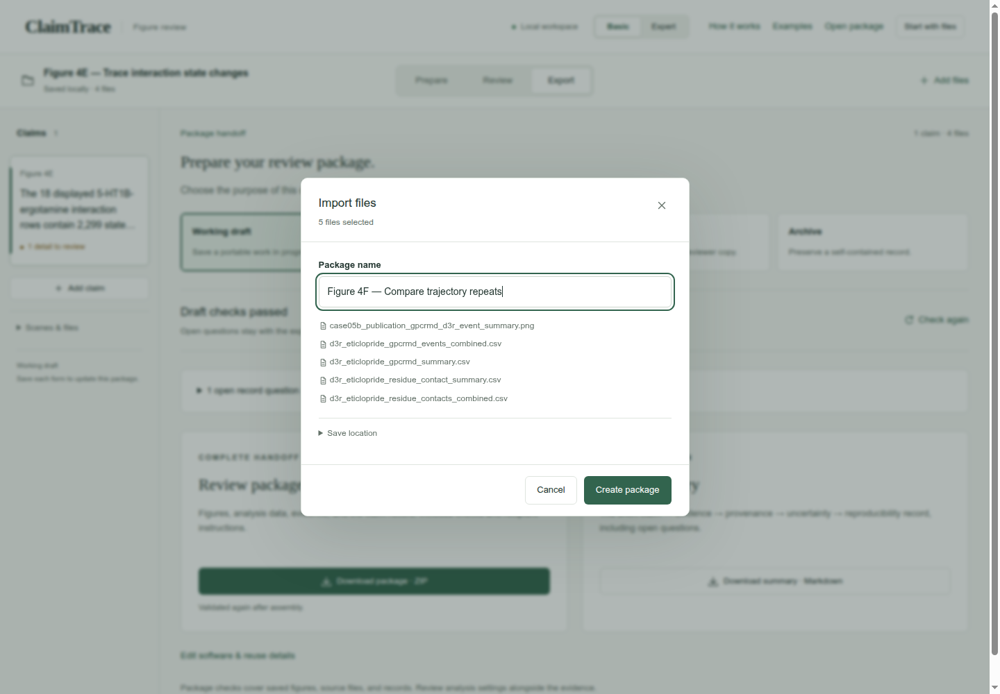
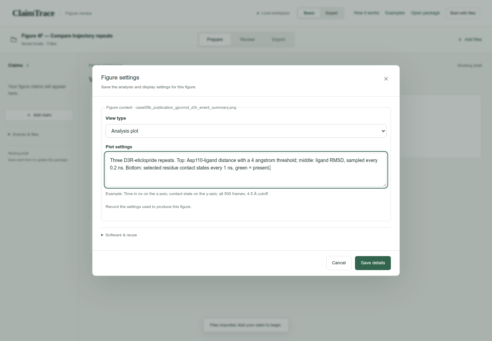
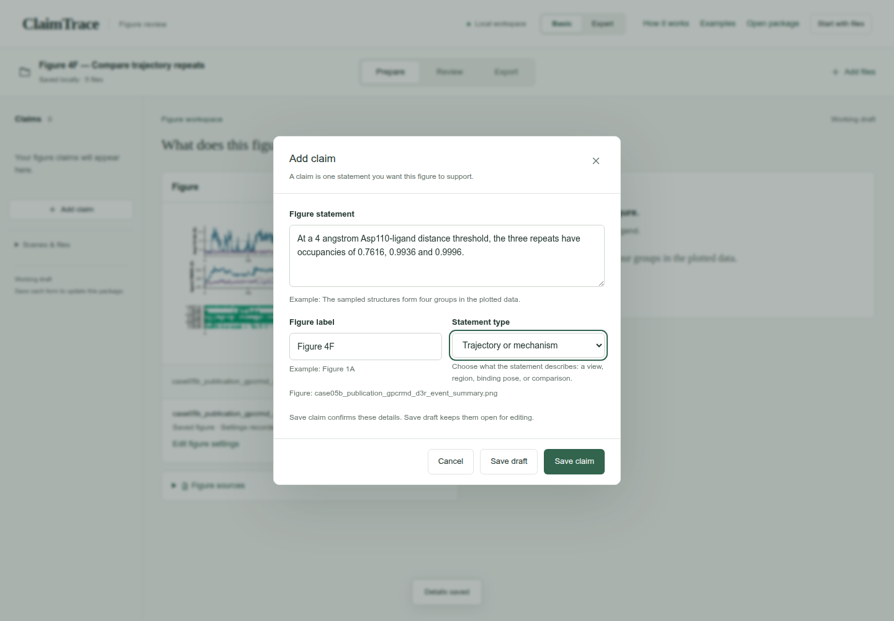
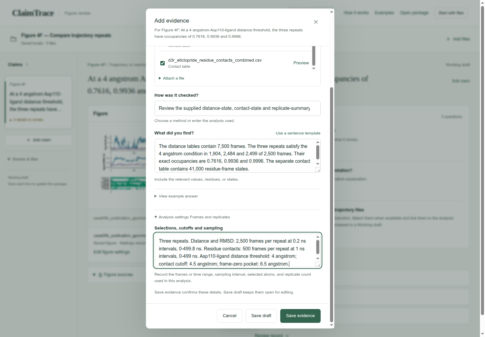
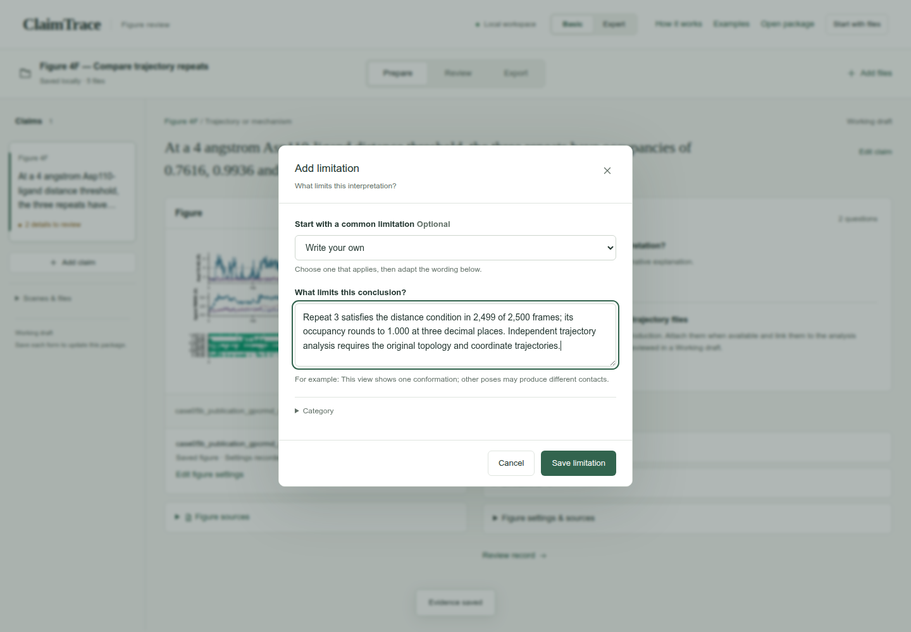
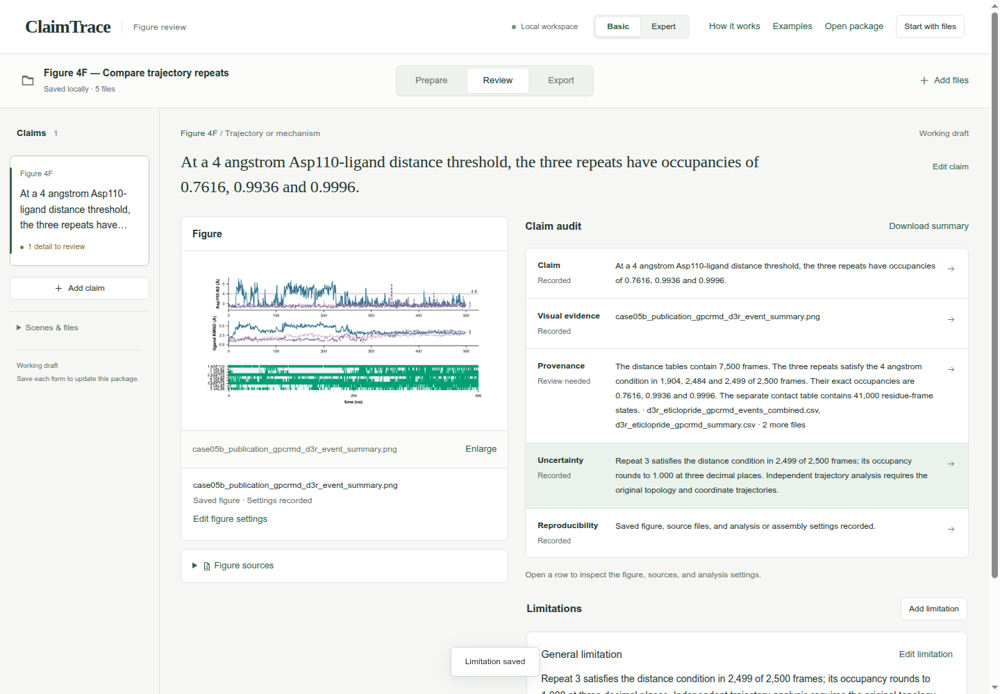
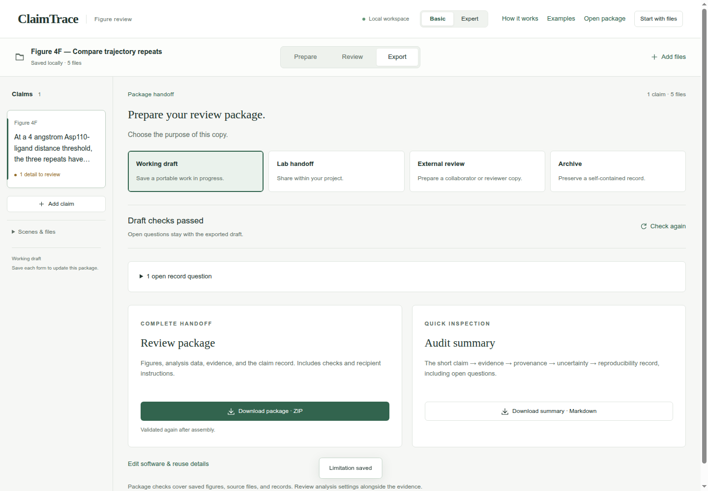
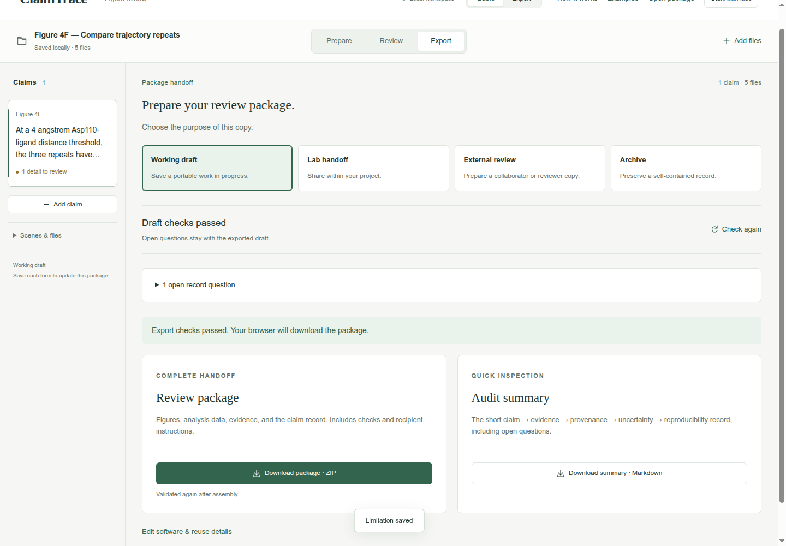

# Compare trajectory repeats

Figure 4F · Review trajectories · Basic mode

Compare three distance-state occupancies and record separate sampling for the distance curves and contact map.

[Download input files](../../downloads/f3-f-inputs.zip) · [Download completed example](../../downloads/f3-f-completed.zip)

[Open ClaimTrace](../../../start.md) · [Start here](../../README.md) · [All cases](../README.md)

Extract the input ZIP and select all 5 files in `files/`.

## 1. Import the case files

Extract the input ZIP and read LAB_NOTES.txt beside the files/ folder. In ClaimTrace, click **Choose files** on the welcome page, or **Start with files** in an open package. Select all 5 files inside files/. Enter the package name below and click **Create package**.

**Package name**

```text
Figure 4F — Compare trajectory repeats
```

**Check:** Saved locally · 5 files appears, and the figure is displayed.



## 2. Describe the analysis plot

Click **Set figure type**. Choose **Analysis plot**, enter the plot context, then click **Save details**.

**View type**

```text
Analysis plot
```

**Plot settings**

```text
Three D3R-eticlopride repeats. Top: Asp110-ligand distance with a 4 angstrom threshold; middle: ligand RMSD, sampled every 0.2 ns. Bottom: selected residue contact states every 1 ns, green = present.
```

**Check:** Saved figure · Settings recorded appears below the figure.



## 3. Write the figure statement

Click **Add claim**. Enter the statement and figure label, choose Trajectory or mechanism, then click **Save claim**.

**Figure statement**

```text
At a 4 angstrom Asp110-ligand distance threshold, the three repeats have occupancies of 0.7616, 0.9936 and 0.9996.
```

**Figure label**

```text
Figure 4F
```

**Statement type**

```text
Trajectory or mechanism
```

**Check:** The statement appears in the claim list and above the figure.



## 4. Choose the evidence and source files

Click **Add evidence**. Choose Trajectory analysis. Check the source files listed below. Scroll within **Source files** when needed.

**Evidence type**

```text
Trajectory analysis
```

**Source files**

```text
d3r_eticlopride_gpcrmd_events_combined.csv
d3r_eticlopride_gpcrmd_summary.csv
d3r_eticlopride_residue_contact_summary.csv
d3r_eticlopride_residue_contacts_combined.csv
```

**Check:** **Source files** shows 4 selected.


## 5. Record the result and analysis settings

Enter the check name and its numerical result. Use the expanded **Analysis settings — Frames and replicates** section to record the sampling and scope. Click **Save evidence**.

**How was it checked?**

```text
Review the supplied distance-state, contact-state and replicate-summary tables.
```

**What did you find?**

```text
The distance tables contain 7,500 frames. The three repeats satisfy the 4 angstrom condition in 1,904, 2,484 and 2,499 of 2,500 frames. Their exact occupancies are 0.7616, 0.9936 and 0.9996. The separate contact table contains 41,000 residue-frame states.
```

**Selections, cutoffs and sampling**

```text
Three repeats. Distance and RMSD: 2,500 frames per repeat at 0.2 ns intervals, 0-499.8 ns. Residue contacts: 500 frames per repeat at 1 ns intervals, 0-499 ns. Asp110-ligand distance threshold: 4 angstrom; contact cutoff: 4.5 angstrom; frame-zero pocket: 6.5 angstrom.
```

**Check:** The page confirms Evidence saved, and **Evidence & sources** shows 1 record.



## 6. State the interpretation limit

Click **Add limitation**. Keep **Write your own** selected, enter the limitation below, then click **Save limitation**.

**What limits this conclusion?**

```text
Repeat 3 satisfies the distance condition in 2,499 of 2,500 frames; its occupancy rounds to 1.000 at three decimal places. Independent trajectory analysis requires the original topology and coordinate trajectories.
```

**Check:** Limitation saved appears, and the uncertainty entry is linked to the claim.



## 7. Read the five-part claim audit

Click **Review**. Read Claim, **Visual evidence**, **Provenance**, **Uncertainty** and **Reproducibility**. Compare the numerical values and scope with your source notes.

**Check:** **Visual evidence**, **Uncertainty** and **Reproducibility** read **Recorded**. **Provenance** reads **Review needed** because the original trajectory/topology inputs remain open.



## 8. Check the working draft

Click **Export**. Keep **Working draft** selected. Expand the open record questions to see the remaining work.

**Purpose**

```text
Working draft
```

**Check:** **Draft checks passed**; 1 open record question requests the inputs and settings behind the trajectory claim.



## 9. Download the review package

Click **Download package · ZIP**. Check your browser’s downloads for claimtrace-review.zip, then save it with your figure. The ZIP contains the source files, claim record and recipient instructions.

**Check:** The page confirms: **Export checks passed. Your browser will download the package.**



## Your saved result

One Figure 4F claim with 4 linked evidence files and one recorded limitation, exported as a Working draft ZIP.

## Continue the scientific review

- Add the original topology and trajectory files to support independent analysis.
- Record the atom selections, sampling and software used when repeating the trajectory analysis.
- Retain the third occupancy as 0.9996 when comparing repeats; the article table rounds it to 1.000.
