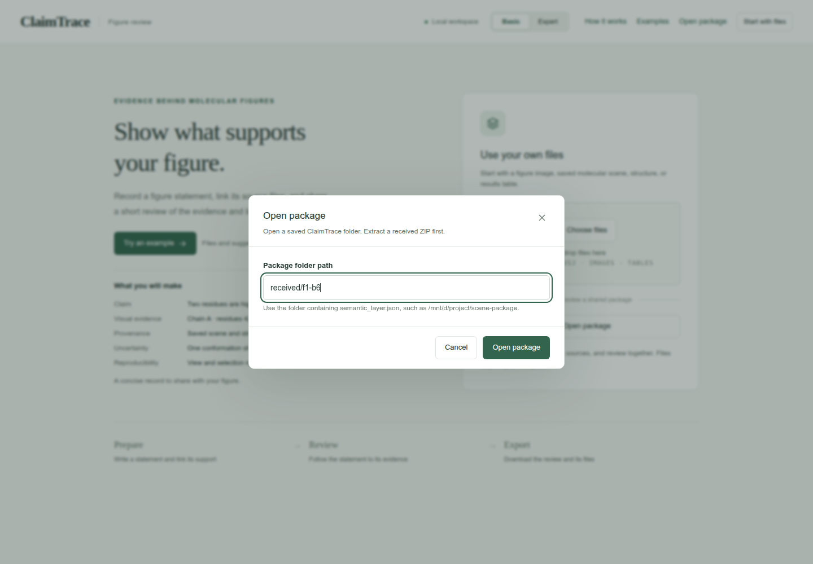
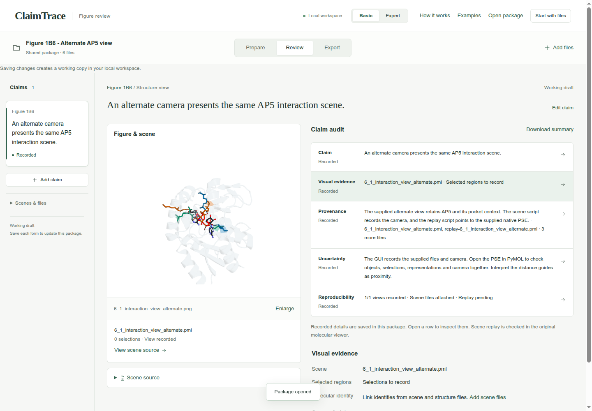
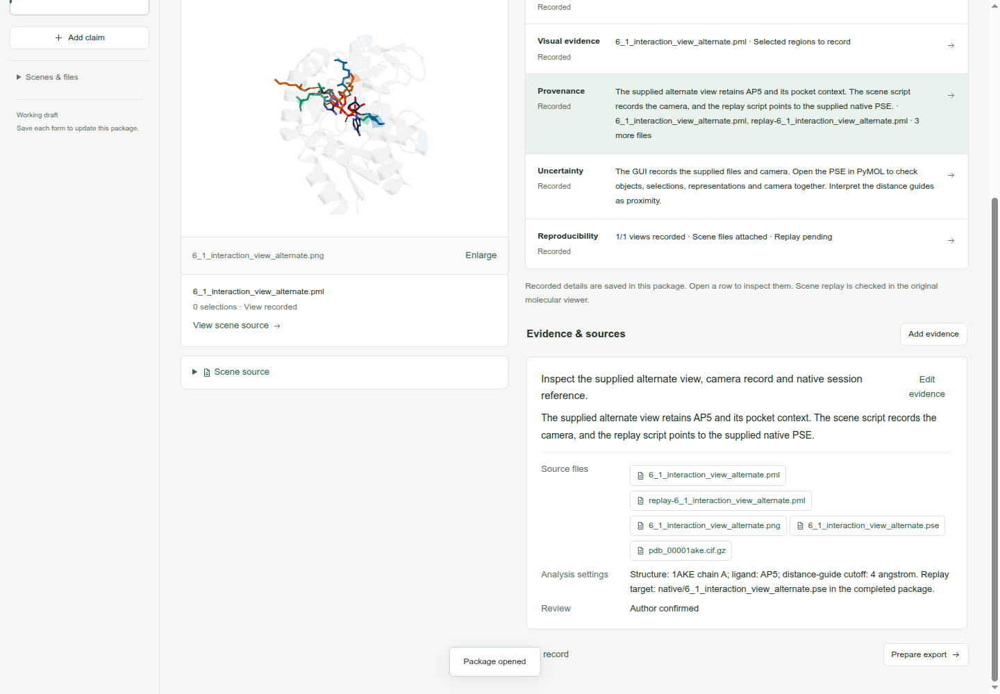
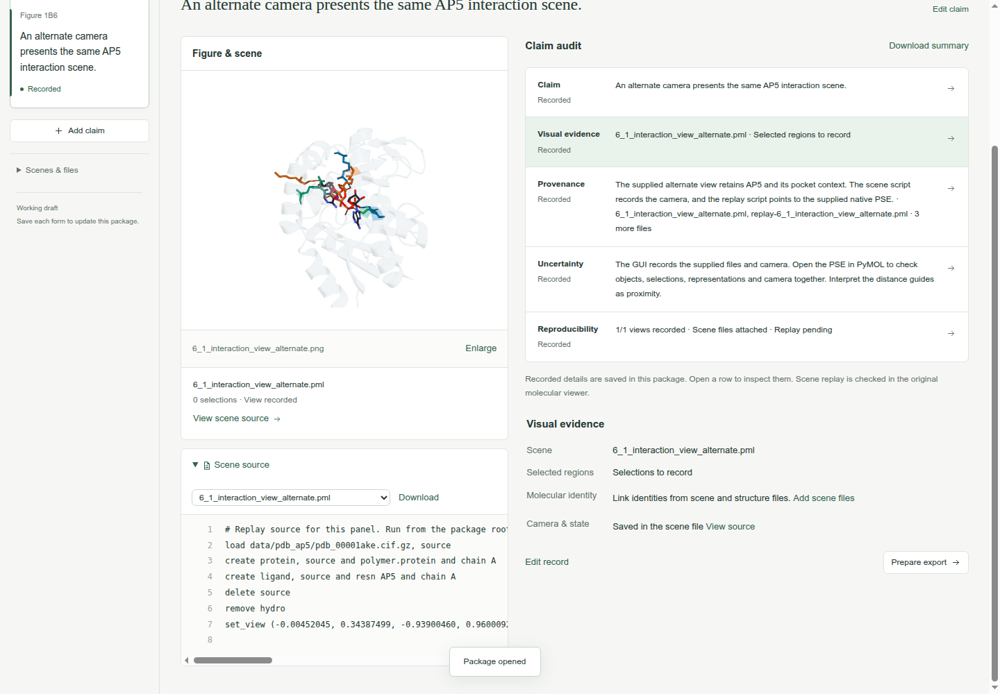
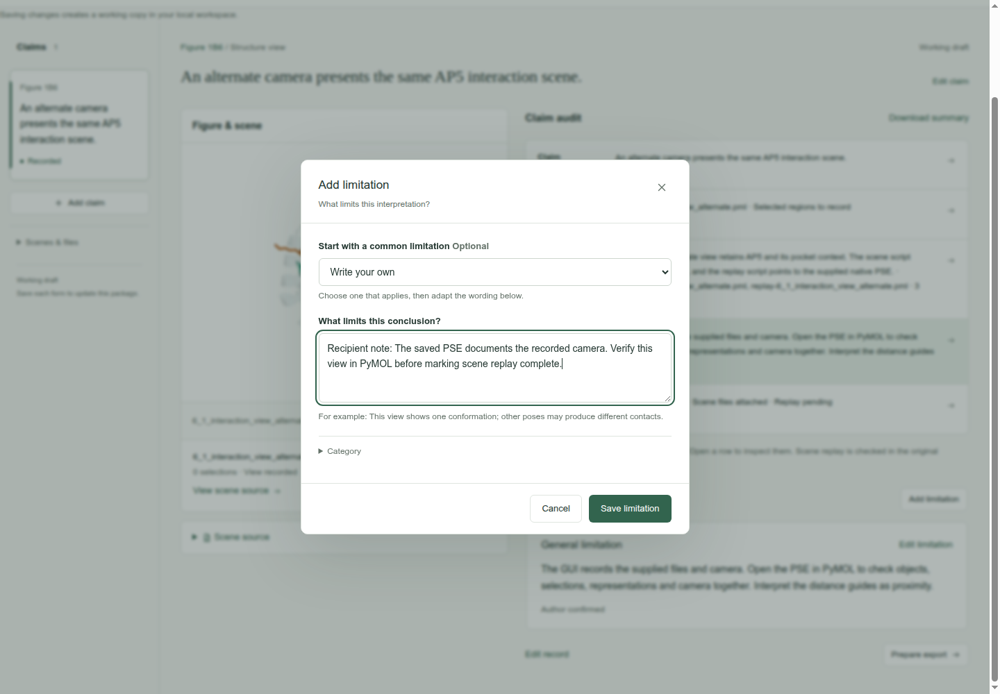
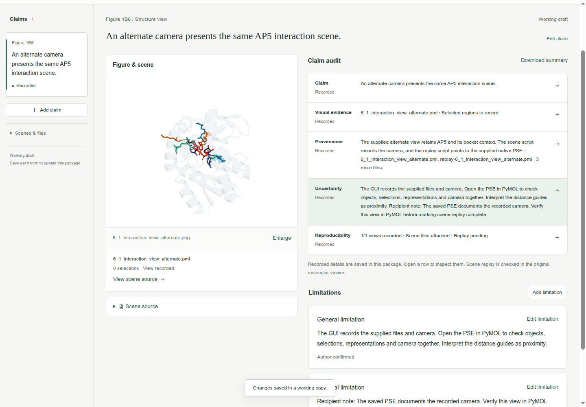
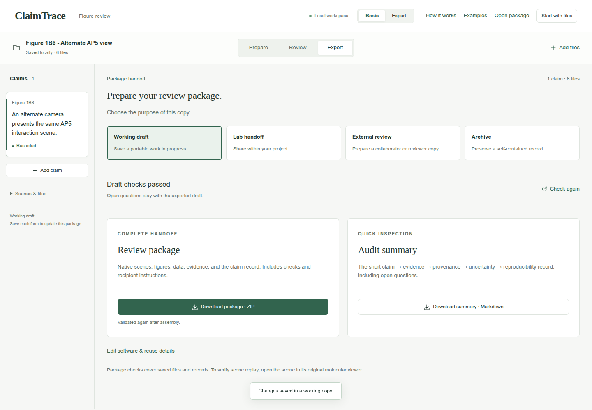
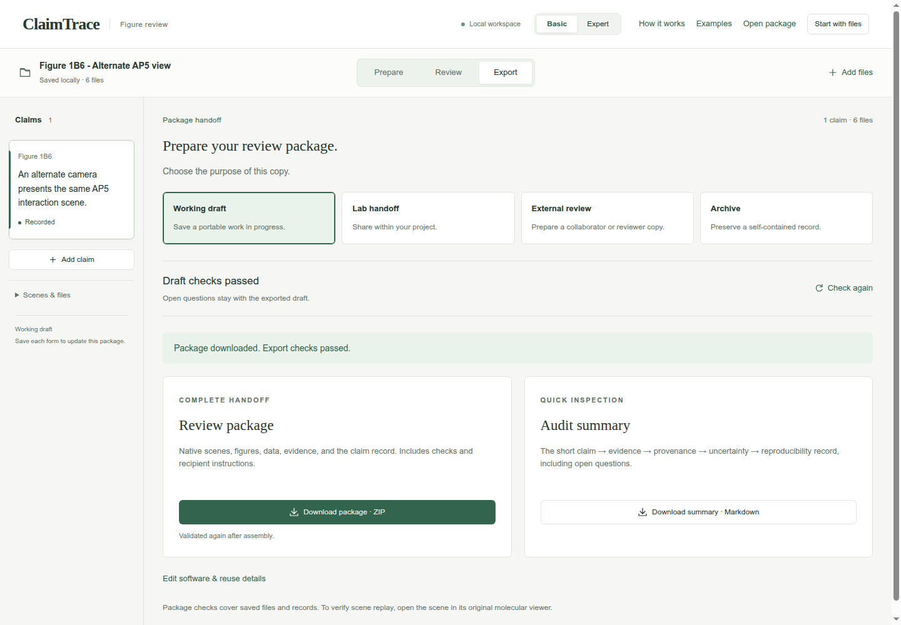

# Open and continue a review package

Shared workflow · Read a package · Basic mode

Inspect a completed example, add a reader note, and export your own working copy.

[Download completed example](../downloads/recipient-completed.zip)

## 1. Open the extracted package

**Download** the Figure 1B6 completed example and extract the ZIP. In ClaimTrace, click **Open package**. Paste the path of the extracted package folder on the computer running ClaimTrace, then click **Open package**. The path below is the folder used for this walkthrough.

**Package folder path**

```text
/tmp/ClaimTrace-review-example/f1-b6
```

**Check:** **Shared package · 6 files** appears. The page explains that saving changes creates a working copy.



## 2. Read the claim audit

Click **Review**. Read the figure statement and the five audit rows. Check the saved figure alongside the interpretation.

**Check:** The alternate AP5 view is linked to its claim. **Reproducibility** includes **Replay pending**.



## 3. Inspect the provenance

Click the **Provenance** row. Scroll to **Evidence & sources** to read the saved finding, source list and analysis settings.

**Check:** **Evidence & sources** shows the alternate-view source inspection and its linked files.



## 4. Read the scene source

Click **View scene source** below the figure. Inspect the load, selection and set_view commands. Use **Download** beside the source selector to save the original file when needed.

**Check:** Scene source opens with the PML text and its saved camera command.



## 5. Add a reader note

Click the **Uncertainty** row, then **Add limitation**. Keep **Write your own** selected and enter the note below.

**What limits this conclusion?**

```text
Recipient note: The saved PSE documents the recorded camera. Verify this view in PyMOL before marking scene replay complete.
```

**Check:** The note is ready to save with the current claim.



## 6. Save your working copy

Click **Save limitation**. Check the location label and confirmation message.

**Check:** The location shows **Saved locally · 6 files**. The page confirms: **Changes saved in a working copy.**



## 7. Check the updated draft

Click **Export**. Keep **Working draft** selected and confirm **Draft checks passed**.

**Check:** **Download package · ZIP** is available.



## 8. Download the updated package

Click **Download package · ZIP**. Check your browser’s downloads for claimtrace-review.zip, then save it in a folder for your reviewed copy.

**Check:** The page confirms: **Export checks passed. Your browser will download the package.**



## Your saved result

A new Working draft ZIP containing the recipient note. The received package remains byte-for-byte unchanged.

## Continue the scientific review

- Open the scene in its original molecular viewer to complete the scene-replay check.
